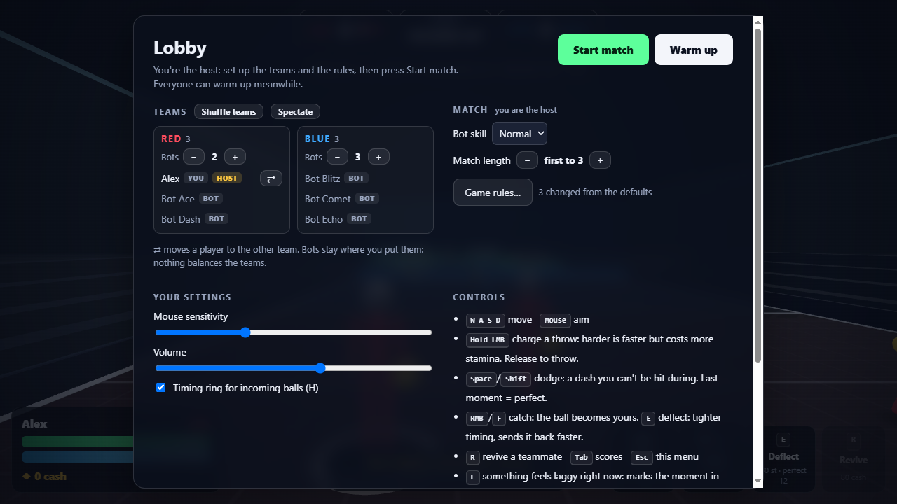
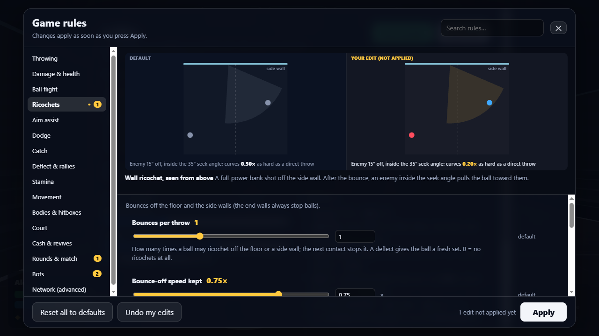

# Dodgeball

[](https://github.com/amirtavakolihaghighi/dodgeball/actions/workflows/ci.yml)
[](https://github.com/amirtavakolihaghighi/dodgeball/releases/latest)
[](LICENSE)
[](https://www.python.org/downloads/)

**A dodgeball game for a room full of people, with nothing for the players to install.** One
computer hosts; everyone else on the same Wi-Fi opens a web page and plays. No accounts, no
internet connection, no app store. It was made for office breaks and game nights, and has been
played by groups of around ten on an office Wi-Fi. For friends who aren't in the room, it also
runs on a cloud server in **internet mode**, behind a password.

It's a game of timing. Hold the mouse to charge a throw: harder throws fly faster, hit harder
and cost more stamina. When a ball comes at you, press at the last moment to **dodge**,
**catch** it, or **deflect** it straight back. A deflected ball gets faster every time, so
rallies get frantic, and because stamina limits everything, mashing buttons gets you hit.


## What's in it

- **Real-time 3D in the browser:** an over-the-shoulder camera and stick figures. Throws arc a
  little, bend gently toward the player you aim at, and can bank off the floor or a side wall.
- **Bots** on either team, in three skill levels, so you can play alone or fill out a small group.
- **The host runs the show.** The game starts in a lobby where the host sets up the teams and the
  bots and can change every number in the game (152 of them, from throw speed to the dodge
  window). Each comes with a plain description and an animated preview of what the change does.
  Everyone else sees what the host is doing, live.
- **Settings for one player:** give a beginner more health and a wider catch window, or one bot
  hard skill, without changing anyone else. Save the whole setup to a file and load it next time.
- **Team health, if you like:** one shared health bar per team instead of everyone's own; the
  whole team falls together, and cash buys health for the bar.
- **Health regeneration, if you like:** health (or the team's bar) comes back by itself after a
  pause without being hit, up to a limit the host sets, faster (or only) while you stand still.
- **Each team's balls have their own colour** (the bots' a paler shade of it), so you can tell
  who threw what at a glance.
- **Fair on ordinary Wi-Fi:** a dodge, catch or deflect is judged against what your screen
  showed, so a parry that looked right counts, and so does stepping out of a ball's way on your
  screen. The host can tune both.
- **Session logs** for when something feels laggy: press **L** at that moment. Afterwards the host
  downloads everyone's logs as one zip, and `tools/log_report.py` explains what happened.
- **Internet mode,** for a server on the internet: friends join with a password, the host types
  the host password, and limits keep strangers from wearing the server down.

## Play it

### On Windows, without installing anything

1. Download `Dodgeball-windows.zip` from the
   [latest release](https://github.com/amirtavakolihaghighi/dodgeball/releases/latest) and
   unzip it.
2. Double-click `Dodgeball.exe`. Windows may say "Windows protected your PC", because the app
   isn't signed by a publisher: click **More info**, then **Run anyway**.
3. A window opens with the addresses to share, and the game opens in your browser. You're the host.
4. Everyone else on the same Wi-Fi opens the `http://192.168.x.x:8000` address shown in that
   window. The game is made and tested with Chrome; other desktop browsers may work but aren't
   tested.

If the others can't connect, it's almost always Windows Firewall. Don't turn it off: double-click
**`Allow friends to connect.bat`** (next to the exe) once instead. It lets computers on your local
network, and nothing from the internet, reach the game.

The app is built by GitHub Actions from the tagged source code, and its SHA-256 checksum is on
the release page next to the zip.

### From source (Windows, macOS, Linux)

You need [Python](https://www.python.org/downloads/) 3.10 or newer.

```bash
git clone https://github.com/amirtavakolihaghighi/dodgeball.git
cd dodgeball
python -m venv .venv
.venv/bin/python -m pip install -r requirements.txt   # Windows: .venv\Scripts\python -m pip install -r requirements.txt
.venv/bin/python server.py                            # Windows: .venv\Scripts\python server.py
```

On Windows you can double-click `run.bat` instead: it sets everything up the first
time. On macOS and Linux, use `python3` if `python` isn't found. `--port 8080` picks the port
(the default is 8000, or the next free one), and `--no-browser` doesn't open a browser.

### Over the internet

Run it on a small cloud server in internet mode, with HTTPS in front:

```bash
python server.py --internet --password orange-tiger-42 --host-password my-long-host-password
```

Use your own two passwords: friends open your `https://` address and type the first; you type
the second, the host password, and get the host's controls. [docs/INTERNET.md](docs/INTERNET.md) walks through it step by step: renting
a server, a name for it, HTTPS with Caddy, running it as a service, and checking the lag after
the first game night.

## How a game goes

1. **The host sets up the lobby.** The browser on the hosting computer is the host. Press **Esc**
   for the lobby: put people on teams, add bots to either side, pick the match length, and open
   **Game rules…** to change anything. Everyone can warm up in the meantime.
2. **The host presses Start match.** Rounds run until a team reaches the number of round wins the
   host picked, or forever. People can join at any time, and changes the host makes during a
   match apply from the next round.
3. **Knocked out?** Teammates earn cash by hitting, catching and deflecting, and can spend it to
   revive you. With team health on, the team shares one health bar and spends cash on health
   for it instead.

<p align="center">
  
  
</p>

### Controls

| Input | Action |
| --- | --- |
| W A S D, mouse | move, aim (the ball goes where the crosshair points) |
| Hold / release left mouse | charge / throw |
| Space or Shift | **dodge**: a quick dash you can't be hit during |
| Right mouse or F | **catch**: the ball becomes yours |
| E | **deflect**: tighter timing, sends the ball straight back, faster |
| R | revive a teammate, or with team health buy health for the team (costs cash) |
| Tab / H / Esc | scores / timing ring on or off / the lobby menu |
| L | "this feels laggy": marks the moment in the session log |

You need a keyboard and mouse: there are no touch controls yet.

### Playing alone

- Add bots to both teams in the lobby (0–12 each, three skill levels).
- Open a second browser window and join with another name to play both sides. Every tab on the
  host's computer is a host; add `?guest` to the address to see what other players see.
- Add `?lag=120` to the address to feel a 120 ms connection, and `&jitter=150` for uneven Wi-Fi.

## Safety and privacy

- **Normally, for your local network only.** The game listens on TCP port 8000 (up to 8019 if
  that's busy) on all of the computer's network connections. There are no passwords: anyone who
  can reach that address can join. Don't expose it to the internet like that, or run it on a
  network you don't trust.
- **On the internet, use internet mode** ([docs/INTERNET.md](docs/INTERNET.md)): a password to
  join, a host password for the host's controls, limits against abuse, and HTTPS in front. The
  logs then keep players' addresses only in part (`203.0.x.x`).
- **The host link** printed in the game's window (`...?host=...`) gives whoever opens it the
  host's controls. Don't share it.
- **Nothing goes to the internet.** The game makes no internet connections, and three.js is
  bundled with it.
- **What it writes to disk**, next to the app: the host's rules and each player's own settings,
  by player name (`saved_rules.json`), and session logs (`logs/`, the 30 newest sessions). The
  logs contain player names, LAN addresses and device details (browser, graphics card, screen)
  and stay on the host's computer unless you send them to someone. `--no-log` turns logging off.
  An exported settings file holds the rules and the names of players with their own settings.
- **Each browser moves its own player** within the court's limits, so a player could cheat by
  editing their browser's code. It's a game for friends, not strangers.

The full threat model, and how to report a vulnerability privately, is in [SECURITY.md](SECURITY.md).

## Documentation

- [docs/MANUAL.md](docs/MANUAL.md): the full manual: every rule and its default, the
  lobby, sharing the game, the session logs.
- [docs/INTERNET.md](docs/INTERNET.md): playing over the internet: internet mode, and setting
  up a cloud server step by step.
- [docs/PROJECT.md](docs/PROJECT.md): the design history, every decision and who made it, the
  architecture and the network protocol.
- [docs/LAG_ANALYSIS.md](docs/LAG_ANALYSIS.md): what the office sessions' logs showed about lag,
  and what was done about it.
- [CONTRIBUTING.md](CONTRIBUTING.md): setting up, running the tests, the conventions.
- [CHANGELOG.md](CHANGELOG.md), [SECURITY.md](SECURITY.md) and
  [THIRD_PARTY_NOTICES.md](THIRD_PARTY_NOTICES.md).
- [CLAUDE.md](CLAUDE.md): working notes for Claude Code, the AI coding assistant the game is
  built with.

## Licence

[MIT](LICENSE). The bundled three.js is MIT-licensed too; see
[THIRD_PARTY_NOTICES.md](THIRD_PARTY_NOTICES.md).
