# The look and feel: the working plan

This is the working plan for the branch `look-and-feel`. Why the branch exists, the analysis behind it and every decision are in phase 15 and decisions 112–131 of [PROJECT.md](PROJECT.md). This file holds:

- the goal;
- the plan and where each step stands;
- how the art is made;
- the budgets that keep laptops smooth;
- the style samples;
- a log of what happened.

Keep it current: update the plan's status and the log after each step.

## The goal

The game should look and feel professionally made: juice and good art, both. We start from the highest expectations and scale down to what's realistic (decision 112).

## The constraints

- **No money and no other people** (decision 113): the user, Claude and free tools.
  - **Claude:** writes the code (effects, animation, sound processing, settings) and the Blender scripts (models, lighting, export).
  - **The user:** picks the direction from options, plays on real screens, listens to every sound, and runs the office sessions.
- **Only art that may be published here** (decision 119): this repository is public and MIT-licensed.
  - **Allowed:** art made here, and CC0 sources (Poly Haven, Quaternius's Universal Animation Library, Mesh2Motion).
  - **Not allowed:** Mixamo (its terms forbid sharing the raw files), paid packs, and the AI model generators.
- **Smooth and fair on office laptops** (decision 116):
  - Here a frame rate is part of fairness.
  - The host's PC also runs the server.
- **The stack stays** (decision 118): the Python server, and three.js in the browser.

## The style

- **The user's taste** (decision 115):
  - vibrant, smooth, clean 3D;
  - liked: Slow Roads, Venge.io, Rocket League, Knockout City;
  - not wanted: pixel art or a retro look, blocky (Minecraft- or Roblox-shaped) humanoids, dull colours.
- **What Claude makes well:** hard-surface shapes, lighting, materials and effects.
- **What Claude makes badly:** faces, hands, hair and cloth. So the proposal is characters in sleek suits, armour and helmets with visors.
  - Round 2 showed hands can be done well from code; faces and hair stay weak, and cloth has no folds.
- **How it's chosen:** from rendered style samples (decision 123; [the samples](#the-style-samples) below).
- **Chosen after round 1:**
  - **The setting:** the sports hall (decision 124).
  - **Colours and light:** like Genshin Impact's landscapes: vibrant and full of light, never pale (decision 125).
  - **The characters:** towards Fortnite-like humanoids (decision 126).

  The two games are references for the style, not something to copy.

## The plan

| # | Step | Status |
| --- | --- | --- |
| 1 | **Style samples:** two or three directions, rendered; the user picks | Done. Round 1: the sports hall (decisions 124–126). Round 2: the hall in vibrant colour and light, and athletes towards Fortnite-like humanoids; both versions, with and without the helmet, picked at random for each player (decisions 127–128) |
| 2 | **Smooth and fair:** a graphics setting that scales itself down when the frame rate drops (D1); a warning when Chrome draws without the graphics card (D2); presses timed from the key event (B4); every effect prepared in the lobby; the host's tab on a lower setting by default | Done (decisions 129–130): Auto, High, Medium, Low; the warning; presses timed from the key; no shader built mid-match (3 before); the host's Auto at most Medium. Real laptops are measured in step 10 |
| 3 | **Juice:** an impact freeze on the player who's hit (never on the balls you react to); a camera punch; screen shake with a slider that never moves the aim; particles; balls that stretch and spin; a zoom while charging | Done (decision 131). The user: the zoom while charging a little more (now 7°), the rest good |
| 4 | **Sound:** CC0 recordings, layered and varied; the hall's echo; music; a volume for each kind | Done (decision 132). The user: the dodge redone, everything else good; added at their request: voices when hit, panting when tired, revive sounds, a lower match music (decision 133); the incoming ball's whoosh (decision 135) |
| 5 | **The arena:** floor, walls, stands and a crowd; lighting baked in Blender | Done (decision 136): the round 2 hall with its light baked, the court painted on its floor, stands and a crowd, the sun's shafts. The user: good; walls and stands behind the camera now turn see-through (decision 137) |
| 6 | **The ball and effects art** | Done (decision 138): effect shapes (starburst, shockwave, sparkles, flare, dust, swipe), a rubber ball with a bright edge, long sun shadows where the sun shines. The user: good for now |
| 7 | **The characters:** the model in both versions, with the helmet and without it, one picked at random for each player who joins (decision 128); team colours; a lighter version for low settings | Done (decision 139): round 2's athlete at about 6,600 + 1,700 triangles (Low a third), the body and kit one surface, coloured per player from maps of colour slots (team kit, six looks), its skeleton following the stick figure's poses until step 8. The user: fine |
| 8 | **Animation:** running from CC0 motion capture; throws, catches, deflects and dodges in code, fitted to the host's timings; knockouts by physics (ragdolls). The user's dodges (decision 134): a perfect dodge is a butterfly twist, a corkscrew or an aerial side flip, picked at random each time, with afterimages; a normal dodge is a ghost dash or an MMA fighter's dash footwork | Being finished one move at a time (decision 142): every move and change of move, what it should look like, the tester's notes and its status are in `docs/ANIMATIONS.md`. Redone once after the user played it (decisions 140 and 141): 17 CC0 clips (Mesh2Motion, with Quaternius's library) for running, the overhead throw, jumps, hits, knockouts, getting up and a round's end; the rest placed by hand and reached with IK, as the user described: three throws at random, the left forearm guarding the face, a backhand parry, a one-handed palm catch, side steps, a lunge forward, a jump back, and a backflip going backwards. All fitted to the host's timings. Knockouts are clips (ragdolls left for later). The user's second test: some fixed, some broken again, some still faulty. The three fixes since were approved on 2026-11-03 and are Locked (the moves test checks them). **On hold, not finished** (decision 143): other work first; when it resumes, the animation tool comes first (a viewer, then an editor), then the rest of `docs/ANIMATIONS.md` |
| 9 | **The HUD and menus** | To do |
| 10 | **An office session:** the logs measure frame rates, freezes and the first download on real laptops | To do |
| 11 | **The merge into `main`**, when the user says so. In the merge's conflicts, keep this branch's phase 15 and decision rows. Rewrite CLAUDE.md's opening section (about this branch) as plain notes for `main`. Update the README's text and screenshots: it still shows stick figures | Not yet |

Step 2 comes before anything heavy, and steps 3 and 4 can follow right after step 1.

## How the art is made

- **Scripts in `art/`** build the art from nothing in Blender, so every piece can be rebuilt and changed (decision 120).
  - Their output (renders and `.blend` files) goes to `art/out/`, which isn't in git.
  - What the game loads is exported as glTF into `static/`.
- **Running a script, in the background** (from a Windows prompt; in a Claude Code worktree session, see `CLAUDE.md` for the Bash form):

  ```text
  "C:\Program Files\Blender Foundation\Blender 5.2\blender.exe" --background --factory-startup --python art\<script>.py -- <options>
  ```

- **The sounds** (decision 132): `art/sounds.py` downloads the CC0 recordings into `art/out/sound-sources/`, cuts and levels them, and writes `static/sounds/`. Run it from the repository's root:

  ```text
  uv run --no-project --with numpy --with soundfile --with py7zr python art/sounds.py
  ```

  - Claude can't hear: the cuts come from measurements and pictures (`--sheets`, with `--with matplotlib`, draws them into `art/out/sound-sheets/`).
  - The user listens on the "Hear every sound" page (`/static/sounds.html`, linked under the volume sliders).
- **The arena** (decision 136): `art/arena.py` builds the hall, bakes its light with Cycles on the graphics card and writes `static/arena/` (about 3½ minutes; `--quick` in 10 seconds, small and noisy, to check the look).
- **The athlete** (decision 139): `art/athlete.py` builds it from round 2's shapes and writes `static/characters/` (about a minute; `--quick` meshes coarser). Check pictures go to `art/out/athlete/`, with a copy in the red team's colours (`athlete_preview.glb`) to import into the user's Blender.
- **The moves** (decision 140): `art/moves.py`, run by `art/athlete.py`:
  - downloads Mesh2Motion's CC0 human animations into `art/out/anim-sources/mesh2motion/`;
  - retargets the clips the game uses onto the athlete and measures them (strides, takeoffs, the throw's cocked arm); the moves placed by hand are in `athlete.js`;
  - with `--sheets`, renders each clip at 8 moments into `art/out/athlete/moves/`, to check the retargeting.
- **The user's open Blender** (through the MCP, decision 121) is for looking: results are loaded there so the user can turn them around.
  - Scripts sent through the MCP run in safe mode: `bpy`, `bmesh`, `mathutils`, `math`, `random`, and no files, programs or network.
- **Conventions:**
  - Metres, with Z up in Blender (glTF export turns it into the game's Y up).
  - The game's real sizes:
    - the court: 28 × 21 m for 4 a side (`config.py`);
    - the ball: 0.2 m radius;
    - a player: about 1.75 m tall, with the throwing hand at 1.45 m.
  - Materials use the Principled BSDF, which exports as glTF PBR.
  - The game's colours:
    - teams: `#ff4d5e` red and `#3fa9ff` blue;
    - team balls: orange `#ff8a2a` and royal blue `#4f6dff`;
    - rally: yellow, cyan, magenta, red, white.

## The budgets

These are starting targets, to be checked on an office laptop and adjusted:

- 60 fps on the default setting on recent built-in graphics (Intel Iris Xe class), and the lowest setting for older laptops;
- under about 30 MB for the whole first download (about 1 MB before the sounds; about 7.2 MB now: 1 MB of sounds, 2.2 MB of music, 1.8 MB for the hall, 1.2 MB for the athlete and its moves);
- a character: about 5,000–10,000 triangles, one or two materials, textures no bigger than 1024 px (the athlete: 8,300–8,400 triangles with its head, two draw calls, textures of 512 and 256 px painted per look);
- the arena: lighting baked into textures, with real-time shadows only for players and balls.

## The style samples

### Round 1 (2026-10-29)

**How they were made:**

- `art/style_samples.py` builds three scenes from nothing, with no downloaded assets, at the game's real sizes and colours. It renders each twice in Blender's EEVEE:
  - **the gameplay view:** the game's own camera, over the right shoulder (`main.js shoulderCamera`: 0.75 m right, 4.4 m back, 2.3 m up, 62° tall);
  - **a close-up** of the near player.
- It also saves them to `art/out/style-samples.blend`, so they can be looked at in Blender.
- The pictures below are copies of `art/out/`.
- The same character kit dresses all three: a smooth body made of lofted tubes, gloves, shoes and a helmet with a visor. Two body types:
  - **sleek**, with armour plates for night and day;
  - **chunky**, with a jersey for the hall.

**The three directions:**

- **Night arena:** a dark stadium; a glossy floor that mirrors the lights; glowing court lines; LED end walls in the team colours; a light rig and haze; a dark crowd with phone lights. The athletes wear glossy team-coloured armour over a dark suit, with glowing rings and a glowing visor. Closest to Venge.io and Rocket League's arenas, and the most readable at night: the glow outlines every player.

  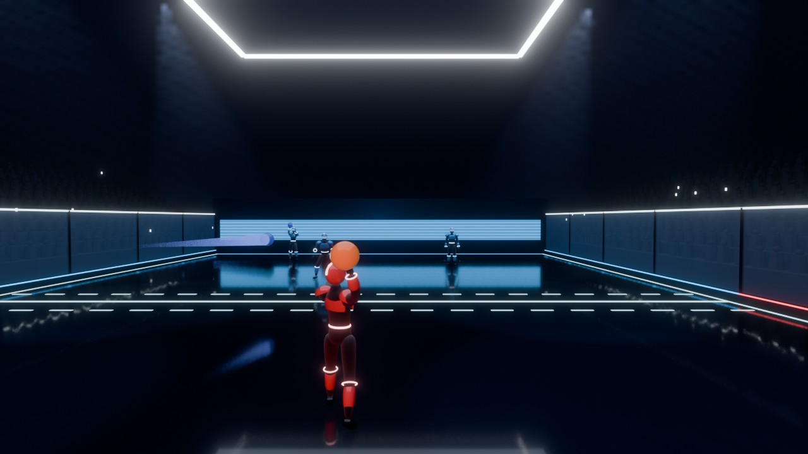
  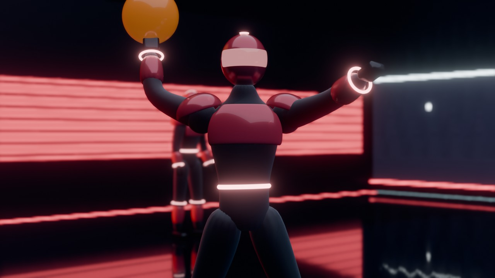

- **Daylight court:** an open-air court on a green plateau, glass side walls, hills fading into haze, round trees, soft sun. The athletes are white with team-coloured armour and dark visors. Calm and soft, close to Slow Roads' mood; the least saturated of the three.

  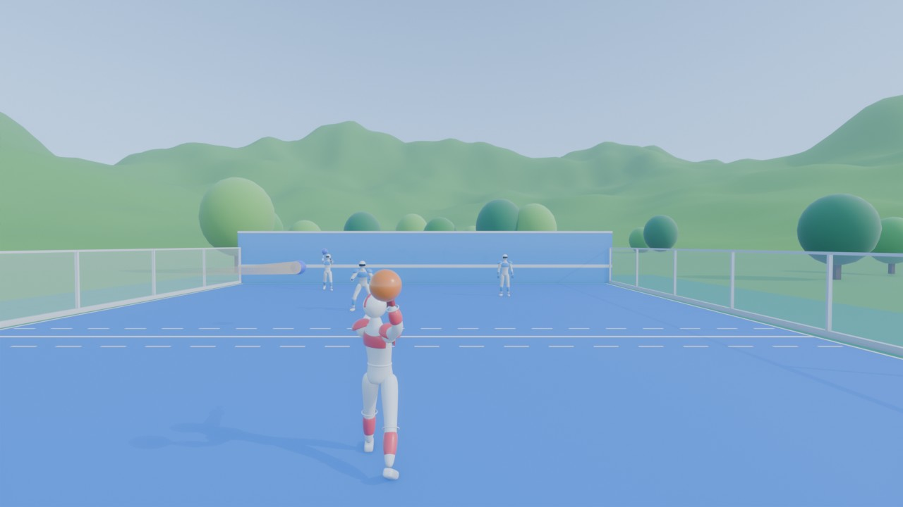
  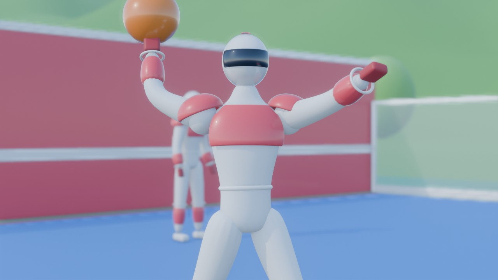

- **Sports hall:** a bright indoor hall. Each team's half is painted in its colour, with padded boards in five colours, a colourful crowd, bunting and big colour blocks on the walls. The athletes are chunkier: team jerseys over dark sleeves, a white belt, big gloves, and white helmets with dark visors. The most playful, nearest to a toy look.

  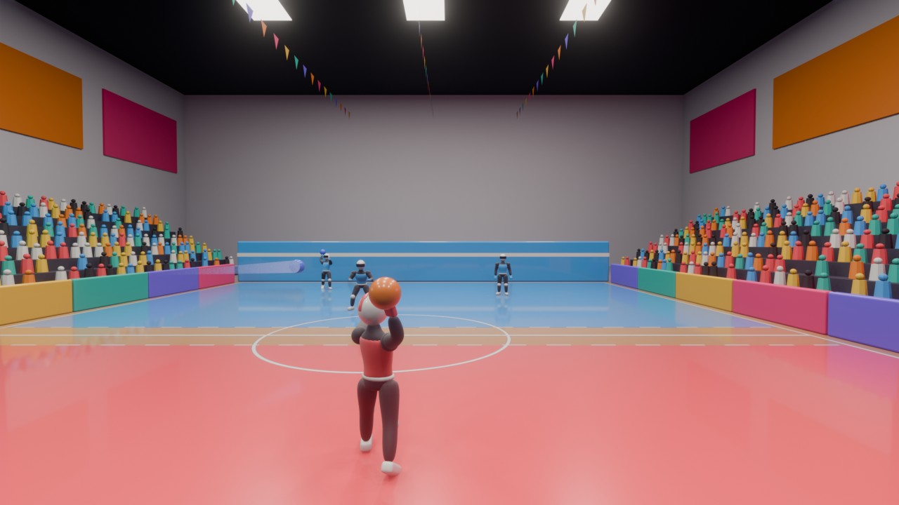
  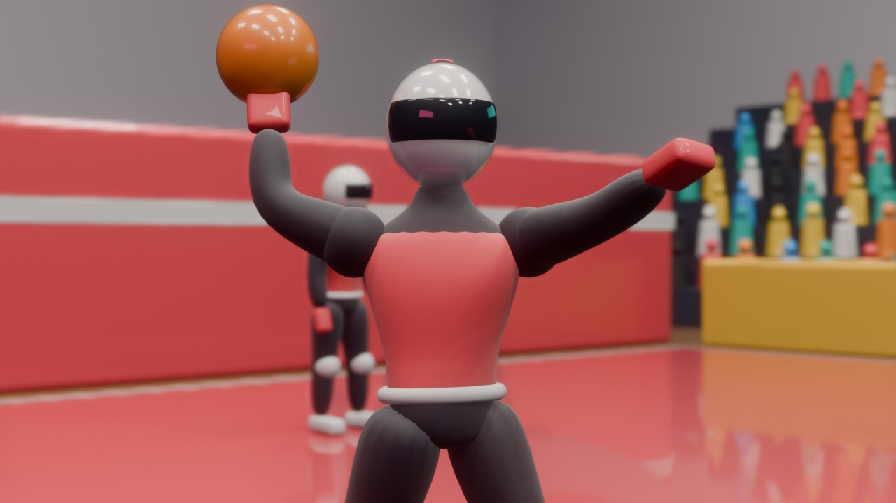

**What carries over to the game, and what doesn't:** these are offline renders. In the browser, on office laptops:

- **Carries over:**
  - the shapes, colours and materials;
  - baked lighting;
  - the glow (bloom, a screen effect);
  - the trails.
- **Expensive:** the haze and the mirror-like floor.
  - The haze would be faked with cheap light beams.
  - The floor reflection costs a second render of the scene, so it would be a setting, or faked.
- So the night arena loses the most in the move to a browser, but its darkness also hides simple geometry, and that helps.

**The user's pick:**

- The sports hall is the setting (decision 124): "vibrant and alive and cheerful".
- The colours and light should become like Genshin Impact's landscapes (decision 125), and "I don't like pale" rules out the daylight court's softness.
- The characters were accepted as a first draft. They should move towards Fortnite-like humanoids (decision 126).

### Round 2 (2026-10-29)

**What was asked** (the plan after round 1):

- **The hall in vibrant colour and light:** a warm, low sun through big windows, in visible beams, with cool sky light filling the shade; rich but harmonious paint, warm wood, some greenery, a bright sky with clouds outside; bloom and a warm/cool colour grade.
- **Characters towards Fortnite-like humanoids:** athletic, slightly heroic proportions; a sports kit in the team colours; real hands, not mittens; livelier poses.
- **The same athlete twice:** with a sports helmet and visor, and with a stylised face and hair. Faces are Claude's weakest area, so the user judges the face version.

**How it was made:**

- `art/style_samples_2.py` builds everything from nothing, with no downloaded assets, reusing round 1's helpers. Round 1's script still rebuilds round 1.
- **The same views as round 1,** at the game's real sizes and colours:
  - **the gameplay view** (the game's own camera) and **a close-up** of the near player, each rendered twice: with helmets and with faces;
  - plus **the two versions side by side** and **a portrait of the face**.
- It also saves `art/out/style-samples-2.blend`: one scene, with tick boxes in the outliner to switch between the helmet version, the face version and the pair.
- **The athletes are sculpted from code:**
  - Each body is made of smooth shapes (ellipsoids and tapered capsules for bones and muscles) blended into each other like clay, then turned into a mesh by the script itself.
  - A pose says where the hands and feet go, and the elbows and knees follow.
  - Heads, hands and shoes are made once and shared by every athlete; only the colours change from player to player.
- **Time:** at full quality it takes about 5 minutes to build and 3 seconds a picture on the user's PC. `--quick` builds coarser meshes for tests.

**The hall:**

- **The light:**
  - A low golden sun (24° up) comes from the left through 11 tall windows between solid piers. It puts window-shaped stripes of sun on the floor and the players, with cool blue sky light in the shade.
  - **The beams in the air are drawn the way a browser game would draw them:** soft, glowing, see-through shafts along the sun, fading at their edges and before they reach the floor, so they never veil the players. EEVEE's real haze either showed no beams or turned the hall milky. A very thin real haze adds depth.
- **The floor and walls:**
  - Deep team-coloured halves in satin paint: a mirror-like court reflected the bright windows, washed the far half out and hid the blue team.
  - Honey-coloured wood, and a warm wooden ceiling on laminated beams.
  - Boards and banners in teal, sunflower, leaf green, violet and tangerine. None are in the team colours, so players stay easy to read.
  - Round 1's colourful crowd, and bunting.
- **Greenery and sky:**
  - A window band over the far end looks out on green hills, round trees and white clouds.
  - A scoreboard in the team colours, a living green wall, and planters with shrubs and small trees.
- **The colour:** AgX "Punchy" colour, bloom, a warm/cool grade (cooler shade, warmer light) and a little extra saturation.

**The athletes:**

- **Proportions:** 1.75 m tall like the game's player, with heroic proportions: the head 1/7 of the height, hands 10% larger with chunky fingers, broad shoulders and back, a narrow waist, muscular arms and legs.
- **Real hands:** a palm, four fingers of three bones each, and a thumb, in four grips: holding the ball (the fingers wrap it by themselves), open for a catch, relaxed, and a fist.
- **The kit:**
  - a short-sleeved jersey in the team colour, with a white collar, cuffs and hem and a number on the back;
  - navy shorts with a team-coloured waistband and side stripe, and white hems;
  - white socks with team stripes, chunky white sneakers with team accents, and wristbands.
- **Poses:** a wind-up (left- and right-handed), the release, running, ready, catching, dodging, and standing.
- **The helmet:** a team-coloured shell with a white centre stripe, a big wraparound visor (dark, turning the team colour at grazing angles) in a white frame, and ear pods.
- **The face:**
  - a stylised male head with eyelids and a dark lash line, eyes with an iris and pupil, a nose, lips with a slight smile, and ears;
  - eyebrows and a short swept-back haircut;
  - six skin tones, with hair and eye colours, spread over the players.

**The pictures:**

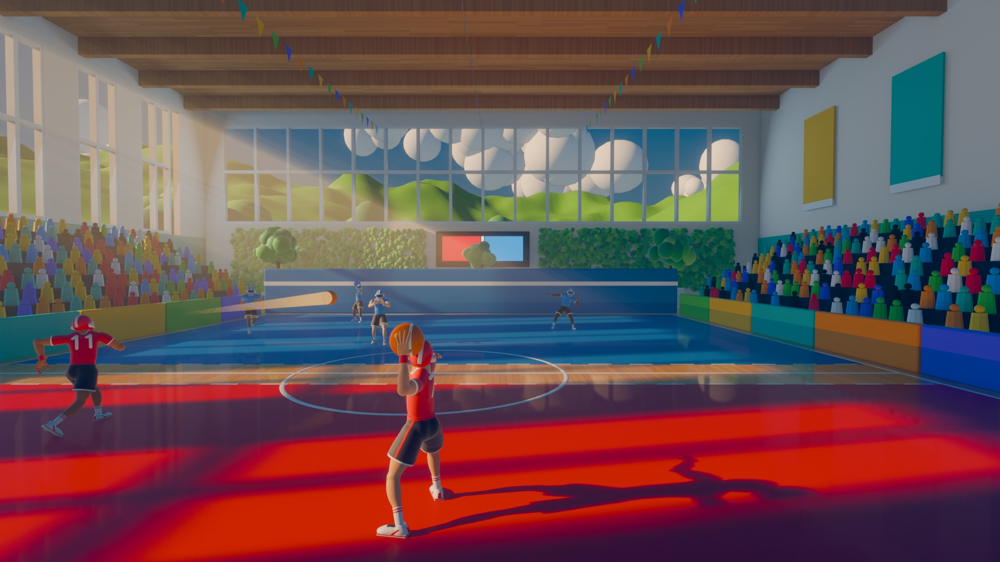
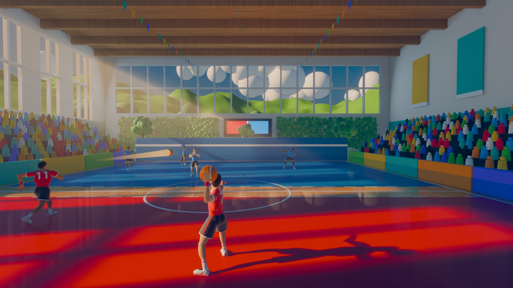
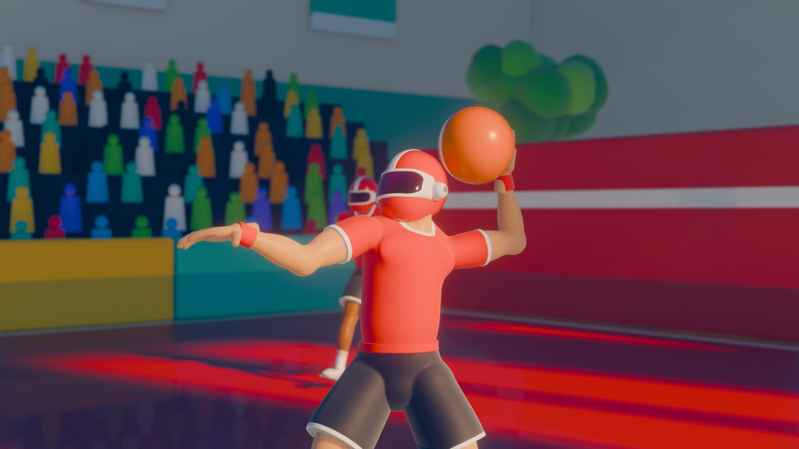
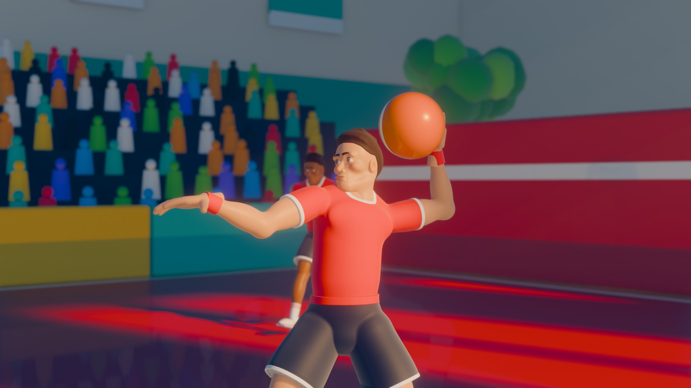
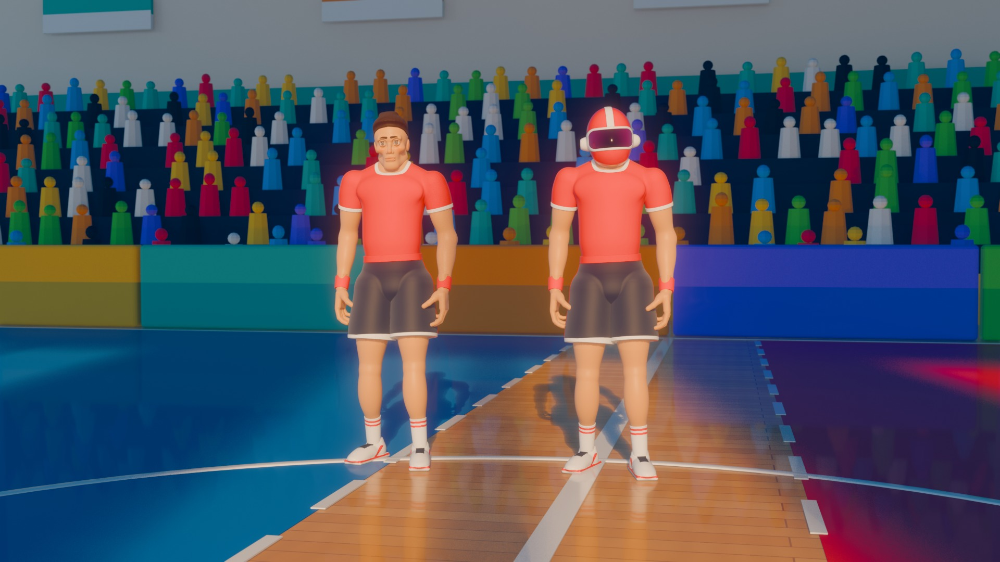
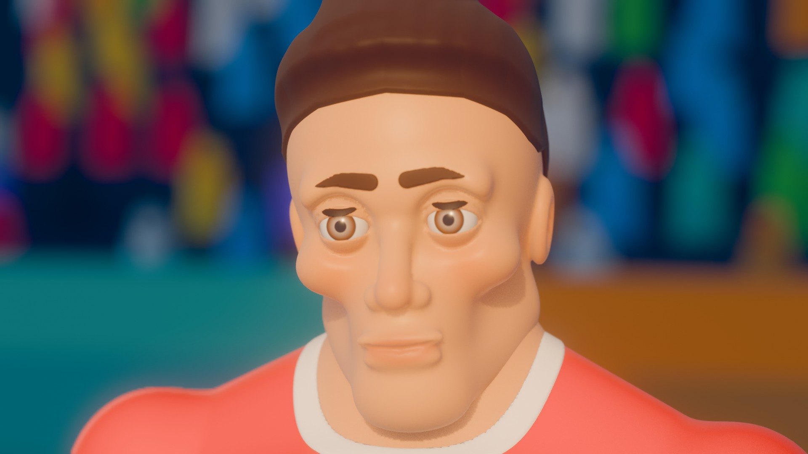

**Claude's honest verdict on the characters:**

- **The bodies, hands, kit and poses work:** athletic and heroic, clearly sports players, with team colours that read. They're a clear step up from round 1's mannequins, but they look like smooth vinyl toys rather than Fortnite's artist-made characters: no cloth folds, simple shoes, plain skin.
- **The helmet version is the stronger one:** clean shapes and nothing uncanny.
- **The face version is the weakest part of the round:**
  - From the game's camera it's fine: faces are tiny there, and the hair reads well from behind.
  - Up close it looks generic and slightly uncanny: the eyes are large and stare, the cheeks and nose are lumpy, and the hair is a simple smooth cap.
  - Faces need a sculptor's hand, or a good CC0 base mesh. Smooth shapes from code only get this far.

**What carries over to the game in a browser, on office laptops:**

- **Carries over cheaply:**
  - the hall's shapes, colours, wood and paint, as textures;
  - the sunlight on the hall: the sun doesn't move, so its window-shaped stripes can be baked into the hall's textures once in Blender, at no cost to the laptops. Players crossing the stripes get lit by a cheap "sun mask" or by real-time shadows from one sun;
  - the light shafts: the same glowing see-through shafts, a few dozen triangles;
  - the sky, hills and clouds outside: a painted backdrop;
  - bloom, tone mapping (three.js has the same AgX, and a Neutral mapping) and the colour grade, as screen effects;
  - the kit's design, numbers and trims, and the helmet, as textures on a game model.
- **Doesn't carry over as it is:**
  - **The athlete meshes:** about 1.5 million triangles each in these pictures (smooth enough for close-ups), against a budget of 5,000–10,000. Each also exists only as a posed statue, one mesh per pose. A game version needs one lighter model per athlete, with the details baked into textures, and a skeleton to animate it (step 7).
  - **The real haze:** replaced by the shafts and cheap distance fog.
  - **The glossy floor's live reflections:** costly in a browser, so faked, or a setting.
  - **The light under the skin** (subsurface scattering): approximated by warmer shading.
  - **Depth of field** in the close-ups: not used in play.
  - **The leaf and cloud blobs:** hundreds of thousands of small triangles, replaced by a textured panel and the backdrop.

**The user's pick** (decision 127):

- **The helmet, for now:** "Helmet is ok for now." The face version is set aside.
- **Then both** (decision 128, the same day): "I want with and without helmet both, when a player joins the game randomly picks a model and uses that."
- **The bodies are "mostly okay", but the lats looked abnormally big.** They were: the lat shapes leaned the wrong way and flared out under the arms. They were slimmed and re-tilted, the shirt's drape narrowed to match, and the round was rendered again. The pictures above are the new ones.
- **The user will look for free models later.** CC0 candidates Claude checked on their official pages:
  - [Quaternius Universal Base Characters](https://quaternius.com/packs/universalbasecharacters.html): CC0, "superhero" proportions, about 13,000 triangles, with a skeleton made for the Universal Animation Library. The free download has 2 base models and 5 hairstyles; the full set costs money.
  - [Blender Studio's Human Base Meshes](https://www.blender.org/download/demo-files/): CC0 realistic and stylised bodies and heads, for sculpting.
  - [MakeHuman / MPFB](https://static.makehumancommunity.org/mpfb/faq.html): CC0 exports; realistic, adjustable, with a skeleton.
  - Not usable: "free" downloads of characters from other games. They're copies of someone else's characters, with no real licence (the `Models` folder, phase 15).

## The log

- **2026-10-29:**
  - The question and the analysis (phase 15).
  - Blender 5.2 and the "MCP for Blender" add-on were installed by the user, then checked, pinned and tested by Claude.
  - The branch `look-and-feel` was created in its own folder, with this plan.
  - Style samples, round 1: three directions, each in a gameplay view and a close-up, also loaded into the user's Blender.
    - Five rounds of fixes along the way: a black daylight scene (world haze blocks the sun), a lamp mirrored as a blob in the floor, a crowd that took 100 s to build, an overexposed hall, and frilly shorts.
    - The lessons are in section 14 of `PROJECT.md`.
  - The user picked the sports hall, with Genshin-like colour and light and Fortnite-like characters (decisions 124–126). Round 2 is planned.
  - Style samples, round 2: the hall lit by a low sun through tall windows, and new athletes sculpted from code with real hands, in a helmet and with a face.
    - The scene was opened in the user's Blender. A copy of their open file (round 1, with unsaved changes) was saved first as `art/out/style-samples-before-round2.blend`.
    - Many fixes along the way:
      - **The light:** green hills outside that hid the low sun; a milky haze; beams too strong, then too faint (now drawn as glowing shafts); the hero standing in the shadow of a window bar.
      - **The colours:** pink jerseys (warm light and the colour transform); the blue team lost against a mirror-like floor.
      - **The kit:** shorts that looked like briefs; sleeves like shoulder pads; a chest that read as a bust under the shirt.
      - **The face:** sleepy, then staring eyes; a hair "helmet", then a "beanie".
      - **The mesher:** long streaks from a bug.
    - The lessons are in section 14 of `PROJECT.md`.
  - The user's pick: the helmet, for now (decision 127), then both versions, one picked at random for each player who joins (decision 128).
    - The lats looked abnormally big, so they were slimmed and the round rendered again. The scene was reopened in the user's Blender, after a copy of their open file was saved as `art/out/style-samples-2-before-slimmer-lats.blend`.
    - The `Models` folder of "free" Fortnite and Call of Duty character downloads was checked (no licences; copies of those games' characters) and removed at the user's request.
  - Step 2, smooth and fair (decisions 129–130):
    - **D1:** a graphics setting with Auto.
    - **D2:** the no-graphics-card warning.
    - **B4:** presses timed from their key.
    - **No first-use freezes:** every effect prepared while the game loads.
    - **The host:** Auto stays at Medium or lower on the host's computer.
    - **Tested:** the new `graphics.json` and the earlier browser and Python tests. In 35 s of every kind of effect, no shader was built mid-match (3 without the warm-up).
  - Committed as step 2. The user hadn't seen a change when trying it: the new art isn't in the game yet, and their computer, being the host, ran at Medium, which is barely softer. Zoomed pictures of the levels showed the difference, and the top-right readout now names the level.
- **2026-10-30:**
  - Step 3, juice (decision 131): an impact freeze on the hit player, specks, stretching and spinning balls with seams, camera shake, jolts and a charge zoom, and a Screen shake slider. None of it moves the aim, as the new `juice.json` test shows.
    - The user's verdict: the zoom while charging a little more (4.5° became 7°); the rest is good.
  - Step 4, sound (decision 132): CC0 recordings in place of the synthesized sounds.
    - **The sources:** BigSoundBank's real recordings (a ball, punches, slaps, whooshes, shoe squeaks, a whistle, a crowd), Kenney's announcer and interface sounds, and MintoDog's "Sunny City" for the music. Kenney's Impact Sounds pack was out of reach: kenney.nl refuses scripted downloads.
    - **Chosen without hearing them:** from measurements and pictures of every recording; `art/sounds.py` cuts and levels them into one file.
    - **In the game:** layered and varied, from the side they happen on and quieter far away, with the hall's echo; an announcer, a whistle and a crowd for the rounds; music in the lobby and in matches; a volume for each kind; a "Hear every sound" page.
    - **A surprise:** Internet Download Manager on this PC grabbed the browser's requests for `.ogg` files, so the page got nothing. The files are named `.oga` instead.
    - **Tested:** the new `sound.json` listens to the output; the juice, graphics, logs and smoke tests and the Python tests pass.
    - The user's verdict: "dodge sound I think is bad; everything else, good". Built at their request (decision 133):
      - the dodge as a whoosh and feet landing hard, played the moment you press (it used to wait for a dodged ball);
      - grunts when hit and cries when knocked out, in four voices, one per player, and a body falling;
      - panting when your stamina is low;
      - revives everyone hears: an entrance for one team, a danger for the other;
      - the match music lower (45% between rounds, 22% during play), and a Back button on the sound page.
    - The incoming-ball tick, which the user hadn't noticed, became a setting: by default a whoosh from the ball's side, loudest as it arrives; or a louder tick; or off (decision 135).
    - Committed after the user's "tested, everything is good".
    - For step 8, the user's dodges (decision 134): perfect ones as a butterfly twist, corkscrew or aerial side flip at random, with afterimages; normal ones as a ghost dash or MMA dash footwork.
  - Step 5, the arena (decision 136): the round 2 hall in the game.
    - `art/arena.py` builds it in Blender, bakes its sunlight, sky and bounce light into lightmaps (Cycles on the graphics card, about 3½ minutes) and renders the outside as the background.
    - The game paints the court on the hall's wooden floor under the baked light, and makes the court's walls, the stands, a crowd that cheers, and the sun's shafts.
    - Fixed along the way: the leaves crowding the walls out of one lightmap (they got their own); shafts so bright they washed out the far end (a third as strong now); thin rails on the glass that read as wires (gone); a cheaper crowd that looked faceted (round again; Low draws a third of it).
    - About 6 MB to download in all now. Headless Chrome draws Low at about 30 frames a second instead of 50: real laptops are measured in step 10.
    - The user: "it was good", but backing up to the end wall hid their own character behind it. Now a wall between the camera and the court turns see-through with a faint outline (decision 137); the side boards and the stands too, for when the camera ends up in them.
  - Committed as step 5 after the user's "tested and it's ok".
  - Step 6, the ball and effects (decision 138):
    - Effect shapes drawn on canvases at start: a starburst and a team-coloured shockwave on hits, a swipe on deflects, a flare and sparkles on perfect plays, dust and a floor ripple on bounces.
    - The ball in grippy rubber with a bright edge in its colour, so it reads against the busy hall (a first, stronger edge washed the blue ball out to lavender).
    - Long soft shadows from the low sun for players and balls, only where it reaches the floor: the bake now saves where the sun falls.
    - Waiting for the user to play: Claude can't see the effects move.
    - The user: "they are good for now". Committed as step 6.
  - Step 7, the characters (decision 139):
    - `art/athlete.py` makes round 2's athlete light: the body and its kit one surface (nothing under the clothes, nothing poking through), the hands, shoes, heads and eyes separate pieces, trimmed to about 6,600 + 1,700 triangles (Low about a third), shaded with the sculpt's own normals.
    - A skeleton of 15 bones, weighted by round 2's body parts; in the game its bones follow the stick figure's joints, so every pose and timing still works until step 8.
    - Colours from maps of colour slots, painted per player: their team's kit and one of six looks. Painting whole faces gave ragged trims, and the first maps had frayed collars (squashed islands, and points snapped between the collar and the neck). Both are fixed.
    - The helmet or the face, and the look, from the player's id: the same on every screen.
    - The ball carried in front of the hip; a faint cool rim light; feet kept above the floor in crouches.
    - About 0.8 MB to download, two draw calls a player; in software rendering a match at Low runs about as fast as with the stick figures (24–26 against 26–27 frames a second).
    - Waiting for the user's look: Claude can't see the athletes move.
    - The user: "they are fine", and step 8 (animation) matters most to them. Committed as step 7.
  - Step 8, the moves (decision 140; 2026-10-31):
    - The source: Mesh2Motion's human library, 178 CC0 clips, Quaternius's Universal Animation Library among them. 22 clips are retargeted onto the athlete in Blender and blended in layers in the game.
    - **Running:** the runs follow the speed, the legs turning where the player goes while the aim is kept (backwards, a backpedal).
    - **The arms:** the throw winds up with the charge and follows through; the deflect swings.
    - **Dodges:** MMA footwork to the sides and back; forwards, a low ghost dash with a faint trail.
    - **Perfect dodges:** the user's three acrobatics (a corkscrew, an aerial side flip, a butterfly twist), at random but the same on every screen.
    - **Hits:** knockouts fall away from the ball, harder the faster it came.
    - **The rest:** revived players get up; at a round's end the winners celebrate and the losers kneel.
    - **Not as planned:** knockout clips instead of ragdolls (reliable, and they look good); the catch keeps the stick figure's pose (no catch in the library).
    - **No new shader**, and about the same speed in software rendering. Waiting for the user to play: Claude can't see motion.
  - Step 8 redone after the user played it ("it needs serious edits"; decision 141, the same day):
    - **Fixed:** strafing, the legs ran the wrong way (the turn's sign); during the forward dash the right hand flicked: it copied the stick figure's arm, with its old swat and catch poses, and now holds the ball in its own pose.
    - **Made here, as the user described:** five clips gave way to moves placed by hand and reached with IK (17 clips remain):
      - three throws at random: overhead (the clip), side-arm at the stomach's height, underarm like bowling;
      - while charging, the left forearm across in front of the face;
      - the deflect, a backhand parry with the left hand like Dark Souls' (the hook clip, with the right hand, looked like a punch);
      - the catch, a one-handed palm blast, then the caught ball pulled in to the right hand;
      - the dashes: a side step pushed off the far foot, landing on the near one; a half-crouched big step forward; a jump back;
      - going backwards, a perfect dodge is a backflip.
    - Every move plays to its end on the figure's own clock: the game ends a catch or deflect the moment it meets the ball.
    - **The shorts:** spread legs stretched them into a skirt; an inseam now parts them.
    - The backpedal looked natural to the user: unchanged. Still no new shader, and the same speed. Waiting for the user to play again.
  - The user's second test (2026-11-01): some things fixed, some broken again, some still faulty. The perfect dodges show nothing until their last moment; the legs are still wrong holding only left or right; getting up after a knockout, the player can move while the body lies flat; and other things.
  - Fixed the same day, waiting for the user's test: the perfect dodges (the dash's footwork had covered them), strafing (a pure sideways move kept the backpedal after backing up), and getting up (moving now cuts the get-up short instead of sliding the body along the floor).
  - Decision 142: one animation at a time from here, in a new session. `docs/ANIMATIONS.md` lists every move and change of move, what it should look like, the tester's notes, its status, and Claude's likely causes for the three problems. A move the user approves is locked. If prompting doesn't work, the user may make moves themselves (Blender, a free tool, or a small web tool Claude makes: Claude's recommendation, starting with a viewer).
- **2026-11-03:**
  - The user's third test: the three fixes are good. Strafing, the perfect dodges and getting up are Locked, and the moves test now fails (`FAIL locked move ...`, exit 1) if a later change alters them. Committed as a checkpoint of step 8.
  - Step 8 is on hold, not finished (decision 143): the office logs and a batch of lobby features come first. When it resumes, the animation tool comes first: the web tool (option c in `docs/ANIMATIONS.md`), a viewer, then an editor.
