# Dodgeball: full project context and history

This document is the complete hand-off for the project. It's written so that a brand-new chat (an AI assistant with no memory of earlier conversations) or a returning human can pick up the work: what the game is, how it got here, every design decision and who made it, how the code works, how to run, test and ship it, and the pitfalls already discovered.

- **In Claude Code:** `CLAUDE.md` in the repository root loads automatically and points here.
- **In any other chat tool:** attach this file.

Last updated: 2026-10-29 (development cycle 2: lobby, host controls, rules editor, lag analysis, session logs; then the office logs, ball-curve rules, per-team bots, host spectating, the host's screen shown live, team cash, press feedback and the firewall helper; then the lag study's five suggestions and the press lockout as Network settings; then the 28 Oct office session and a fix for a browser whose clock ran fast; then publishing as **Dodgeball**: a public repository with a rebuilt history, the game at the repository root, CI and release builds; then a hit says why it got through, TOO EARLY or SECOND BALL, in v2.1.0; then each team's ball colours, team health, each player's own settings and settings files; then health regeneration and the lobby's round-time buttons; then standing still to regenerate; these three in v2.2.0; then internet mode, for friends over the internet, with a guide for a cloud server, on the branch `internet-mode` until the user's friend has tested it; then the look-and-feel cycle (graphics, juice and sound, with the art made in Blender), on the branch `look-and-feel`; on that branch also the office logs of 31 Oct to 2 Nov and a batch of lobby requests: longer names, players known by who they are rather than their name, renaming, a search across every tab, and bots with flags; all of it merged into `main` on 2026-11-03 and released as v2.3.0, with the athletes' animations and the HUD left on `main`'s task list).

## Contents

1. [The game in one paragraph](#1-the-game-in-one-paragraph)
2. [The user and how they like to work](#2-the-user-and-how-they-like-to-work)
3. [Folder map](#3-folder-map)
4. [History: the path from idea to now](#4-history-the-path-from-idea-to-now)
5. [Decision log](#5-decision-log)
6. [Current features](#6-current-features)
7. [Rules and numbers](#7-rules-and-numbers)
8. [Architecture](#8-architecture)
9. [Network protocol](#9-network-protocol)
10. [Server code tour](#10-server-code-tour)
11. [Client code tour](#11-client-code-tour)
12. [Bots](#12-bots)
13. [Running, testing, building, sharing](#13-running-testing-building-sharing)
14. [Pitfalls and lessons learned](#14-pitfalls-and-lessons-learned)
15. [Known limitations and ideas for next steps](#15-known-limitations-and-ideas-for-next-steps)
16. [Glossary](#16-glossary)

## 1. The game in one paragraph

**Dodgeball** (called Dodge & Parry until v2.0.0) is a real-time multiplayer 3D dodgeball game played in the browser on a local network, with no internet needed:

- **The core:** two teams throw balls at each other. Stamina limits everything, Dark Souls-style. An incoming ball can be **dodged**, **caught** or **deflected**, and pressing at the last moment is "perfect", which is cheaper and pays more.
- **Rallies:** a ball deflected back and forth gets faster every time.
- **Throwing:** throws are charged, and harder throws cost more stamina, fly faster and deal more damage. Balls fly in gentle arcs and can ricochet once off the floor or a side wall.
- **Elimination:** 0 HP knocks you out, and teammates can spend cash to revive you.
- **Hosting:** one PC runs the game server (Python, or the packaged `Dodgeball.exe`). Everyone on the same Wi-Fi opens a web page.
- **The lobby:** the server starts in a lobby. The host, who plays in the browser on that PC, sets up the teams, the bots and **every rule of the game**, then starts the match. Others can join at any time, but only the host changes anything. Changes made during a match apply from the next round.
- **The rules editor:** each of the 164 numbers has a name, a description and an animated preview that runs the default next to the lobby's value.
- **One player's own settings:** the host can give any person or bot their own values for the rules about a player (health, throws, defences, a bot's skill...). The whole setup saves to a file and loads back.
- **Team health (optional):** one shared health bar per team; the whole team falls together, and cash buys health for it.
- **Looks:** an over-the-shoulder, Fortnite-style camera, with stick figures for characters, and each team's balls in its own colours.
- **Bots:** the host puts any number on either team, so it also works solo.
- **Spectating and the host's screen:** the host can watch instead of playing, and everyone else sees the host's menus and rule edits live while they set things up.

## 2. The user and how they like to work

- **Machine:**
  - Windows 10.
  - Python 3.14 (python.org install).
  - Node 24, Chrome and Edge, uv, git, GitHub CLI.
  - Edited in VS Code with Claude Code (PowerShell, with Git Bash also available).
  - **Git:** the folder is a git repository, published as the **public** GitHub repo `amirtavakolihaghighi/dodgeball` (MIT) with a history rebuilt for publishing (phase 9). The original history is gone: the user deleted the old private repo `dodge-and-parry`, and every local backup of it was deleted too. `main` holds the releases, **v1.0.0**, **v2.0.0**, **v2.1.0**, **v2.2.0** and **v2.3.0** (tags, each with a GitHub release carrying the Windows zip built by GitHub Actions). Commits use GitHub's noreply address. Commit or push only when the user asks.
  - The PC runs VPN/proxy tools, whose tunnel adapters show up in the join-address list.
- **Wants simple but genuinely working prototypes.** They were burned by a ChatGPT prototype that looked polished but didn't work, with fake UI, mechanics that could never trigger and a broken renderer. No fake or decorative features: everything shown must work.
- **Wants blunt, evidence-based judgment**, backed by screenshots, simulations and measurements, not opinion.
- **Wants to be asked about genuine design forks** (multiple-choice questions with a recommendation), but not about things with an obvious default. Asked to choose between two reasonable ways (team health's bar size, what R buys), they answered "both kinds, the host decides, the recommended one as the default": alternatives become host settings.
- **Tests solo** by opening several browser tabs or windows as different players, plus bots.
- **Platform:** desktop/laptop only for now (keyboard and mouse). Phones/touch were explicitly deferred.
- **Shares builds with friends.** They first sent a RAR of the source folder, which broke, and now send the standalone Windows app.
- **Plays with coworkers in the office** (6–10 people, office Wi-Fi; several on Linux laptops). Some of them had lag; see `LAG_ANALYSIS.md`. The user collects the session logs and drops them in `testlog\` (git-ignored) for analysis.
- **Works in development cycles:** a stable version on `main`, then a batch of requested changes, then the user tests.
- **Wants to discuss before building** when a topic is open-ended (the lag plan was discussed first, then built as settings: phase 7).
- **Isn't a developer, SRE or devops person.** Explain setup and infrastructure in plain steps. A friend who is a developer sets up servers (internet mode's test server, phase 14).

## 3. Folder map

```text
dodgeball/                     (git repo -> github.com/amirtavakolihaghighi/dodgeball, public)
├── README.md                  the front page: what the game is, playing and hosting, safety and privacy
├── CLAUDE.md                  short instructions auto-loaded by Claude Code (points here)
├── LICENSE                    MIT
├── CHANGELOG.md               what changed in each version (Keep a Changelog)
├── CONTRIBUTING.md            setup, tests, conventions, the release routine
├── SECURITY.md                what the game exposes and writes; reporting a vulnerability privately
├── CODE_OF_CONDUCT.md
├── THIRD_PARTY_NOTICES.md     three.js, the sounds and music (CC0), the Python packages, PyInstaller's bootloader
├── .gitignore / .gitattributes / .editorconfig   venvs, builds, logs, saved rules ignored; LF except .bat (CRLF)
├── .github\                   workflows\ci.yml (tests on 3 OSes x Python 3.10-3.14, a browser match),
│                              workflows\release.yml (the Windows zip from a tag), issue and PR templates
├── docs\
│   ├── MANUAL.md              the player and host guide: run, share, lobby, controls, every rule's default, logs
│   ├── PROJECT.md             this document
│   ├── LAG_ANALYSIS.md        cycle 2: measured causes of lag, options, what the office logs showed
│   ├── LOOK_AND_FEEL.md       the look-and-feel cycle: its plan, the budgets, the style samples, its log
│   ├── ANIMATIONS.md          every animation and change of move, what it should look like, the tester's notes, its status (on hold: section 15)
│   └── images\                the README's screenshots
├── run.bat                    start the server (creates/repairs .venv; opens the browser)
├── build_exe.bat              build the standalone Windows app -> dist\Dodgeball-windows.zip
├── build_exe.py               the build logic (PyInstaller + zip with retries; ships the firewall helper too)
├── Allow friends to connect.bat   lets other PCs join through Windows Firewall: one rule, local network only
├── server.py                  FastAPI web server + WebSocket + game loop + host detection + rules broadcast/saving
├── sim.py                     all game rules (server-authoritative), lobby/match states, host actions
├── diag.py                    the session log: per-second server/host/connection numbers, stalls, late presses
├── rules.py                   every host-editable rule: name, description, range, preview; the Rules object
├── bots.py                    bot AI
├── config.py                  the DEFAULT value of every gameplay number
├── requirements.in            the direct dependencies: fastapi, uvicorn[standard]
├── requirements.txt           the lockfile: exact versions for every OS (uv pip compile)
├── requirements-build.in/.txt PyInstaller for build_exe.py, pinned the same way
├── icon.ico                   app icon (gold dodgeball, generated by a script)
├── tools\log_report.py        reads a session's logs and prints the diagnosis
├── art\                       Blender scripts that build the art (run in the background: arena.py is the hall, athlete.py the players, moves.py their clips), and sounds.py (the sounds);
│                              art\out\ is their output and downloads (git-ignored)
├── static\                    the browser client (served by server.py)
│   ├── index.html             HUD, lobby menu, rules editor, join screen markup; import map for three.js
│   ├── style.css
│   ├── js\main.js             glue: join flow, rules, local player, camera, aim, preview, threat ring, events, HUD
│   ├── js\lobby.js            the lobby / pause menu: teams, each team's bots, match settings, host controls, spectate
│   ├── js\bots_ui.js          the Bots & flags page: the host's own bots, flags on any bot, the flags themselves
│   ├── js\rules_ui.js         the rules editor (list, search, draft, apply, reset; following the host's screen; one player's own settings)
│   ├── js\settings_file.js    settings files: the whole setup or one player's own settings, saved and read back
│   ├── js\previews.js         the rules editor's animated previews (24 scenes, the game's own formulas)
│   ├── js\physics.js          launchVelocity and curveShare, shared by the game client and the rules previews
│   ├── js\diag.js             this browser's diagnostics log: per-second numbers, moments, L marks; sent to the host
│   ├── js\net.js              WebSocket, server-clock estimate, snapshot interpolation, event queue
│   ├── js\world.js            three.js scene: court, stick figures, balls, trails, effects
│   ├── js\hud.js              DOM HUD (bars, tags, ring, popups, feed, scoreboard, hint line)
│   ├── js\input.js            keyboard/mouse, pointer lock, release-everything-on-blur
│   ├── js\graphics.js         the graphics setting: Auto, High, Medium, Low; the no-graphics-card check
│   ├── js\juice.js            camera shake, jolts and the charge zoom (applied after the aim)
│   ├── js\fxtex.js            the effects' shapes, the ball's bumps and the shadows' shapes, drawn at start
│   ├── js\athlete.js          the athletes: loads them, paints each player's colours, moves them (clips, and moves placed by hand)
│   ├── characters\            the athlete (athlete.glb), its colour-slot maps and athlete.json, built by art\athlete.py
│   ├── js\sfx.js              the sound: recordings mixed with Web Audio, the hall's echo, music, synthesized fallbacks
│   ├── js\sound_check.js      the "Hear every sound" page (sounds.html)
│   ├── sounds.html            that page
│   ├── sounds\                sfx.oga + sfx.json (every short sound) and the two music tracks, built by art\sounds.py
│   ├── arena\                 the sports hall: hall.glb, its lightmaps, the sky, arena.json; built by art\arena.py
│   └── vendor\                three.js 0.185.1: three.module.min.js + three.core.min.js; addons\: its glTF loader and two helpers
├── tests\
│   ├── test_sim.py            74 rule tests: python tests\test_sim.py (or pytest)
│   ├── test_server.py         9 server tests (lobby protocol, players' own settings and files, who a player is, the host's screen, saved rules, session logs, the log report, a dropped connection)
│   └── browser\               headless-Chrome end-to-end tests (cdp.js driver + step files, freeze_server.py)
├── logs\                      (made at runtime) one folder of session logs per server run; the 30 newest are kept
├── saved_rules.json           (made at runtime) the host's rules and players' own settings, reloaded at the next start
├── testlog\                   the user's collected session logs from office tests (git-ignored: names and IPs)
├── .venv\                     local Python environment (made by run.bat; never share it)
└── dist\                      build output: Dodgeball\ (app) + Dodgeball-windows.zip
```

The code is about 12,000 lines in total. The biggest files are `previews.js` (~1,580), `sim.py` (~1,400), `test_sim.py` (~1,260), `main.js` (~1,190), `world.js` (~800), `rules.py` (~660), `rules_ui.js` (~580), `server.py` (~510), `log_report.py` (~490) and `diag.py` (~450).

## 4. History: the path from idea to now

### Phase 0: the idea and ChatGPT's attempt (2026-10-19)

The user described the game to ChatGPT (free version); the transcript was deleted when the project was published (phase 9). The requirements, in the user's words, condensed:

- **Teams and balls:** two teams. Each player has a ball; after throwing there's a cooldown, then a new ball.
- **Defence:** the targeted player can **dodge, catch or deflect**.
  - Dodge at the last moment = **perfect dodge**.
  - Catch at the last moment = **extra points**.
  - **Deflect** = catch and throw in quick succession: more skill, smaller window.
- **Health and stamina:** dodging costs stamina; perfect dodges cost less (same idea for catch and deflect). Getting hit loses health; at 0 you're out. Teammates can spend **cash points to revive** fallen teammates.
- **Rallies:** a continuously deflected ball gets **faster and faster**.
- **Tech:** a Python server on a PC, with friends on the same Wi-Fi playing in a browser.
- **Follow-up message:** throwing costs stamina **based on how hard you throw**. It should be **3D with a Fortnite-like camera**; stick figures are fine.

ChatGPT produced a first attempt (deleted since): a FastAPI server and a single `index.html` with hand-written WebGL. When asked to judge it harshly, I verified every claim by running it:

1. **The 3D view never rendered.**
   - Its matrix multiply produced B·A instead of A·B for column-major matrices, so the whole MVP chain was reversed.
   - Running its exact math in Node put the camera's look-at point far off-screen and the player at NaN.
   - A headless-Chrome screenshot showed diagonal stripes, with no arena, players or balls.
2. **Deflect, the signature mechanic, could never succeed.**
   - It required a catch in the previous 0.38 s, but a catch deletes the ball, and pressing deflect overwrote the catch action.
   - A simulation confirmed that every deflect attempt got the player hit.
3. **Dodge didn't move the player**: the ball just vanished on touch within 0.34 s. **Catch also deleted the ball**, so the player never got it.
4. **Aiming was fake**: every throw auto-targeted the nearest enemy, flying straight at a fixed height.
5. **WASD was mirrored**: a reflection transform, so at spawn W walked backward and D walked left.
6. **Fake UI:**
   - A static "05:00" timer and "FIRST TO 10".
   - A "REVIVES 0/2" limit that didn't exist.
   - Each team's score showed its *own* dead count.
   - Cover blocks were drawn with no collision.
7. **Rules gaps:**
   - Hits earned 0 points, so revives were barely fundable.
   - No rounds or win condition, and no center line.
   - Throw power was trusted from the browser.
8. **Server flaws:**
   - It awaited each client's send inside the game loop, so one slow client stalled everyone.
   - It used a deprecated startup hook and paths relative to the working directory.
   - It had no network-delay handling.

**Salvaged:** only the stack choice (Python FastAPI server, browsers over WebSockets). Everything else was rewritten in `prototype\` (the game's folder until phase 9 moved it to the repository root).

### Phase 1: the first real prototype (2026-10-20 → 21)

**Questions asked, and the user's answers:**

| Question | Options offered | User chose |
| --- | --- | --- |
| How should aiming work? | soft lock-on (homing) / free aim, straight / **free aim + light assist** | **Free aim + light assist** |
| How is deflect performed? | **own key, tighter window** / catch then quick throw | **Own key, tighter window** |
| Bots? | **yes, fill teams** / no | **Yes** |
| Devices? | **desktop only** / phones too | **Desktop/laptop only**, *and* "I want to open multiple tabs so I can test with different players" |

**What got built:**

- **Server and rules:** a server-authoritative Python simulation (`sim.py`) with explicit timestamps.
- **Client:**
  - A three.js client with real lighting, stick figures with procedural animation, an over-the-shoulder camera with pointer lock, and a full HUD.
  - Client-side movement for instant response, with server validation.
- **Lag compensation:** the client tells the server which moment it was looking at when a key was pressed (section 8).
- **Bots, rounds, revives, cash, per-tab identity** (sessionStorage, auto-rejoin on reload), and inputs released on blur.

**Evidence and iteration:**

- **Rule tests** (22 at first) passed on the first run, except one: a bots-only match was far too slow.
  - Profiling showed 70 revives in 2 rounds; rounds always hit the 3-minute cap.
  - Fix: **escalating revive cost** (80, then +40 per revive per team per round) and lower catch/deflect cash.
  - Dodges that dashed cleanly out of the way weren't credited. That led to the **"afterimage" rule**: a ball reaching the spot where your dodge started counts as dodged.
  - After both fixes, rounds lasted 21–92 s (about 50 s on average) with 1–2 revives per round.
- **Headless-Chrome screenshots** drove the camera changes: pulled back to 4.4 m, raised, field of view 62. A teammate standing next to the camera blocked the view, so players within 2.6 m of the camera now fade.
- **A bug found by reasoning:** inputs sent before the client noticed a teleport could overwrite the server's "face the enemy" spawn direction. Fix: the `tp` teleport counter gates position, yaw and pitch.
- **End-to-end "auto-defender" through the real network path:** catch 6/6 perfect; deflect at 150 ms simulated lag gave 5 deflects and 0 hits; dodge 8/8 perfect.
- **Two simultaneous browsers** (Alice and Bob) saw each other move and saw each other's throws and hits.

### Phase 2: the user's second round of requests (2026-10-21)

The user asked for:

1. A **perfect dodge** that looks different: a 360° spin out of the way with afterimages.
2. **Deflected balls** that look distinct: another color, afterimages, or a path that lingers in the air to show the speed.
3. **Vertical curves**, for example throwing at the ground so the ball ricochets toward another player.
4. **Holding to throw makes the ball faster, and speed is what deals damage.** This was already the rule, but too subtle.
5. **A wider arena for more players**, growing with each added player.

**Questions asked, and answers:**

| Question | Options | User chose |
| --- | --- | --- |
| Vertical curves | **light gravity arcs on every throw** / straight throws + ricochets only | **Light gravity arcs** |
| Ricochet surfaces | **floor only** / floor and walls | **Floor and walls** |

**What got built:**

- **Physics:** ball physics became velocity-based with gravity (6 m/s²). A ballistic launch solve keeps the crosshair accurate: the ball lands where you aim.
- **Aim assist** now steers toward the *arc* that would hit the target.
- **Ricochets:** one bounce off the floor or a side wall, losing speed, then curving toward the nearest enemy ahead.
  - **End walls stop balls.** This was my decision: with every wall bouncing, about half of all misses came back off the back wall and hit defenders from behind, unseen.
  - Bots throw **bank shots** (15% of throws on normal skill).
  - Aiming at the floor or a wall *short of* an enemy disables the throw-time assist, so the bounce happens.
- **Throw preview:** while charging, a dotted line shows the arc and the bounce point.
- **Charge, speed and damage:** a tap is 12 m/s for ~15 damage; a full charge is 34 m/s for ~45. The HUD shows speed, expected damage and cost while charging, and the kill feed shows each hit's speed and damage.
- **Perfect-dodge visuals:** a 360° spin with a hop, glowing afterimage copies of the figure, and a gold screen-edge flash for your own perfects.
- **Deflect visuals:**
  - A distinct color per rally level (yellow → cyan → magenta → red → white-hot).
  - A camera-facing ribbon trail that lingers in the air, longer per rally level, plus fading ghost balls.
- **Arena size** scales with the biggest team. It grows immediately and only shrinks between rounds.
- **Extra bots** join mid-round; fewer bots apply next round.

**Bugs found by diagnostics and fixed** (several affected timing fairness, not just looks):

1. When standing near your back wall, the camera sits outside the court, and the aim ray skipped the walls, so the aim point landed 42 m away. Fix: a slab test for where the ray leaves the court box.
2. Clicking the bot-count "+" rapidly computed from a stale snapshot. Fix: a local pending value.
3. The timing ring ignored lobs aimed at you that were predicted to fly over (the assist bends them down). Fix: a ball homing on you always counts.
4. The ring's near-miss margin (0.6 m) baited wasted presses. Fix: 0.15 m for free-flying balls, 0.6 m for balls homing on someone else.
5. A second ball close behind the first was hidden by the ring. Fix: once you've pressed for a ball, the ring moves on to the next.
6. Your browser kept you "busy" after a catch until the confirmation arrived, so a second ball couldn't be answered. Fix: free your hands the moment the answered ball arrives, as the server does.
7. Snapshot interpolation took a ball's state and velocity from the *later* snapshot. A ball touching a player is frozen ("pending") with zero velocity, so it vanished from threat detection up to 33 ms early. Fix: take state and velocity from the earlier snapshot until the later one's time.
8. **Balls arrived late on screen**: they drifted into the contact point over a whole snapshot interval. Fix: arrive at full speed at the true contact moment. Caught balls keep flying until they vanish instead of hanging in the air.
9. Score and round count survived after everyone left. Fix: reset when no humans remain.
10. Shockwave rings and your own afterimages near the camera blocked the view. Fix: no ring for your own actions, fainter own ghosts, smaller rings.

**Results after the fixes:**

- 30 rule tests pass.
- Auto-defender:
  - catch: 9 of 10, with 0 hits;
  - catch at 60 ms lag: 18 of 19 (the one miss was a ricochet visible only 0.011 s before impact);
  - deflect at 150 ms lag: 12 of 12;
  - dodge: 9, with 8 perfect and 0 hits.
- In bot matches, ~32% of throws bounce and ~17–23% of hits are ricochets. Damage ranges 15–52 (average ~31), and rounds last 26–89 s.

### Phase 3: sharing with friends, and the standalone app (2026-10-21)

**The `.venv` problem:** the user sent friends a RAR of `prototype\`. Friends got:

```text
did not find executable at 'C:\Users\<user>\...\Python314\python.exe'
```

A venv stores the absolute path of the Python that created it, and the RAR included `.venv`.

- **Immediate fix for them:** delete `.venv` and run `run.bat`.
- **Permanent fix:** `run.bat` now checks that `.venv` works (`import fastapi, uvicorn`). If it doesn't, it deletes it and rebuilds it with the `py` launcher, or `python` on PATH. This was verified by recreating the friends' exact error in a copy of the folder.

**Standalone app:** the user asked whether it could work without Python. It now does.

- `build_exe.bat` → `build_exe.py` runs **PyInstaller** (onedir) and writes `dist\DodgeAndParry-windows.zip`: about 19 MB zipped and 36 MB unpacked, holding `DodgeAndParry.exe` plus `_internal\`.
- `server.py` gained:
  - a static path that works inside the package (`sys._MEIPASS`);
  - **automatic browser opening** once the port accepts connections (`--no-browser` turns it off);
  - **the first free port from 8000** when `--port` isn't given;
  - in the packaged app, a "Press Enter to close" pause on exit, so errors stay readable.
- A custom icon, a gold dodgeball, was generated programmatically.
- **Verified:**
  - it runs from a fresh unzip with Python hidden from PATH;
  - a full match played in the browser with no errors;
  - with 8000 occupied it moves to 8001;
  - a forced busy-port error stays visible;
  - the browser opens at the right address (checked by pointing the `BROWSER` environment variable at a recorder script).

Finally, the browser test tools were moved from a temporary folder into `prototype\tests\browser\`, and this document plus `CLAUDE.md` were written.

### Phase 4: version control and development cycle 2 (2026-10-22)

**Git:** the folder became a git repository, pushed to the private GitHub repo `amirtavakolihaghighi/dodge-and-parry`.

- `main` = **v1.0.0**, "the first stable version": tagged, with a GitHub release that carries `DodgeAndParry-windows.zip`.
- `.gitattributes` keeps `.bat` files CRLF and the vendored three.js byte-for-byte.
- Cycle-2 work is on the branch `cycle-2` and is left uncommitted for the user to test first.

**The user's cycle-2 requests**, after playing with 6–8 coworkers on the office Wi-Fi:

1. **Lag.** Some players lagged. The user asked three things:
   - what would reduce lag, including gameplay changes;
   - what each kind of resource shortage (host or player machines) does;
   - whether connecting to the host's hotspot changes anything.
   **They want to discuss before anything is built.**
2. **A lobby phase.**
   - The server creates a lobby that the host configures and starts.
   - Anyone can join, even mid-game, but only the host controls anything. Before, anyone could press Esc and add bots or switch teams.
   - Rule changes made mid-game apply from the next round.
3. **The host can change every number of the game mechanics.** Each comes with a proper name, a description, and if possible an image or a replaying video of what changing it looks or feels like.

**1. The lag analysis** is in `LAG_ANALYSIS.md`, written from measurements on the v1 code.

- **The server is not the bottleneck:**
  - 3% of one core with 8 simulated players, ~60 MB of RAM, ~35 kbit/s per player after compression;
  - snapshots always on time (worst gap 39 ms).
- **So the likely causes** are per-player Wi-Fi jitter and stalls, slow rendering, or the host's process pausing. One host-side pause: a click in the console starts a QuickEdit selection, which freezes the whole game at the next `print`.
- **The client tolerates only ~47–80 ms of lateness** before players and balls freeze and jump.
- **It proposes a plan** (diagnostics first, then smoothing fixes, gameplay forgiveness last) and lists the questions that would sharpen it. **Nothing from it is implemented.**

**2 and 3. What got built:**

- **Rules as data.**
  - `rules.py` lists 111 rules in 16 groups, each with a name, a plain-language description, a range, a step, a unit and a preview scene.
  - A `Rules` object holds one complete set. `sim.py` and `bots.py` read every number from `game.rules` instead of `config.py`, which now holds only the defaults.
  - Untrusted edits are type-checked and clamped to their range. Ordered pairs stay in order (the edited one wins), and a perfect zone or perfect cost can't exceed its window or cost.
- **The lobby state:**
  - The server starts in `lobby`: a warm-up where combat is open, the downed stand up after 2 s and bots don't throw.
  - The host presses **Start match**. The first countdown is 2 s longer, so people can click in.
  - Rounds then run until a team reaches **rounds to win** (a new rule; 0 = endless, the default), or the host presses **End match** (two clicks). Either way everyone returns to the lobby, which shows the result.
- **Who is host:**
  - the browser on the server's own computer (loopback or one of its addresses);
  - anyone opening the **secret host link** the console prints (`?host=KEY`), for hosting from another device;
  - `?guest` opts a local tab out, so you can see the guest view.
  - The server gates every host-only message; others get a "deny: host".
- **Host controls:**
  - Start/End, ⇄ move any player, Shuffle teams;
  - bots fill and skill, match length, and the full rules editor;
  - cancelling changes that wait for the next round.
  - In the lobby (and while a match waits for players) changes apply at once. During a match they wait for the next round's countdown, and both the menu and the editor show "next round (now X)".
  - Players no longer pick teams: they're auto-balanced, the host moves them, and a reconnecting player gets their team back (the server remembers names).
- **The rules editor:**
  - category list, search, sliders and number boxes, per-rule reset, "Reset all", "Undo my edits", Apply;
  - read-only for guests;
  - every rule has an **animated preview**, one of 19 canvas scenes computed with the game's own formulas and arc maths (`physics.js`). Most run the default and the lobby's value side by side in real time, so a change is visible as a difference.
- **Saved rules:** the host's rules are saved to `saved_rules.json` next to the app and reloaded at the next start. `--fresh` skips this, for tests.
- **Smaller fixes made along the way:**
  - Name tags use the max HP/stamina.
  - The ball mesh follows the ball radius.
  - The throw preview respects "0 bounces".
  - Bot defence leads shrink with narrow windows.
  - Equal throw costs no longer divide by zero.
  - Join addresses skip `169.254.x` and list `192.168.x` / `10.x` first. This PC's VPN adapter used to come first.

**Evidence:**

- **42 rule tests**, including:
  - lobby and host gating;
  - rule changes applying at once vs next round;
  - validation;
  - "every listed rule is read by the game" (no decorative settings);
  - a fuzz test of 20 matches with random rule values, often at the extremes and also changed mid-match, checked for crashes and NaN.
- **2 server tests over real WebSockets:** the lobby protocol, the host key, re-sync, and saved rules.
- **Browser runs:**
  - a host and a guest at the same time;
  - the host's quick controls;
  - a match won on rounds;
  - screenshots of all 19 preview scenes, checked against the formulas.
- **Auto-defender after the changes:**
  - catch: 9 of 10, 0 hits;
  - deflect at 150 ms lag: 12 of 13, 0 hits;
  - dodge: 13 of 13, all perfect.

### Phase 5: session logs, to measure the lag (2026-10-22)

**The user's answers to the lag questions:**

- Only some people lagged, going by what they said.
- Nobody knows the ms/fps numbers or which symptom was worst.
- The host was the user's own PC, on Wi-Fi, and the user played on it too.
- Maybe someone clicked the server window, and maybe a VPN was running.

**The request:** the server and every client should write log files during the next test, so the user can collect them and send them in.

**What got built** (`diag.py`, `static/js/diag.js`, `tools/log_report.py`):

- **The server log:** one folder per server run under `logs/` next to the app. `server.jsonl` gets:
  - **every second:** loop timing, the host's CPU, memory and page faults, and each player's input rate and gaps, screen delay, and queue, drops and send time;
  - **notable moments:** game-loop stalls, console prints held up (QuickEdit), hits on people, presses that arrived after the ball had hit, joins and leaves (with IP, the local address their traffic leaves from, and browser);
  - **every 30 s:** Wi-Fi and power;
  - **once:** the adapters (VPNs) and the build version.
- **Every browser's log:**
  - **every second:** fps, long frames, code time per frame, update lateness and gaps, frozen time, ping and inputs;
  - **notable moments:** hitches and freezes over 150 ms, presses, own hits and defences, rounds, disconnects, errors, visibility and focus, and **L** marks;
  - **once:** the device (graphics card, CPU cores, screen, pixel ratio).
- **Delivery:**
  - The browser sends its log to the server every 5 s. Chunks are acknowledged and kept in localStorage until then; after a reload they're resent, and the server skips duplicates.
  - "Save my log" downloads the browser's own copy.
  - The host's "Download all logs (zip)" fetches the last 24 h of sessions from `/logs/download`, which only the host may do.
- **`tools/log_report.py`** reads a zip, a folder or a single saved log, and prints the diagnosis. It splits each player's frozen time into host side (a server stall, or most others froze too) and their own, and gives every L mark a cause.
- **A test option:** `?jitter=N` simulates uneven Wi-Fi delay (in order, like TCP).

**Evidence:**

- **Rehearsals with a jittery player and a forced 1.5 s server freeze:** the report named each cause correctly (details in `LAG_ANALYSIS.md`).
- **New tests:** 3 server tests (the whole pipeline over a real server, the three detectors, the report's judgement), plus the browser test `logs.json`.
- **Timing unchanged:** the auto-defender still defends every press (catch 13/14 perfect, deflect at 150 ms lag 12/12, dodge 10/10, 0 hits).

**Found along the way** (see section 14):

- Chrome hands `Content-Disposition: attachment` responses to its download manager, and the page's `fetch` gets an empty 204.
- The venv's `python.exe` is a launcher with the server as a child process.
- This console uses code page 1256.
- Two software-rendered headless Chromes saturate this 16-thread PC and starve the server.

### Phase 6: the office logs, and the next batch of requests (2026-10-25 → 27)

**What the user sent:** five browser logs from the 25 Oct session, then the server logs of eight runs (three office sessions with 7–11 players: 25, 26 and 27 Oct) and the host's "Download all logs" zip of the 27th. Analysis details are in `LAG_ANALYSIS.md`, "Update 2". In short:

- **The host and server were healthy:** no game-loop stall over 100 ms in any session, the server at ~10–15% CPU. The host PC's memory sat at 90–96% (Chrome, VPN tools).
- **Devices were fine:** everyone ran at 60 fps or more.
- **Lag compensation for buttons works:** 3 of 567 hits (25 Oct) came after a press that was in time on the player's screen.
- **The worst lag was a few players' own Wi-Fi, mostly Linux laptops:** three of them froze in bursts, a 170–230 ms freeze every ~0.43 s for 5–20 s, every 30 s to 5 min (the signature of Wi-Fi background scanning); one stuttered steadily (17.6% frozen; likely Wi-Fi power saving). Their uploads stalled too, so others saw them jump.
- **The host's own Wi-Fi went quiet three times on the 26th** (~0.25 s, every remote player at once, both directions); not on the 25th or 27th.
- **"My press did nothing":** after a dodge, catch or deflect that meets no ball, the browser ignored new presses for its window plus recovery (~0.5 s) without a sound. 8–11% of all hits landed inside such a lockout.
- **Ricochets** were 50–66% of all hits; one player's lag marks followed bank-shot deaths, not network trouble.
- **The report tool needed fixes:** browsers resend unsent chunks from earlier sessions (it now leaves those out), menu time counted as input gaps (now only while playing), and players' PC clocks differ by minutes (times now on the host's clock).

**The requests, and what got built:**

- **Slower throws curve less** (configurable): `SLOW_BALL_CURVE`, "Slow-ball curve", default 0.5. The aim assist's bend is now measured per metre: a tap-speed ball bends half as much as a full-power one; balls in between scale smoothly, and so does a ball that slowed down. A full-power throw bends exactly as before. Preview: a new "Slow balls curve less" scene.
- **A bounce takes curve away** (configurable): `RICOCHET_CURVE_KEEP`, "Curve kept after a bounce", default 0.5, replacing `RICOCHET_TURN_RATE_DEG` (150°/s homing). A ricochet bends at half the strength of a ball that never bounced, and each further bounce halves it again.
- **The host can spectate:** a Spectate / Join a team button in the Teams panel. Watching, the host is on no team (team −1): never hit, not counted, still running the lobby. Free camera (mouse, WASD, Space/Shift), or LMB/RMB to ride behind the next/previous player. At once in free play, otherwise from the next round, like a team move.
- **Everyone sees the host's screen live:** the host's browser reports which screen it shows, the rules group, the search, the rule in focus and its unapplied edits (≤ ~8 times a second). Guests get a "The host's screen" box in the menu and a line on the HUD ("The host is looking at the rules: Ricochets › Curve kept after a bounce 0.50× → 0.30× (not applied yet)"). With "Follow the host" on (default), their own read-only rules editor opens on the same page, highlights the same rule and shows the host's draft. Teams and bots were already visible to everyone.
- **The host sets each team's bots freely:** `BOTS_RED` and `BOTS_BLUE` (0–12 each, defaults 1 and 2) replace `BOT_FILL`. Nothing adds, removes or balances bots or people automatically; a newcomer still joins the team with fewer people, and the host moves anyone.
- **Shared team cash** (an option, off by default): `TEAM_CASH`. Everything anyone earns goes into one pot per team; any teammate can spend it on revives (bots too). Switching it on pours everyone's cash into the pot; switching it off shares the pot out evenly.
- **Cash that carries over while prices don't:** this already existed ("Cash resets each round" off; revive prices start over every round). The descriptions now say so, and a new match always starts everyone at 0 cash.
- **Presses during a recovery** now say "Still recovering (0.3s)" with the deny sound, and are logged (`ignored`), instead of doing nothing silently.
- **Firewall:** `Allow friends to connect.bat` (next to the exe, and in `prototype\`) asks for admin once, adds one inbound rule (TCP 8000–8019, local subnet only, any network profile) and removes Windows' old block rules for the game's program. The server window points to it.
- **Answered without building:** UDP (not worth it now: browsers can't use raw UDP, and the measured freezes were radio gaps that UDP can't fix); the five earlier lag suggestions, re-explained from the player's side.

**Evidence:** 47 rule tests and 6 server tests pass. Browser runs confirmed: smoke; lobby controls (per-team bots, "Still recovering", the new previews, mid-match bot changes, spectate on/off across rounds, free flight, following a player, the host's body not drawn); the two-browser test with the guest following the host's rules screen; the auto-defender (catch 13/13 perfect, deflect at 150 ms lag 10 defended, dodge 10/10, 0 hits in all modes); and the logging test.

**Found along the way:** the lobby's `.tag` labels shared a class name with the join screen's tagline, so each inherited the other's style (scoped now); a `const` in one browser-test step leaks into the next (steps use IIFEs).

### Phase 7: the lag study's suggestions, as settings (2026-10-27)

**The request:** "All five suggestions look good. Apply them, as options in the network settings with their own explanation. Also put the lockout timer (after a dodge, catch or deflect that didn't meet a ball) in the options: I may want to test with 0."

**What got built** (all in Game rules › Network (advanced), each with a player-terms description and a preview):

1. **Ricochet homing:** already a setting (Ricochets › Curve kept after a bounce, 0.5); the Network blurb points to it.
2. **View delay** (`INTERP_DELAY`) now defaults to **0.10 s** (was 0.08): a bigger cushion, so fewer one-frame stops on jittery Wi-Fi; the description explains the trade.
3. **Press grace** (`PRESS_GRACE`, default **0.02 s**, people only): a dodge, catch or deflect counts from 0.02 s before the press, because the screen is drawn a moment before the finger moves. A defence that counted only thanks to it is marked `graced`.
4. **Sidestep compensation** (`SIDESTEP_COMP`, default **on**): stepping out of a ball's way is judged by the player's own screen. The server keeps each person's recent reported positions with the moment their screen showed (`Player.seen`). When a ball touches someone with no defence active, it already waits (pending) for a late press; now, once that player's report from the contact moment arrives, the server checks where they were *on their screen*. Clear: the ball flies on past them from where it would be by now (event `sidestep`, popup "SIDESTEPPED"). With it on, browsers no longer shift nearby balls onto the player's present position (that shift existed to match the old server judgement).
5. **Logs:** every hit on a person records `gap`, how far clear of the ball they were on their own screen (negative = touching); sidesteps and graced defences are logged; the report has a FAIRNESS section.
6. **Lockout after a missed press** (`LOCKOUT_SCALE`, default **1×**, 0–1.5×): scales the window-plus-recovery lockout after a defence that meets no ball. At 0 you can press again at once, and the new press takes over from the one still active. The action's own window is never cut short (`Player.lockout_end` is separate from `action_end`).

**Evidence:**

- 50 rule tests (3 new: press grace, sidestep compensation on/off/too late, lockout 1 / 0 / short) and 6 server tests pass.
- A new end-to-end browser test (`sidestep.json`): a scripted player walks out of every incoming ball's path with 150 ms simulated lag. With compensation **on**: 26 tries, 13 balls missed them, 7 hits, 0 hits while clear on their screen. **Off**: 16 tries, 14 hits, all 14 while clear on their own screen.
- The lobby test checks lockout 0 in the browser (two quick presses both sent, none ignored, no "busy" refusals) and screenshots the new previews.
- The auto-defender still has 0 hits in all modes (catch 9/12 defended, deflect at 150 ms lag 13/13, dodge 6/8; the rest were balls that missed anyway).
- The logging test, plus a logged sidestep run: the report's FAIRNESS line matched the browser's own count (11).

**Found along the way:** for a frame after the host starts spectating, the interpolated view still had them on a team while the newest snapshot said team −1, so the game tried to draw a body with no team colour (fixed in `playerStates`).

### Phase 8: the 28 Oct office session, and a clock fix (2026-10-28 → 29)

**The session:** 10 players, 22 minutes, with the new settings (team cash on, lockout 0, slow-ball curve 0.2, ricochet curve kept 0.75). The host switched sidestep compensation **off** mid-match (15:47:51, from the next round), which made a clean A/B test:

- **On (15:41–15:48):** 233 balls missed people who had stepped clear on their own screen, and **no** hit while clear on screen.
- **Off (15:48–16:01):** about 400 hits on people who were clear on their own screen (up to 0.9 m clear).
- The server was healthy (no stalls, 18% CPU), no browser errors, and every player ran at 47–144 fps.

**The bug it showed:** one player (a Linux laptop, 144 Hz) had the picture stand still for about 5 minutes. Their updates kept arriving 30 times a second with a normal ping, but the measured lateness climbed smoothly from 30 to about 330 ms over 25 s, and the server saw their screen times run *ahead* of its own clock. Their computer's clock ran about 1% fast for those 25 s, most likely the system's time service correcting the clock. The browser's clock estimate only moved back 1 ms per second, so it took minutes to recover; meanwhile the view time sat past the newest update (no smooth motion, events played late, presses and sidesteps without lag compensation).

**The fix** (`net.js addSnapshot`): if even the least late update of a 1.5 s window arrived more than 40 ms behind the estimate, re-anchor it by that much at once (logged as a `clock` line in the browser's log; the report notes it). Ordinary jitter always has some quick update in the window.

**Evidence:** a new browser test (`clock.json`) makes the page's clock run fast (+300 ms over 10 s). Before the fix: frozen about 1 s of every second until the end (22 s of 25, and it would have gone on for minutes). After: 2 s in total, partly during the ramp, recovered as soon as the clock settled. With jitter up to 200 ms it re-anchored once (49 ms) in 35 s; with 100 ms jitter or a steady 150 ms lag, never. The auto-defender is unchanged (deflect at 150 ms lag 14/15, dodge 10/12, catch 6/6 and 11/12, no hits apart from one two-balls-at-once case), and the sidestep test still has no hits while clear.

### Phase 9: publishing on GitHub as Dodgeball (2026-10-29)

**The request:** check the user's standard for publishing projects on GitHub and suggest improvements (then work them into it), prepare the project, and publish it following the standard. The user's choices:

- a **public** repository under the **MIT** licence, with commits under GitHub's **noreply** address;
- the name **Dodgeball** for the project, wherever it's needed (it was Dodge & Parry), in a new repository `dodgeball`; the user deleted the old private `dodge-and-parry` afterwards, and every local backup of the old history went with it;
- the idea transcript (`Chat.md`) and ChatGPT's attempt left out of the repository, then deleted from disk altogether;
- the game's files moved out of `prototype/` to the repository root.

**The privacy gate** (the standard's first step) found personal data in the old history: a personal email address in every commit and in the v1.0.0 tag, and in the docs a local folder path containing the Windows user name, coworkers' names (from the log analysis), a LAN address and details of the office network. The idea transcript and ChatGPT's attempt were committed in v1.0.0 too.

**What was done:**

- **The history was rebuilt** with the same content, dates and messages, minus the personal data (coworkers became "Player A" to "Player F", the path a generic one, the address `192.168.x.x`) and the two dropped files: v1.0.0, then the cycle-2 commit, then one publishing commit (v2.0.0). The v1.0.0 tag was recreated with its original date. GitHub keeps force-pushed commits reachable by their id and in a repository's public Activity view, so the clean history went to a fresh repository rather than over the old one.
- **The rename:** the join screen's logo and the page title, the browser tab, the server window, the app (`Dodgeball.exe` in `Dodgeball-windows.zip`), the log downloads (`dodgeball-logs-…`, `dodgeball-log-…`), the firewall helper's rule (it removes the old "Dodge & Parry" rule too), the docs and the repository. Internal names (`dp.settings` in the browser's storage, `window.dp` for the tests) stay, so players' saved settings survive. `log_report.py` reads logs by their content, so logs with the old names still work.
- **The flat layout:** everything that was in `prototype/` sits at the repository root, and its README became `docs/MANUAL.md`. The code needed no changes, since every path is relative to its own file; the docs, CI and the release workflow did. The release workflow still builds v1.0.0, which has the old layout.
- **Front page and policies:** `README.md` (the problem first, playing and hosting, safety and privacy, screenshots checked by eye for personal data), `LICENSE`, `CHANGELOG.md`, `CONTRIBUTING.md`, `SECURITY.md` (what the game exposes and writes), `CODE_OF_CONDUCT.md`, `THIRD_PARTY_NOTICES.md`, issue and pull request templates. `PROJECT.md` and `LAG_ANALYSIS.md` moved to `docs/`.
- **Line endings:** `.gitattributes` stores every text file with LF and `.bat` files with CRLF, and leaves images, archives and the vendored three.js untouched.
- **Locked dependencies:** `requirements.in` lists the two direct dependencies; `requirements.txt` is a lockfile for every OS and Python 3.10+ (`uv pip compile --universal`); `requirements-build.txt` pins PyInstaller, which `build_exe.py` installs from it.
- **CI** (`.github/workflows/ci.yml`): the rule and server tests on Windows, macOS and Linux with Python 3.10 to 3.14, plus a job that boots the server and plays a match in headless Chrome.
- **Release builds** (`.github/workflows/release.yml`): a pushed `vX.Y.Z` tag builds the Windows app on GitHub's machines and attaches the zip and its SHA-256 checksum to the release; "Run workflow" with a tag rebuilds an older one.
- **Repository settings:** private vulnerability reporting (`SECURITY.md` relies on it), secret scanning with push protection, Dependabot alerts, a description and topics.

**Evidence:** before the push, both test suites passed in a fresh clone installed from the lockfile (Python 3.14, and Python 3.10 through uv), the server booted and a match ran in headless Chrome with no page errors, the Windows app built and started, the privacy scan found nothing in any commit, and the line endings were checked in the staged files. CI's first run passed on Windows and Linux and in the browser, and failed on macOS: the tests that start a real server never saw its host link, because the server looked up the computer's own name before printing it, and on macOS that lookup can stall. Startup now waits at most 2 s for it (decision 71), and the second run passed on all three systems.

### Phase 10: why a hit got through (2026-10-29)

**The report:** a player said that a successful deflect turned their screen red, as if they had been hit and the deflect had failed. The user asked whether that was real, and whether the lag work caused it.

**What the logs showed** (that player's browser logs from 25 and 28 Oct, then every player's):

- The red flash comes only from a real hit: the server's `hit` event for that player.
- **A second ball:** on 25 Oct the player's deflect worked five times and a different ball, from another thrower, hit them 0.16–0.25 s later (once two more balls within 0.23 s). A catch or a deflect is spent on the ball it meets (`_caught` and `_deflected` clear the action), so a ball right behind it finds no defence.
- **Too early:** on 28 Oct, three of the player's hits came after deflect presses made 0.23–0.54 s before the ball reached them on their own screen; the 0.18 s window had ended first (the closest by 0.05 s).
- **Not the lag settings:** across all players, 8% (25 Oct), 9% (27 Oct) and 8% (28 Oct) of successful catches and deflects were followed within 0.3 s by another ball's hit: the same before and after them. Three of the player's late presses on 25 Oct (0.01–0.02 s after contact on their screen) would now count, thanks to the press grace.

**What got built** (the user chose to say what happened, option A, over a deflect that covers its whole window):

- **The server marks each hit on a player:** `early` (seconds) when their last press, which met no ball, had ended at most 0.5 s before the ball came, measured in the same view timeline the press is judged in; `second` when they had dodged, caught or deflected another ball at most 0.5 s before. `Player.press_end`, `press_met` and `defended_at` keep what's needed after the action itself is cleared. The marks never change who gets hit.
- **The hit popup says why:** "TOO EARLY (0.05 s)  −30 HP" or "SECOND BALL  −37 HP".
- **Logs:** the server log's `hit` lines keep the marks, and the report's FAIRNESS section counts them per player.

**Evidence:**

- 53 rule tests pass, 3 of them new: too early, with the amount, and no mark for a press long before; a second ball after a deflect and after a dodge whose dash had ended, and no mark a second later; an ordinary hit with no mark. With the marks switched off, the new tests fail.
- 6 server tests pass.
- A new browser test (`why_hit.json`) plays against three hard bots and deflects every other ball about 0.27 s early. 10 hits: 6 marked too early and 3 second ball, and exactly those popups on screen.

**Also:** the user deleted the old private repository, and every local backup of the old history was deleted and pruned. The old DodgeAndParry build was removed. Released as **v2.1.0**.

### Phase 11: ball colours, team health, each player's own settings, settings files (2026-10-29)

**The request**, four changes, in the user's words (lightly condensed):

1. "The ball color for 2 teams to be different from each other, and the color of bots of each team in the same family of color of that team but different from the user ball color. Reflect colors stay the same. All new values related to this feature customizable in the lobby."
2. "Team health: similar to team cash, 1 big bar of health for the whole team; if it is fully depleted, the whole team dies at once. Players can use earned cash to get health. The values related to this feature, plus an on/off switch for the feature itself, customizable in the lobby."
3. "Per character and bot setting: to be able to customize settings for a specific character or bot to be different from the others."
4. "Export and import global and per character settings."

They also asked for questions wherever it was ambiguous, "so that the definition of done and expected behaviour are as transparent as possible".

**Questions asked, and the user's answers:**

| Question | Options offered | User chose |
| --- | --- | --- |
| Default ball colours (plain red and blue clash with the 3× red and 1× cyan rally colours) | **orange & peach / royal blue & periwinkle, clear of the rally colours** / the exact team colours | **Orange & blue, no clash** |
| Team health: how big is a team's bar? | **everyone's health added up** / one fixed size for both teams | **Both, as a host setting**, default added up |
| Team health: what does R buy? | **a pack per press at a rising price** / all your cash at a fixed rate | **Both, as a host setting**, default the pack |
| What do settings files cover? | **the whole setup + one-player files** / the whole setup only | **Whole setup + one-player files** |

**What got built:**

- **Ball colours** (four rules under Game rules › Ball colours, a new `color` kind with a colour picker): RED people `#ff8a2a` (orange), RED bots `#ffc48f` (peach), BLUE people `#4f6dff` (royal blue), BLUE bots `#aab8ff` (periwinkle).
  - A ball nobody has deflected is drawn in its thrower's colour, and so is the ball in a player's hand. Deflected balls keep the rally colours; dead balls stay grey.
  - Browsers work the colour out themselves, from the thrower's team, people or bot, and own settings.
  - A preview scene ("Ball colours") runs the four next to the rally colours.
- **Team health** (eight rules under Game rules › Team health):
  - `TEAM_HEALTH` (off by default): one bar per team. Every hit drains it (`hit` events carry `bar`), nobody falls alone, and an empty bar takes the whole team down. Each member counts as a knockout for the thrower and an out for themselves; the knockout bonus is paid once. The round ends like any wipe.
  - **Bar size:** `TEAM_HEALTH_SIZE` "sum" (everyone's health added up, own settings included) or "fixed" (`TEAM_HEALTH_FIXED`, 300). Someone joining brings their share (bar and fill grow by it). Someone leaving takes their share of what's left: the fill keeps its proportion, so leaving never heals a team.
  - **R buys health** (`Game.heal`; no revives while it's on): `TEAM_HEAL_MODE` "pack" (`TEAM_HEAL_AMOUNT` 50 for `TEAM_HEAL_COST` 80, plus `TEAM_HEAL_COST_STEP` 40 per pack, per team per round) or "cash" (all your cash, or the team's pot, at `TEAM_HEAL_PER_CASH` 0.5 health each, never more than the bar is missing). A full bar refuses (`deny: full`).
  - **The time limit** goes to the larger share of the bar left. In the warm-up a fallen team stands up after the warm-up respawn with a full bar.
  - **Bots buy too:** a pack when the bar has room for it and they can afford it; all their cash when the bar misses at least what it would buy, or a quarter of itself. With team health they no longer prefer hurt targets (everyone shares the bar).
  - **On screen:** each team's bar under its score (`r.th` in snapshots); your health bar reads "TEAM 240 / 300"; the R tile reads "Team health +50 · 80 cash"; name tags drop their health bar; the feed says "X knocked out RED, the whole team". A preview scene ("Team health") hits three teammates every half second: without it they fall one by one, with it together, with R buying health when the cash allows.
- **Each player's own settings:**
  - The rule set holds `players: {name: {key: value}}`. `Param.who` marks the 90 rules that may differ per player (`all`, `people` or `bots`; the colour rules also carry their team). `Rules.for_player(name)` is the set a player plays by: everyone's values with theirs on top, ordered pairs and caps kept, their own value winning.
  - The game reads a player's numbers from `p.rules` and a ball's (damage, curve, ricochet range) from `b.rules`, its thrower's or deflector's; `game.rules` only for what's the same for everyone: ball flight and ricochets, bodies and ball size, the court, rounds, revive prices, cash rules, team cash and team health, bot counts, the server's rates.
  - Host messages: `rules {player, set}` (null: everyone's value again) and `rules {player, replace}`. They apply like any rule change: at once in free play, from the next round in a match (`next_rules` carries them). A value equal to everyone's is no own setting.
  - Each browser gets its own `cfg` (its player's movement, throws, defence windows, view delay...) and everyone's own settings (`players`, `nextPlayers`), for the lobby, the editor, other players' name tags and ball colours.
  - Settings go by name. Bots are named by their slot on the team (RED: Ace, Comet, Echo...; BLUE: Blitz, Dash, Flick...) and lose their last slots first, so a bot keeps its name and settings when the count goes down and back up, across restarts and in files.
  - **The page:** a ⚙ next to every person and bot opens the editor for just them: only the rules that may differ for them (a bot sees the numbers of the skill it plays at), each "same as everyone" or "everyone: X", **All the same as everyone**, and previews comparing EVERYONE with them. An "own settings: N" tag in the team lists. Guests open it read-only, and following the host they see the host's page and unapplied edits (hostview `pl`).
  - `saved_rules.json` became `{"rules": {changed}, "players": {...}}`; the old flat file still loads.
- **Settings files** (`settings_file.js`):
  - **Export settings** (lobby, anyone) saves `dodgeball-settings-<date>.json`: `{dodgeball: "settings", version: 1, rules: {every value}, players}`.
  - **Import settings…** (host) sends one as `rules {import}`, and the server's `Rules.replace` makes it the whole setup: rules it leaves out go back to their defaults, only its players keep own settings, every value is checked like an edit. An old `saved_rules.json` (flat, or the new `{rules, players}`) loads too.
  - On a player's page, **Export** saves `dodgeball-player-<name>-<date>.json` (`{dodgeball: "player", name, settings}`) and **Import…** loads one onto that player (`rules {player, replace}`). Wrong files get a clear message.
- **Also:** `rules {reset}` clears players' own settings too. The rules editor fits short windows (a 200 px preview below 640 px height), and on narrow windows nothing covers its footer any more (an old overflow the guests' new Export button showed).

**Evidence:**

- 64 rule tests (11 new) and 7 server tests (1 new) pass. Each new rule test was run against a deliberately broken copy of its feature (team health off in hits, leaving capping the bar, flat pack prices, the time limit ignoring the bars, bots not buying, no own settings, bots named in order, bots ignoring their own profile, an import merging): every break made its tests fail.
- Bots-only 3v3 matches, 5–8 rounds each: without team health rounds averaged 92–97 s; with it (packs) 67–70 s, with 8 wipes and 20 packs in 8 rounds. With all your cash at 1 health per cash every round ran to the 3-minute limit (787 purchases); at 0.5 rounds took 89 s on average (none capped), at 0.35 79 s, at 0.25 54 s, so the default became 0.5.
- Uneven teams (2 bots against 4, 30 rounds each) lose either way: RED won 1 round without team health, 0 with the bar added up and 2 with a fixed bar.
- Browser runs, with no page errors:
  - `team_health.json`: bars of 200 and 300, R buying +50, the time limit going to 100% against 61%, and a wipe with both RED players down;
  - `own_settings.json`: a bot's page, own settings applied and tagged, a person's own run speed in their browser, the colours editor, export then reset then import restoring everything, a profile moved from one bot to another, wrong files refused, and the colours balls are really drawn in (RED person `#ff8a2a`, RED bot `#ffc48f`, BLUE bot `#33dd66` as set);
  - the two-browser test, with the guest following the host onto Bot Ace's page;
  - the auto-defender (deflect at 150 ms lag 16 of 17, catch 15 of 15, dodge 5 of 7; 0 hits), sidestep (on: 10 of 23 sidestepped, 0 hits while clear; off: 11 of 13 hits while clear), why-hit (8 too early and 1 second ball, the same popups), logs (the report as before) and the lobby controls.

**Found along the way:** with the bar added up, capping the fill at the new size when someone left would have healed a damaged team (140 / 200 → 100 / 100); the leaver now takes their share of what's left (70 / 100). A bot's own skill also picks which profile's numbers its page shows, since it only plays by that one.

### Phase 12: health regeneration, and round time in the lobby (2026-10-29)

**The request:** "Is the round time configurable in the lobby? If not, add it. Also a health regeneration mechanic: x amount over time, up to y or z%, every other value of it configurable in the lobby by the host, for both player health and team health."

**The answer and what got built:**

- **Round time** already was a rule (Game rules › Rounds & match › Round time limit, 20–900 s), just not among the lobby's quick controls. It now has **Round time − / +** next to Match length, stepping 20 s, 30 s, 45 s, 1, 1:30, 2, 3, 4, 5, 7, 10 and 15 min; anything else can still be typed in the editor.
- **Health regeneration** (six rules, Damage & health › Health regeneration; a player can have their own): `HEALTH_REGEN` (off by default), `HEALTH_REGEN_RATE` (2 HP per second), `HEALTH_REGEN_DELAY` (4 s after the last hit, or after coming back in; every hit starts it again; 0 = no pause), `HEALTH_REGEN_CAP_MODE` "share" (of full health, `HEALTH_REGEN_CAP_SHARE` 50%) or "amount" (`HEALTH_REGEN_CAP_AMOUNT` 50 HP, never above full). It only fills up to the limit, never takes health away above it, and runs whenever combat is open (warm-up included). With team health on it does nothing.
- **The team bar's regeneration** (six rules, Team health › Bar regeneration): `TEAM_REGEN` (off), `TEAM_REGEN_RATE` (5 HP per second for the whole bar), `TEAM_REGEN_DELAY` (4 s after anyone on the team was hit), `TEAM_REGEN_CAP_MODE` share (`TEAM_REGEN_CAP_SHARE` 50% of the bar) or amount (`TEAM_REGEN_CAP_AMOUNT` 150 HP). A team that fell stays down.
- `Rules.regen_limit(full, team)` is where it stops; `hud.js regenLimit` is its twin, for a white marker on your health bar and on both team bars (BLUE's measured from its outer end). A preview scene ("Health regeneration") draws health over 30 s: hits, the pause, the climb and the limit line, everyone's values next to the lobby's.
- **Fixed along the way:** the lobby's − / + buttons stepped from the copy of the rules the menu keeps per frame, so a click right after a rules update (before the next frame) stepped from an older value: in the test, + from 20 s gave 3:00. They now read the latest values at the click (`Lobby.chosen`).

**Evidence:**

- 66 rule tests (2 new) and 7 server tests pass; each of eight deliberately broken versions of regeneration (no pause, no limit, filling down to the limit, a hit not restarting the pause, the amount ignored, the team bar never or always regenerating, players' regeneration running with team health on) made the new tests fail.
- Bots-only 3v3 matches, 20 rounds each: own health, rounds averaged 94 s without regeneration and 114 s with the defaults (2 of 20 reached the 3-minute limit); with no pause 128 s; at 5 per second up to 100%, 19 of 20 ran to the limit. Team health: 64 s without, 94 s with the bar's defaults (1 of 20 at the limit), 141 s with no pause, every round at the limit at 15 per second up to 100%. The pause is what keeps regeneration from stretching rounds.
- `regen.json` in the browser: the round-time buttons; health sampled ten times a second rose 1.4 s after each hit (the pause 1.5 s, samples 0.1 s apart) at 11.7–12.2 per second and stopped at 70 of 100 (the 70% limit), for a player and for a team bar; the markers at 70%. The lobby controls and team-health tests pass as before.

### Phase 13: standing still to regenerate (2026-10-29)

**The request:** "If a player stands still for x (time), they regenerate faster (or at all: regeneration only kicks in if you stand still). Movement from a dodge doesn't count (you keep regenerating even if the movement button is held during the dodge's movement; if you release the button before the dodge's movement ends, you keep regenerating). The same for team health: each player standing still adds to its regeneration. All values, amounts, limits, rates and percentages configurable in the lobby."

**Questions asked, and the user's answers:**

| Question | Options offered | User chose |
| --- | --- | --- |
| How is "faster" set (also what each teammate standing still adds)? | **extra health per second** / a percentage faster / both, the host picks | **Both, the host picks** (default extra health per second) |
| Does standing still change the limit too? | **the same limit** / its own limit | **The same limit** |
| Should bots stand still to regenerate? | **yes, when hurt** / no, they keep moving | **Yes, when hurt** (with a setting to turn it off) |

**What got built:**

- **Five rules for players' own regeneration** (Damage & health › Health regeneration; a player can have their own) and **five for the team bar** (Team health › Bar regeneration):
  - `*_STILL` "faster" (default) / "only" / "off": standing still makes it faster, is needed for it, or doesn't matter;
  - `*_STILL_TIME` (2 s): how long you stand still before it counts;
  - `*_STILL_BOOST` "extra" (default) / "percent", with `*_STILL_EXTRA` (+4 HP/s; for the bar, per teammate standing still) and `*_STILL_PERCENT` (+200% for a player, +50% per teammate for the bar).
  `Rules.regen_speed(standing, team)` combines them: the normal speed (nothing while moving with "only"), plus the extra for each player standing still, or times one plus the percentage for each. The limit and the pause after a hit work as before.
- **What counts as standing still** (`Game._track_still`): staying within 2 cm of where you stopped. People's steps are judged as their position reports arrive, bots' each tick. A dodge's dash isn't walking: a report in the player's own timeline up to 0.06 s after the dash ended (it may carry the end of the dash) moves the "where you stopped" point without starting the time over; walking on after that does. So holding a direction through a dash and letting go before it ends keeps you standing; holding on is walking from when the dash ends. Turning, throwing and defending don't count. Measuring from where you stopped (not step by step) catches slow creeping too: a 0.25 m/s charge-walk counts as moving.
- **Bots** (`BOT_STAND_TO_REGEN`, on; a bot can have its own): while standing still would bring its health (with team health, its team's bar) back faster or at all and it's below the regeneration limit, a bot stops wandering and doesn't sidestep slow balls, but still turns, throws, catches, deflects and dodges.
- **On screen:** a line under your bars, only when standing still matters, there's health to regain and the pause is over: "Stand still to regenerate faster" → "Standing still: regenerating faster" (green), and the team versions ("Standing still: filling the team's bar"). The browser judges standing still the same way (`trackStill`), as a hint; the server decides. The regeneration preview now has them move until 8 s and stand still after (two of three for the bar).

**Evidence:**

- 69 rule tests (3 new) and 7 server tests pass; seven deliberately broken versions (the dash counting as walking, standing never counting, "only" regenerating while walking, the percentage ignored, one teammate standing counting for all, bots never standing still, bots standing still whatever the setting) each made the new tests fail.
- Bots-only 3v3 matches, 20 rounds each: the standing-still rules alone change nothing for bots (wandering bots never stand still for 2 s: 114 s rounds as before). With hurt bots standing still, own-health rounds went 114 → 106 s (4 of 20 at the 3-minute limit, bots standing still 15% of the time) and team-health rounds 94 → 69 s (30% of the time): a bot standing still is an easier target, so the trade-off is real. "Needed" and "faster" came out the same for bots: a hurt bot stops at once, and the 4 s pause outlasts the 2 s it needs to count.
- `still.json` in the browser, for a player and for a team bar ("only while standing still", 4 per second): 0 while walking and in the first second after, 6 in the next 1.5 s, 6–7 after a dodge whose key was let go during the dash (no restart), 1–2 for a dodge with the key held on (what came during the dash), and the hints matching each part.

**Released as v2.2.0**, with phases 11 and 12, after the user had tested it all ("everything okay").

### Phase 14: internet mode, on its own branch (2026-10-29)

This is the short version, kept on `main` while internet mode waits on its branch. This file on the branch `internet-mode` has the full record: what was built, how it was tested, decisions 102–111, pitfalls, and the setup guide `docs/INTERNET.md`. The code isn't on `main` yet.

**Where it started:** the user asked what it would take to run the game on a server on the internet instead of the office Wi-Fi, and how to get there step by step. It was discussed before anything was built:

- The game already works over the internet: it's a web page plus a server. What was missing was protection, because on a LAN the game trusts everyone who can reach it.
- **Measured on a throwaway server:** through a tunnel or proxy on the same computer, every stranger became the host and could download everyone's logs. One oversized message stalled the game for everyone for 361 ms.
- **Ping, in player terms:** your own movement stays instant, and what the server confirms comes about one ping later. Presses are judged fairly up to about 150 ms of ping.

**The user's choices** (decisions 102 and 111): friends with a password, on a cloud server; and the work on its own branch until a friend of the user's has tried it on a real server.

**What internet mode is** (`server.py --internet`):

- a password to join; the host types the host password in the same box (nobody is the host because of where they connect from);
- limits against abuse that friends never notice: at most 16 people, a minute's wait after wrong passwords, few connections per address, a cap on what a connection may send;
- HTTPS in front of the game (Caddy), and a log folder per game night with players' addresses kept only in part;
- `docs/INTERNET.md`, a step-by-step guide for a cloud server (Ubuntu, Caddy, the game as a service), opening with a technical summary for whoever sets up the server.

**Its purpose:** to let friends who aren't on the same Wi-Fi play together. First it has to be tried on a real server: the user isn't a developer, so a friend of theirs who is sets up the test server.

**Where it stands:** on the branch `internet-mode`, pushed to GitHub and not merged. All its tests pass (CI, started by hand on the branch: all 16 jobs). The Linux setup and Caddy in front of the game haven't been run on a real server yet: that's the friend's test.

**The plan:**

1. The friend sets up a test server from the branch's `docs/INTERNET.md`. Anything that doesn't work as written gets fixed on the branch.
2. The first internet game night. Its logs show the real lag (what to read: `docs/LAG_ANALYSIS.md` on the branch, Update 4).
3. The merge into `main`, when the user says so. In the merge's conflicts keep the branch's versions: its full phase 14 and decisions 102–111 replace this short entry and the placeholder row. Also take `--branch internet-mode` (and the sentence after it) out of the guide's clone command.
4. A release, if the user wants one (the routine is in `CONTRIBUTING.md`).

### Phase 15: the look and feel (2026-10-29)

The full record of the look-and-feel cycle. It was developed on the branch `look-and-feel`, in its own folder, while `main` kept a short version of this phase; the branch was merged into `main` on 2026-11-03 and released as v2.3.0 (phase 16). The working plan, the budgets and the log of what happened are in `docs/LOOK_AND_FEEL.md`.

**The question:** "If I was to perform a graphical overhaul to the whole game and polish it, make it juicy, to have better models, better animation and physics visualizations, better sound effects, better SFX and VFX (to summarize, make the game look and feel better, like a professionally made, distribution-ready AA video game), how much change should take place to the tech stack? Does the technology used make it possible for me? If so, with what cost? What can I expect the output to look like? Give examples of games with similar technology as a benchmark. How will it affect performance, network and processing?"

**The answer, discussed before anything was built:**

- **Where the game stood** (from the code and the lag study):
  - Everything on screen was built from code: stick figures from capsules and spheres, textures drawn on canvases, dark blobs for shadows, no screen effects. There wasn't a model, texture or sound file. The sound was synthesized beeps and noise (`sfx.js`).
  - It was light: about 150 draw calls, 22,000 triangles and 1.7 ms of code per frame in a 4v4. In three office sessions every player ran at 60 fps or more, some at 140–165.
  - Some juice already existed: trails, glow bursts, ricochet sparks, perfect-dodge afterimages, screen-edge flashes and popups. Missing: screen shake, an impact freeze, a camera kick, particles, real lighting and shadows, character animation, a crowd and music.
- **Four approaches:**

  | Approach | What changes | Looks like | Verdict |
  | --- | --- | --- | --- |
  | A. Polish what's there | The browser side only; three.js's own add-ons for models and screen effects | A stylised indie game, the top end of browser games | Recommended |
  | B. Another web engine (Babylon.js, PlayCanvas) | The browser side rewritten | The same: the same browser draws it | No gain |
  | C. A native engine (Godot, Unity, Unreal) | The whole client (about 5,700 lines) rewritten as an app; the server can stay | Somewhat better lighting and effects for the same art | Every player installs it; months to get back to today; Unity and Unreal are largely worked by clicking in their editors, which Claude does far less well than code |
  | D. Real AA | Everything | Knockout City | 50–100 people, $10M–$40M, 3–4 years |

  Godot's browser version only uses its simpler renderer, so Godot in a browser wouldn't look better than three.js. Engine fees: Godot is free; Unity is free under $200K a year in revenue; Unreal takes 5% of revenue above $1M.
- **Benchmarks, and what the user thought of their pictures** (decision 115 came from these):
  - **Slow Roads** (three.js, one developer): "looks nice".
  - **Krunker** (reportedly three.js; in the browser and on Steam): the user didn't like its characters, or any Minecraft- or Roblox-shaped humanoid.
  - **Shell Shockers** (Babylon.js): looks worse than the stick figures, though it may have good sound and feel.
  - **Venge.io** (PlayCanvas): "looks really good".
  - **Vampire Survivors** (Phaser, a JavaScript framework, then Unity from 2023) and **CrossCode** (HTML5, shipped on Steam): no pixel art, pixelated or retro looks, or dull colours, even with CrossCode's lively colours.
  - **Rocket League** (Unreal Engine 3; 8–12 people for most of it, under $2M) and **Knockout City** (its own engine, about 50–85 people, 4 years): "very nice", and expected at their budgets.
- **Performance:**
  - **Network:**
    - Gameplay traffic doesn't change (about 35–70 kbit/s per player). The world updates already carry what animation and effects need (position, facing, the action and its age, charge, ball speed and rally), and effects hang off events that already exist.
    - New: the first download. It's about 1 MB today and would be roughly 20–60 MB for a stylised overhaul. The host's PC sends it to every player over the game's own Wi-Fi.
    - A mid-match join or reload pulls that download while the others play, and the host's Wi-Fi is the shared choke point (`LAG_ANALYSIS.md`, Update 2). So: load everything in the lobby, compress models and textures, and hold back big transfers during a round.
  - **Processing:**
    - The server doesn't change (10–15% CPU in the office sessions). Cosmetic physics, like ragdolls, runs in each browser.
    - Players' computers take the cost: several times today's graphics work (an estimate, to be measured). That's fine on recent built-in graphics; older Intel UHD laptops need a low setting.
    - The lag study's D1 (a graphics setting), D2 (a warning without the graphics card) and B4 (presses timed from the key event) were never built. At 60+ fps that's harmless; after an overhaul it isn't. A 20 fps laptop's presses would be judged up to 50 ms late, and Chrome without the graphics card already runs at about 19 fps.
    - An effect prepared for the first time mid-match freezes the picture, which looks exactly like lag.
    - The host's PC also runs the server. Its memory was 90–96% used in the office sessions, and a starved host freezes everyone.
    - The logs already record each player's frame rate, freezes and graphics card, so an office session measures the real cost.
- **Hidden costs:**
  - The repository is public, and most paid asset packs forbid sharing their files.
  - CI's browser test draws without a graphics card, so it needs a "no effects" switch.
- **"Distribution-ready" is more than graphics:** internet play, cheating (each browser moves its own player), rooms, reconnecting, a tutorial, settings menus and code signing. A web game can ship on Steam wrapped as a desktop app; Vampire Survivors and CrossCode did. That's a separate conversation.

**The follow-up: no money, two people, Blender.** "What if I install Blender and connect you to its MCP? I have no more money but I can give you time if you can do work… It's me and you and whatever tool you can work with. Juicy and good visual and art: I want both." The analysis:

| Part | How | Where it can get |
| --- | --- | --- |
| Arena: floor, walls, lights, stands | Blender scripts, CC0 textures, lighting baked once in Blender so it costs laptops nothing | High: the level of Venge.io or Rocket League's arenas |
| Lighting and mood | Game code plus the baked light | High: Slow Roads' look is mostly this |
| Ball and effects | Code; effect textures made in Blender | High |
| Characters | Sleek suits, armour and helmets with visors; no faces | Good, below Knockout City |
| Animation | Running from free motion capture; throws, catches, deflects and dodges in code; knockouts by physics | Lively, sometimes stiff |
| Sound | CC0 recordings, layered and varied in code | Good, after the user's listening rounds |
| HUD and menus | HTML and CSS | High |

- **Why actions belong in code:** the host can change every timing (charge time, dodge dash, catch window). A pre-made animation has a fixed length, while code stretches to whatever the host sets.
- **The limits:**
  - Claude sees still pictures, not motion, and can't hear, so the user judges movement, feel and sound.
  - Faces, hands, hair and cloth come out amateurish; helmets, visors and armour avoid them.
  - First versions look computer-made and get good through the user's feedback rounds.
  - Pictures fill a conversation fast, so it's one asset per session.
  - The developer's PC is fast, so everything gets checked on an office laptop.
- **Time and money:** roughly 20–30 working sessions after setup, paced by the user's reviews, and $0:
  - Blender is free, and its GPL licence doesn't cover what's made with it.
  - Poly Haven, the free tier of Quaternius's Universal Animation Library and Mesh2Motion are CC0.
  - Not Mixamo: its terms forbid sharing the raw files, and this repository shares everything.
- **Ceiling and likely result:**
  - **Ceiling:** a consistent sci-fi sports look close to Venge.io and Rocket League's arenas.
  - **Likely result:** the arena, lighting and effects get there; the characters land a notch below.
  - **Out of reach:** Knockout City's characters (faces, personality, hand-made animation).

**The user's choices** (decisions 112–117):

- juice and good art, starting from the highest expectations, then scaled down;
- no money and no other people;
- Claude makes the art in Blender through an MCP add-on;
- a vibrant, smooth, clean 3D style;
- D1, D2, B4, every effect prepared in the lobby and a lower default for the host's tab, in this cycle;
- each cycle on its own branch, with `main` left as it is.

**Connecting Blender** (decisions 114 and 121). The user installed Blender 5.2 and the community add-on "MCP for Blender" (v1.8, by Siddharth Ahuja) from a third-party guide, and enabled Poly Haven. What was checked and set:

- **The add-on is genuine:** byte-for-byte the same as the project's file on GitHub. It listens on 127.0.0.1:9876 only, this computer alone.
- **The rename:** the project renamed itself in September 2026, and the guide's `uvx blender-mcp` is now a stub that installs `mcp-for-blender`. The server is pinned to `mcp-for-blender==2.2.6`, which expects exactly the add-on's protocol (15), so an update can't silently break the match.
- **Telemetry:** the add-on's "Allow Telemetry" (prompts, code, screenshots) is off by default. Without a switch, the server still sends anonymous usage events: a persistent random ID, tool names and timings. `DISABLE_TELEMETRY=true` turns that off.
- **Safe mode** (`BLENDER_MCP_SAFE_MODE=1`): scripts sent through the MCP may only use `bpy`, `bmesh`, `mathutils` and pure-Python standard modules (`math` and `random` included), plus Blender's own import, export, render and save. No files, programs or network. It guards against text from downloaded assets steering Claude into harmful code.
- **Where it's registered:** in Claude Code at user scope (every project), so it works from any folder of the project.
- **Tested:**
  - the versions match;
  - Poly Haven is on and the generators are off;
  - safe mode refused `import os` before it reached Blender;
  - a test ball was built at the game's size, looked at from two angles, and deleted.
- **What the user was told:**
  - keep Blender open with the add-on connected;
  - say No to any telemetry prompt;
  - tell Claude before clicking "Update Addon", so the pin can follow;
  - connect one AI app to Blender at a time;
  - no API keys or "premium" are needed.

**The branch** (decisions 117 and 122): `look-and-feel` starts from the `main` commit that put this phase's short version there. It's checked out as a git worktree in a folder next to the main one, so the main folder can stay on `main` or `internet-mode`. The user works on internet mode there. (Merged into `main` on 2026-11-03, after which the worktree folder was removed: phase 16.)

**How the art is made** (decisions 119, 120 and 123):

- The art is built by scripts in `art/`, run by Blender in the background (or sent through the MCP).
- What the game loads is exported as glTF into `static/`.
- The user's open Blender is where they look at the results and turn them around.
- Before any art is built, two or three style samples show different directions, and the user picks one.
- The details are in `docs/LOOK_AND_FEEL.md`.

**Style samples, round 1, and the user's pick** (decisions 124–126):

- **The round:** three directions (a night arena, a daylight court and a sports hall), each rendered from the game's own camera and as a close-up. The pictures and descriptions are in `docs/LOOK_AND_FEEL.md`.
- **The pick:** the sports hall is the setting. Its colours should become like Genshin Impact's landscapes: vibrant and full of light, never pale. The characters should move towards Fortnite-like humanoids.
- **The tension:** Fortnite-like humanoids have faces and hair, which is where Claude's results are weakest. So round 2 shows both a sports helmet with a visor and a stylised face, and the user judges.

**Style samples, round 2** (the pictures, the details and Claude's verdict are in `docs/LOOK_AND_FEEL.md`):

- **How:** `art/style_samples_2.py` reuses round 1's helpers.
  - The athletes are sculpted from code: smooth shapes for bones and muscles, blended like clay and meshed by the script. Poses say where the hands and feet go.
  - Same views as round 1, each with helmets and with faces, plus the two versions side by side and a face portrait.
  - Loaded into the user's Blender; their open file was copied first.
- **The hall:** a low golden sun through tall windows between piers puts window-shaped stripes of sun on the court, with cool sky light in the shade.
  - The beams in the air are glowing see-through shafts, as a browser game would draw them.
  - Deep team-coloured halves in satin paint, honey wood, a wooden ceiling, a palette of teal, sunflower, leaf green, violet and tangerine.
  - Hills, trees and clouds through the far windows, a living green wall, bloom and a warm/cool grade.
- **The athletes:** heroic proportions, real hands with fingers and four grips, a full kit in the team colours, seven poses.
- **The verdict:** the bodies, hands, kit and poses work, though they look like smooth vinyl toys. The helmet version is the stronger one. The face is generic and slightly uncanny up close, though fine from the game's camera.
- **What carries over:**
  - the hall, its baked sunlight, the shafts, the sky backdrop, bloom and the grade carry over cheaply;
  - each athlete is about 1.5 million triangles, against a budget of 5,000–10,000, and exists only as posed statues, so the game needs lighter rigged models (step 7).
- **The user's pick** (decision 127): the helmet, for now. Then, the same day, both versions: when a player joins, the game picks one at random (decision 128). The bodies are "mostly okay", but the lats looked abnormally big. They were: the lat shapes leaned the wrong way and flared out under the arms, so they were slimmed and re-tilted, and the round was rendered again.
- **The `Models` folder:** the user had downloaded four "free" character models for Claude to check: three Fortnite characters and a Call of Duty character.
  - They were copies of Epic Games' and Activision's characters, at least one extracted from the game itself (Fortnite's own texture names), with no licence at all.
  - They were unusable (decision 119, and decision 126: a reference, not something to copy), and risky in a public repository. They were removed at the user's request.
  - Claude listed CC0 alternatives in `docs/LOOK_AND_FEEL.md`, and the user will look for models later.

**Step 2: smooth and fair** (decision 116; built the same day; decisions 129–130):

- **D1, a graphics setting** for each player, under Your settings: Auto (the default), High, Medium and Low (section 7).
  - The levels change the render resolution (all, 3/4 or half of the screen's sharpness) and, on Low, only decorative effects: no perfect-dodge afterimages, half as many behind deflected balls.
  - Auto steps down when the frame rate stays under 45, keeps a step only if it helps, and tries a level up after 20 smooth seconds.
- **The host's tab on a lower setting:** on the host's computer, Auto stays at Medium or lower. A chosen High overrides it.
- **D2, a warning** on the join screen and in the menu when the browser draws without the graphics card, with the browser setting that fixes it. Auto starts at Low there.
- **B4, presses timed from the key event** (`event.timeStamp`) instead of from when the page handled them, which on a slow laptop can be a frame later. Each `press` log line records how long the browser held it.
- **Every effect prepared in the lobby:** one of every effect is built while the game loads and kept hidden, so its shader exists before play; a rebuilt court reuses the old court's shaders.
  - Measured with three.js's own count: in 35 s of play with every kind of effect, the warm-up left no shader to build mid-match. Without it, 3 were built mid-match, each a short freeze on a real laptop.
- **The log report** notes Auto's changes (with why) and presses the browser held for 30 ms or more.
- **Tests:**
  - New: `graphics.json`.
  - Re-run and passing: the smoke, auto-defender (13 of 15 presses defended at 150 ms of lag), sidestep (13 of 24 sidestepped, no hits while clear), lobby (one and two browsers) and logs tests, and the 69 rule and 7 server tests.
- **Not done:**
  - An antialiasing switch: antialiasing is fixed when the page starts, and costs little on a smaller picture.
  - A frame-rate cap for the host's tab: an idea for later.
  - Measuring on real office laptops: that's step 10.

**Step 3: juice** (decision 131; built 2026-10-30; the numbers are in section 7):

- **Impact freeze:** a hit player holds and shudders for a split second, then flinches. Never the balls, so nothing anyone reacts to stops.
- **Particles:** specks of light from hits, catches, deflects, ricochets and perfect dodges, from one pooled set of points.
- **Balls:** they stretch along their flight when fast and spin, with seams so the spin shows.
- **Camera:** shake on being hit and on near ricochets; jolts on throws, catches and deflects; punches on perfect presses and your own hits; a slight zoom while charging.
- **Screen shake:** each player's own setting scales the camera motion, down to none.
  - It's applied after the aim is worked out, to the picture only, so it never moves the aim.
  - The new `juice.json` test proves it: the aim with full shake equals the unshaken aim.
- **Tested:** `juice.json` and `graphics.json` (no shader built mid-match: the two new materials are prepared at load), the smoke test, and the auto-defender (12 of 14 presses defended at 150 ms of lag, no hits).
- **The user's verdict:** "the zoom while charging I think can be a little more; rest is good". The zoom went from 4.5° to 7°.

**Step 4: sound** (decision 132; built 2026-10-30; the numbers are in section 8):

- **Recordings instead of synthesized sounds**, all CC0 (`THIRD_PARTY_NOTICES.md`):
  - real recordings by Joseph Sardin from BigSoundBank: a ball kicked and bouncing, punches, slaps, whooshes, shoe squeaks, a plastic whistle, cheering and applause;
  - Kenney's fighting-game announcer and three interface sounds;
  - MintoDog's "Sunny City" for the music.
- **How they were chosen:** Claude can't hear, so it measured every recording and looked at pictures of them (waveforms and spectrograms).
  - Measured: the separate hits in each recording, their length, loudness, attack and brightness.
  - Then it cut single hits, trimmed the silence before them, cut the rumble, faded the ends and levelled them.
  - Two squeaks were dropped for a steady whine under them.
  - `art/sounds.py` does it all from the downloads, so it can be redone and changed. It packs 83 variants of 28 sounds into one 590 KB file.
- **Layered and varied:**
  - a hit is a ball's thump plus a body's smack, plus a low boom when it's you;
  - a catch is a slap plus a soft bounce;
  - a deflect is a crisp punch plus the ball off a wall, both rising in pitch with the rally, plus the old rally tone;
  - a dodge is a shoe squeak plus a swish.
  - Each sound has 2 to 13 recordings, never the same twice in a row, with a little pitch and level change each time.
- **Where it happens:** sounds come from their side (stereo) and get quieter with distance, as heard from the camera. Your own throw landing stays loud wherever it lands.
- **The hall's echo:** one shared reverb (1.4 s, like a sports hall), fed more by sounds farther away.
- **The rounds:**
  - The announcer names the round ("Round 1" to "Round 5"; "Final round" when both teams are one win from the match).
  - A whistle and "Fight!" start it.
  - A long whistle and the crowd end it: a cheer, or applause and "It's a tie".
  - At the end of a match: a bigger crowd, and "You win" or "You lose".
- **Music:** "Sunny City" in the lobby, and its faster version through a match, quieter while a round is played.
- **A volume for each kind** under Your settings, each saved: Volume (all of it), Music, Effects, Announcer, Interface and Crowd.
- **Hear every sound:** a page (`/static/sounds.html`, linked under the sliders) plays every moment of the game and every recording, so they can be judged.
- **Kept synthesized:** the incoming-ball warning (louder, to stand out among the recordings; later a whoosh, decision 135), the countdown beeps and the perfect chime. Every old sound stays as the fallback while the recordings load, or if they can't.
- **Internet Download Manager:** on this PC it grabbed the browser's requests for `.ogg` files, so the page got nothing (an empty 204; section 14).
  - The files are named `.oga` (the standard name for Ogg audio), which it leaves alone.
  - A failed load is logged, and the log report says so.
- **Performance:**
  - One 590 KB file, decoded once: about 11 MB of memory, at 48 kHz whatever the sound card runs at.
  - At most 40 sounds at once, and the same sound twice within 25 ms plays once: 300 bounces in one go cost 0.5 ms and no slower frames.
  - The first download grows by about 2.8 MB, of which the music is 2.2 MB.
- **Tests:**
  - The new `sound.json` listens to the output: every moment makes sound; a kind at 0 is silent while the rest play; left and right differ by 14 dB; the music follows the round; a match's events play their sounds; the sound check page lists all 28.
  - Re-run and passing: `juice.json`, `graphics.json`, `logs.json`, the smoke test, and the 69 rule and 7 server tests.
- **The user's verdict** (the same day): "dodge sound I think is bad; everything else, good". And requests, all built (decision 133):
  - **The dodge:** "a sudden movement sound, like a whoosh, with legs hitting the ground with more force". The shoe squeaks went.
    - Now a whoosh and a push-off step the moment you press dodge, then the feet landing hard as the 0.22 s dash ends, with a low thump under it. From jump landings on wood and concrete, and steps on a wooden floor.
    - It used to play only when a ball was dodged (the server's `dodge` event), late; a dash with no ball near was silent. Another player's successful dodge now sounds from where they are.
  - **"A human reaction sound, like 'akh', when hit":** four voices from two CC0 packs (qubodup's, and three of HaelDB's four voices). Each player keeps one voice, a little higher or lower, for grunts when hit and a cry when knocked out. A knockout also has a body falling, timed to when the figure reaches the floor.
  - **"Heavy breathing when low stamina":** your own panting, under 35% stamina, louder and a little faster the more tired; it goes on for a moment after you recover.
  - **Revives:** everyone hears one now. For the revived player's team, an entrance: a deep drum, a ringing bell-like cymbal and the rising chime. For the other team, a danger: the drum lower, a horn an octave down, and a rumble.
  - **The music:** "in the main menu ok; in the game it can be lower, in the background". The match music is now 45% between rounds and 22% during play (it was 100% and 45%).
  - **"There is no back on the Hear every sound page":** it has a "Back to the game" button now, which closes the page's tab.
  - **"Incoming-ball tick? What is that?":** the short beep when a ball is less than a second from reaching you, as the timing ring appears. The user hadn't noticed it, so it wasn't doing its job.
    - Claude suggested the ball's own whoosh instead, from its direction; the user said to do it (decision 135).
    - Now a setting, "Incoming-ball sound": a whoosh that swells from the ball's side and is loudest as it arrives, the moment to press (the default); a louder tick; or off.
  - **Committed** as the sound step after the user's "tested, everything is good". They saw an error in the server's window during the test, which the session log doesn't keep and a rerun didn't reproduce: they'll send its text next time.
- **The sounds file** grew to 1.0 MB: 134 variants of 43 sounds, about 20 MB once decoded.
- **For later, the dodge's animation** (decision 134, step 8): a perfect dodge as a butterfly twist, a corkscrew or an aerial side flip, picked at random each time, with afterimages; a normal dodge as a ghost dash or an MMA fighter's dash footwork.
- **Tests:** `sound.json` covers the new sounds (each makes sound, the breathing stops by itself) and plays a match with the auto-defender, so the dashes sound for real. Re-run and passing: `juice.json`, `graphics.json` and the smoke test.

**Step 5: the arena** (decision 136; built 2026-10-30; the numbers are in section 8):

- **The round 2 hall, in the game:** tall windows on the left with a low golden sun, a big window wall over a scoreboard and green walls at the far end, banners on the right, a wooden ceiling on beams, plants and bunting. Through the windows: sky, hills, trees and clouds.

  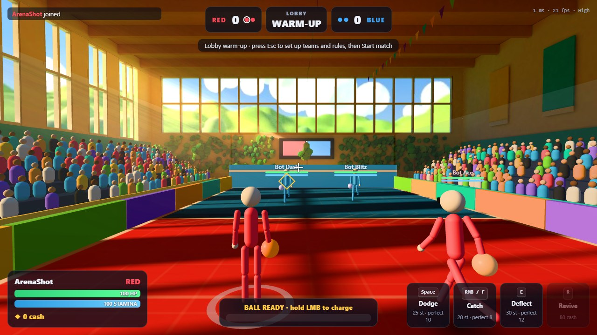
  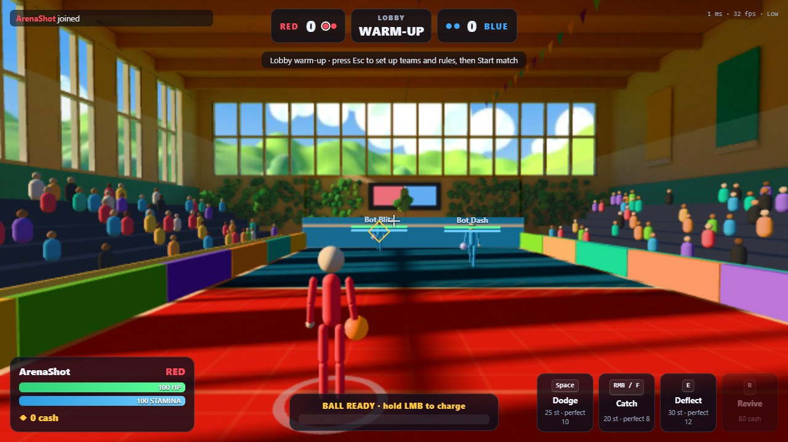

- **Baked in Blender** (`art/arena.py`, background, Cycles on the graphics card, about 3½ minutes):
  - the sun's window stripes and the sky and bounce light, into three lightmaps: the floor's, the hall's and the leaves' (hundreds of tiny leaf islands crowded the walls out of one shared map, so they have their own);
  - the outside, rendered all the way round from the middle of the hall, as the game's background;
  - the hall exported as glTF: two meshes (the hall and its leaves) in flat colours, with one UV map each.
  - So the laptops draw the hall with no lighting at all: a colour times a texture, per pixel.
- **Made by the game, because they follow the court's size:**
  - **the floor:** a canvas of honey wooden boards with the court painted on it (the halves in satin team paint, the lines, the 1 m grid, the no-go strip), drawn under the floor's baked light, so the paint gets the sun's stripes;
  - **the court's walls:** padded boards in the hall's palette along the sides, the team's colour at the ends with a white stripe, glass above;
  - **the stands and a crowd:** six rows along each long side, and a few hundred round fans in shirts of every colour, in two draw calls. They sway, and jump when a round ends or someone is knocked out;
  - **the sun's shafts:** soft glowing see-through prisms from each window pane to the floor;
  - **the light on the players and balls:** the same sun as the bake, and a hemisphere light (the sky above, the warm floor below).
- **A court too big for the hall** (a host's settings) makes the whole hall scale up, so the court and its stands always fit.
- **The plain court stays** until the hall has loaded, or if it can't load; `?noarena` asks for it (to compare frame rates).
- **Graphics levels:** Low draws a third of the crowd, standing still, and no shafts.
- **Cost:**
  - **Download:** 1.8 MB for the hall, plus 0.17 MB for three.js's glTF loader (vendored); the whole first download is now about 6 MB.
  - **Graphics memory:** about 70 MB of textures (the floor's canvas and lightmap, the hall's lightmap, the sky).
  - **Drawing:** about 130 draw calls and 100,000 triangles at High (the crowd most of them).
  - **In headless Chrome, which draws in software:** Low went from about 50 to about 30 frames a second; the crowd costs about 6 ms of that, the hall's surfaces covering the screen the rest. A graphics card draws flat textured surfaces cheaply, so real laptops are measured in step 10.
- **Tests:** `graphics.json` (no shader built mid-match: the hall's are built as it loads), `juice.json`, `sound.json`, the smoke test and the auto-defender pass. The auto-defender scored 15 of 15 with the hall and 12 of 13 without it (another run gave 7 of 13: it varies run to run).
- **The user's verdict** (the same day): "I checked and it was good", with one issue: backing up as far as you can, you're hidden behind the end wall and can't see your own character. Their fix: the wall turns see-through, with its border a little visible, when it blocks the view (decision 137).
  - Built: when the camera is behind your end wall, the wall and its white stripe fade to 15% with a faint white outline, and come back when you step away.
  - The same for the side boards (to 20%), and for a side's stands and crowd (to 15%), which block the view in the same way when you stand at a side wall and turn to face across: the camera then ends up in the stands.
  - Only the picture changes: the aim is worked out from where the camera would be anyway.

  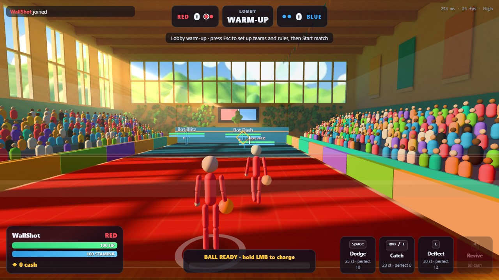

- **Tests:** `juice.json`'s new check backs into the end wall (the wall fades to 15%, its outline shows) and steps away (back to solid), then the same at a side (that side's boards, stands and crowd fade, the other side's don't). `graphics.json` and `juice.json` now wait for the hall to load before counting shaders: no shader built mid-match (30 before and after).

**Step 6: the ball and effects** (decision 138; built 2026-10-30; the numbers are in section 8):

- **The effects' shapes** (`fxtex.js`): drawn on small canvases when the game starts, so nothing more to download: a starburst, a soft shockwave ring, a four-point sparkle, a six-point flare, a dust puff and a crescent swipe, white on transparent, tinted and glowing additively.
  - The plan said "effect textures made in Blender"; flat shapes like these come out as well from a few lines of canvas drawing, and change without a bake.
- **Each moment's effect:**
  - **a hit:** a white starburst (bigger for a knockout) and a shockwave ring in the team's colour, with the specks;
  - **a catch:** the old ring or flash, and a gold six-point flare for someone else's perfect catch;
  - **a deflect:** a crescent swipe in cyan (gold if perfect), smaller for your own;
  - **a bounce:** off the floor, a puff of dust and a ripple lying on the floor; off a wall, a spark and a ripple on the wall;
  - **perfect plays:** sparkles (four-point stars, a second pool of specks) instead of round specks.
- **The ball:** grippy rubber (a normal map of small bumps) and a bright edge in its own colour where its surface turns away from you, so it stands out against the busy, colourful hall. A first, stronger edge washed the blue ball out to lavender; it's thinner now, and the team colour stays.

  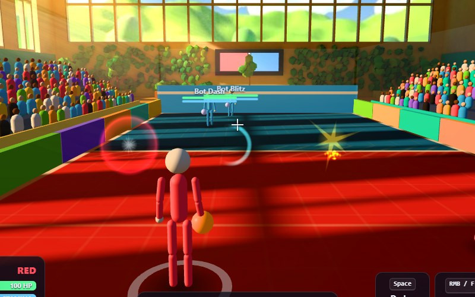
  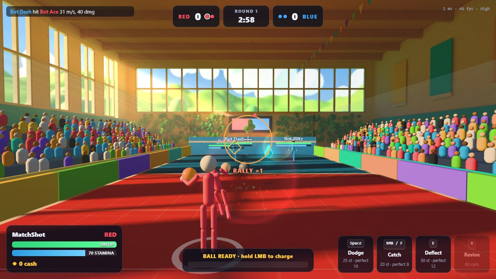

- **Long shadows from the low sun:** players and balls cast long, soft shadows away from the sun, only where its light reaches the floor (its window stripes). The bake now also saves where the sun falls (`floor_sun.jpg`), and the shadows' shader reads it. They are flat soft shapes on the floor, not shadow maps: almost free.
  - A figure's is a capsule as long as it's tall times 2.25 (the sun is 24° up), darkest at the feet; a ball's is an oval where the sun's ray through it meets the floor, softer the higher it flies.
  - At first they were too faint to see among the floor's own stripes (the debugging forced a solid black shape to prove it was there); they're as dark as the shade between the stripes now.

  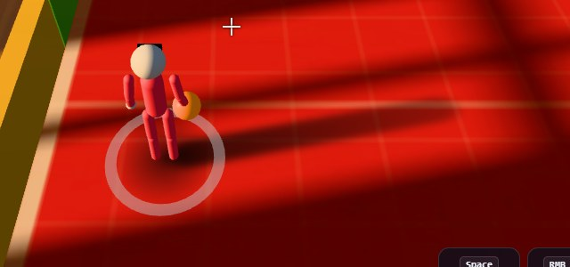

- **Tests:** `graphics.json` and `juice.json` (no shader built mid-match: 34 before and after, the new ones built in the warm-up), the smoke test. A match at High shows the effects and the balls' shadows.
- **The user:** "they are good for now". Committed.

**Step 7: the characters** (decision 139; built 2026-10-30; the numbers are in section 8):

- **The athlete** (`art/athlete.py`, about a minute in Blender): round 2's athlete, made light enough for laptops and given a skeleton.
  - **One surface for the body and its kit:** round 2's body wore its shirt, shorts and trims as layers. Here the shirt, shorts, socks and wristbands are joined to the skin where it shows. Nothing is hidden under the clothes, and nothing pokes through them when the body bends. The shirt hangs over the shorts with a white hem.
  - **Hands, shoes, the two heads and the eyes** are separate pieces, each following one bone.
  - **Trimmed** to about 6,600 triangles for the body (with hands and shoes) and 1,600–1,800 for a head; the Low version has about a third.
  - **Shaded with the sculpt's own normals** (from its shapes, at each vertex), so the light mesh shades smoothly instead of in facets.
- **Colours from maps of colour slots:** each pixel of a mesh's map says which slot it is (skin, lips, hair, eyes, team cloth, team bright, helmet, white, navy, sole, laces, visor), not which colour.
  - When a player joins, the game paints their own copy: their team's kit and one of the six looks (skin, hair, eyes) from the style samples. Players with the same team and look share it.
  - The maps are twice the texture's size, and each 2 × 2 is averaged, so borders come out smooth.
  - First tries, and why they changed:
    - painting whole faces of the light mesh: the trims' borders came out ragged;
    - the first maps: frayed edges on the collar. Projection squashed the hems' steps edge-on, and snapping each pixel onto the "true" surface jumped between the shirt's collar and the neck under it.
    - Now each island is flattened again with the least stretch, painted where the trimmed surface is, and packed tighter (52% of the map used, from 33%).
- **The two versions** (decision 128): a sports helmet with a visor, or a face with hair. Each player gets one, and a look, from their id: picked once when they join, and the same on every screen without anything new on the network.
- **The skeleton follows the stick figure:** the stick figure still makes every pose (its joints), and each frame the athlete's bones take the same turns (retargeting). Its arms and legs are straightened at rest to hang like the stick figure's.
  - The hips go down with the stick figure's crouch, but are lifted if a foot would go through the floor (the stick figure's dodge put its feet 9 cm under it).
  - Real animation is step 8.
- **The ball in hand:** held against the right palm, at any ball size. Carrying it, the right elbow bends so the ball is in front of the hip, not in it.
- **A faint cool light on the edges** (where the body turns away from you): the athletes stand out from the warm, busy hall, and the visor gets a glossy rim.
- **What it costs:**
  - two draw calls a player: the body and the head;
  - one shader for every athlete;
  - each look's textures about 2 MB of graphics memory;
  - about 0.8 MB more to download;
  - in headless Chrome, which draws in software, a match at Low runs at 24–26 frames a second with the athletes and 26–27 with the stick figures (`?noathlete`), two runs each.
  - Low graphics draw the light meshes. Until the athlete has loaded (or with `?noathlete`), the stick figures show.

  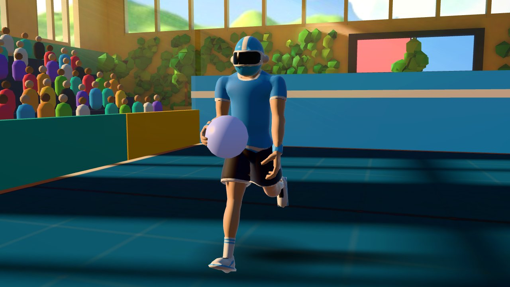
  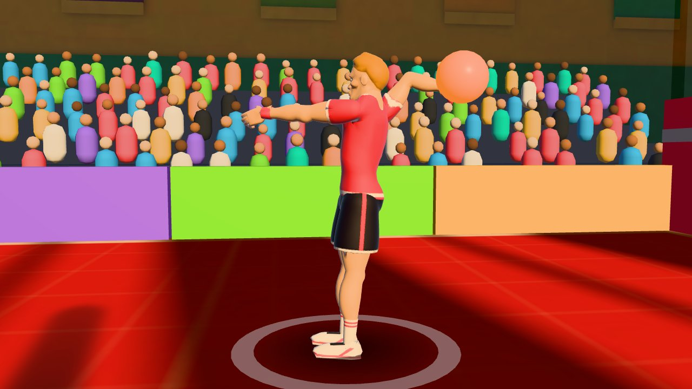
  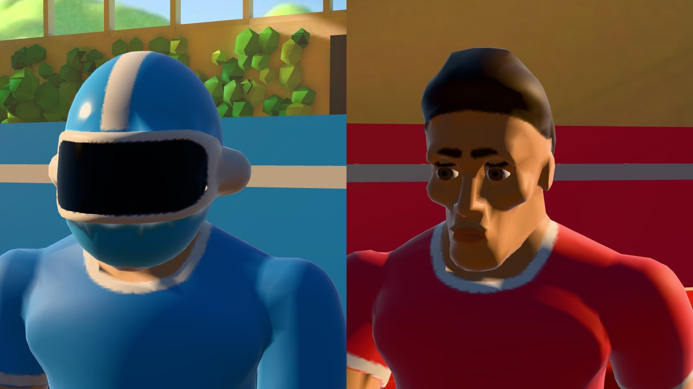

- **Tests:** the new `athletes.json` checks that:
  - everyone is dressed, with both versions among 4 players;
  - each player draws two meshes, and Low swaps them;
  - the athletes' hands stay within 10 cm of the stick figures' and no ankle goes under the floor, in the wind-up, a dodge, a catch and a deflect;
  - no shader is built (37 throughout).

  It also takes close-up pictures. Re-run and passing: `graphics.json`, `juice.json`, the smoke test.
- **The user:** "they are fine". Committed.

**Step 8: the athletes' moves** (decisions 140 and 141; built 2026-10-31 and redone the same day after the user played it; the numbers are in section 8). The user: the step that matters most to them.

- **The clips:** 17 clips of real motion, retargeted onto the athlete's skeleton in Blender (`art/moves.py`, run by `art/athlete.py`):
  - The source is Mesh2Motion's human animation library: 178 CC0 clips, Quaternius's Universal Animation Library among them, plus the author's own clips and motion capture.
  - `art/moves.py` downloads it once (from GitHub; data only, read by Blender's glTF importer).
  - The chosen clips: idle, a boxer's guard, jog, sprint, an overhead throw, a backflip, a mid-air pose, two flinches, three knockouts, getting up, two victories, cheering and kneeling.
  - Their walking strafes and backwards walk were too slow for the game's 6 m/s; the runs cover every direction instead.
- **Retargeting:** each of our bones follows one of theirs:
  - its turn away from its rest pose is applied to ours, after our rest is turned to point the way theirs does;
  - the hips follow their pelvis, scaled by the hip heights;
  - clips that travel are kept in place, since the game moves the player itself;
  - Blender also measures what the game needs: each run's stride and footfall, when the backflip takes off and lands, and the throw's cocked arm and release.
- **Made here:** what no library has is placed by hand: where the hands and feet go over the move, in the body's frame, and the arms and legs bend to reach it (two-bone IK). That's the dodges' footwork, the side-arm and underarm throws, the left arm's guard, parry and catch, and carrying the ball.
- **In the game** (`athlete.js`): the layers, every frame:
  - **Running and standing:**
    - The jog and the sprint follow the player's speed, their cycle advancing with the distance run, so the feet keep pace.
    - The legs turn towards where the player goes (up to 75° from the aim) while the chest and head keep facing the aim. Moving backwards, the run plays in reverse: a backpedal.
    - Standing, a boxer's guard during play, a relaxed idle in the lobby and between rounds.
  - **The throw:** one of three styles at random, each throw:
    - overhead: the clip, wound up with the charge to its cocked arm and released into its follow-through;
    - side-arm: the hand at the stomach's height, further out to the right as the charge grows, the chest turning away; released in a sweep across the front;
    - underarm, like bowling: the hand down and back below the waist, the body bent forward; released in a low swing forward.
  - **The left arm:**
    - while charging, the forearm across in front of the face, hiding it;
    - a deflect is a backhand parry like Dark Souls': the forearm across the chest, then swinging out to the left like a door on its hinge, the back of the hand leading and the chest unwinding with it. Mid-charge, the right arm stays up a moment, as the game cancels the charge;
    - a catch is a palm blast: the arm straight out at the shoulder's height, the palm turned forward (from the guard, the hand turns over) and the left shoulder forward;
    - a caught ball shows in the left palm for 0.35 s while the hand pulls it in and the right hand comes to take it.
  - **Carrying the ball:** the right hand holds it in front of the right hip.
  - **Dodges**, by the dash's direction, as the user described them:
    - to a side: the near foot lifts a little while the far foot pushes the body across, the upper body tilted forward and down; at the end the near foot comes down and takes the weight;
    - forwards: a half crouch and one big step;
    - backwards: a jump back, still facing forward;
    - every dash leaves a faint trail of afterimages (the "ghost dash");
    - the dash itself takes the rules' dash time, the landing the rest of the dodge.
  - **Perfect dodges:** one of the user's three acrobatics, picked from the player and the moment (every screen shows the same one), with afterimages; going backwards, a backflip (the user's addition):
    - a corkscrew: the backflip, lower, with a full twist;
    - an aerial side flip: the body turning over sideways towards the dodge;
    - a butterfly twist: leaning flat and spinning round.
    - These aren't in any CC0 library, so they're built from its jumps plus whole-body turns.
  - **Hits:** a flinch after the impact freeze.
  - **Knockouts:** three falls, harder the faster the ball came, the body turned to fall away from the thrower; then lying on the floor until it fades.
  - **Revives:** getting up from the floor.
  - **A round's end:** the winners celebrate (a jump, a fist pump or cheering), the losers kneel.
  - **Timing:** every action is stretched to the host's timings (the rules: the dash, each action's window and recovery, the charge), and plays to its end on the figure's own clock. The game's own stops early: it ends a catch or deflect the moment it meets the ball, and shows your own press for 0.4 s. Other players' timers come in steps, with the updates.
- **The user's first verdict** ("it needs serious edits"), and what changed:
  1. Strafing right, the legs ran left: the legs' turn had the wrong sign.
  2. The forward dash flicked the right hand: the right arm copied the stick figure's, with its old swat and catch poses. It now holds the ball in its own pose, and the dash clip gave way to the user's footwork.
  3. The deflect looked like a punch (a hook clip, with the right hand): now the left hand's backhand parry.
  4. Three throws at random, the left forearm guarding the face while charging, the parry mid-charge, the catch turning the hand over: as above.
  5. The catch: the palm blast.
  6. The dashes' footwork as described, and the backflip going backwards.
  - The backpedal looked natural to the user: unchanged.
- **The shorts** (`art/athlete.py`): round 2's shorts were one piece between the legs (its legs touch), so the side steps' spread legs stretched them into a skirt. A 1.6 cm inseam now parts them below the crotch, and below the hip joints they follow the thighs. Standing, they look as before, with a small notch at the hem.
- **Not done as planned:** knockouts by physics (ragdolls). The knockout clips look good and never misbehave, so ragdolls are left for later, if the user wants them.
- **Fixed along the way:**
  - The bake once left later clips floating 0.6 m up: some clips move Blender's armature object itself, which carried over to the next clip. The retargeting now works in each skeleton's own space.
  - The sprint's stride first measured 0.5 m: its foot sticks to the floor for a few frames, then catches up. Each footfall's whole contact is measured now.
  - Lowering the hips in the underarm throw and the parry only lifted the hands: the rule that keeps feet out of the floor lifted the whole body back up. Only the dashes, whose legs bend to reach the floor, lower the hips.
  - The dashes crouched from the rest pose, which stands straight-legged, so they stood 4 cm too tall: they crouch from the guard's stance now.

  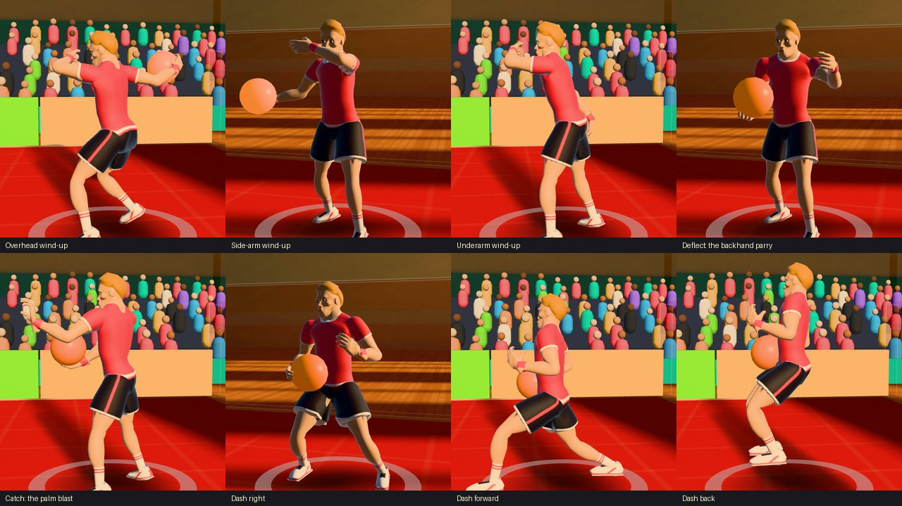
  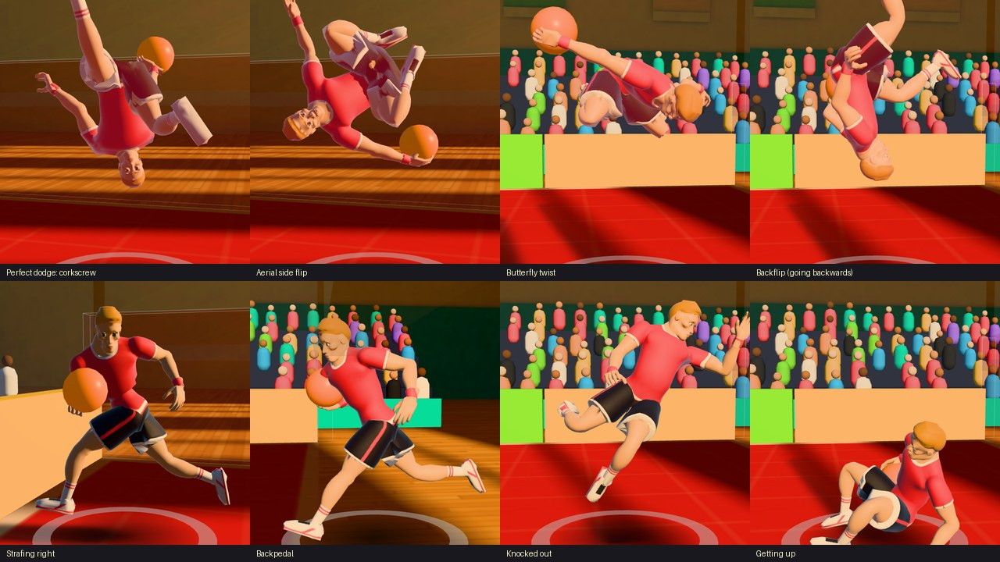

- **What it costs:**
  - the clips are about 380 KB of the athlete's 1.12 MB;
  - each player's pose is a few dozen quaternion blends and a few limbs reached a frame, with no new shader. The graphics test's match ran 8 dodges (2 perfect), 9 catches and 7 deflects with 37 shaders before and after, at 23 frames a second in software (as before).
- **Tests:**
  - `moves.json` holds your player in every move, at an exact moment, and takes pictures. Its numbers check each one:
    - strafing right and left, the hips turn +1.29 and −1.31 rad (towards the movement);
    - the side-arm wind-up's hand is 0.62 m out at 1.09 m;
    - the parry is 0.42 m out to the left at its peak, and the catch 0.6 m out at 1.34 m;
    - the right dash's right foot is 9 cm up and its left 0.37 m out;
    - the forward dash's step is 0.56 m, with the hips 16 cm down;
    - lying, the hips are 0.24 m up; kneeling, 0.49 m.
  - Re-run and passing: `athletes.json`, `graphics.json`, `juice.json`, `sound.json`, the smoke test.
- **The user's second test** (2026-11-01): "some things that were fixed got broke, few things got fixed and some are still faulty":
  - the perfect dodges: "nothing is happening with the character until last frame of animation and then only some movement from the after image is visible";
  - the legs are still wrong holding only left or right;
  - after a knockout, getting up (revived, or at a round's start), the player can move left and right while the body lies flat;
  - "there are other things too".
- **The approach from here** (decision 142): the user found fixing everything at once from descriptions inefficient (it broke what worked), and suspects that making animation through Blender is hard for Claude.
  - **One animation at a time:** `docs/ANIMATIONS.md` lists every move and every change from one into another, what it should look like, and the tester's notes. The user tries one, says what differs, Claude fixes that one only, and once approved it's locked.
  - **If prompting doesn't work** for a move, the user may make or fix it themselves: in Blender (Claude teaching the basics), in a free tool, or in a small web tool Claude makes. Claude recommends the web tool, starting with a viewer for every move (looping, slow motion, frame by frame), then an editor for the moves made here. The options are weighed at the end of `docs/ANIMATIONS.md`.
  - Claude's likely causes for the three reported problems are also there: the dash's footwork covering the perfect dodges (a regression from the redo), a dead band in the switch between running and backpedalling that holds pure sideways moves, and the game letting a revived player move during the 1.1 s get-up.
- **Fixed after the second test** (2026-11-01; approved on 2026-11-03):
  - **The perfect dodges:** the dash's footwork now comes first and the acrobatics over it.
  - **Strafing:** the backpedal starts past 103° from the aim and stops under 97° (was 77°), so pure sideways always runs forwards, even after backing up.
  - **Getting up:** moving while getting up cuts the get-up short (it gives way to running over 0.15 s), and the figure no longer takes the server placing a player (a round's start) for running.
  - The moves test checks all three: a corkscrew in the middle of a dash (in the air, the hips 1.48 m up), a strafe right after a backpedal (the hips turned +1.28 rad, running forwards), walking during a get-up (up and running, the hips 0.89 m up).
- **The user's third test** (2026-11-03): the three fixes are good, and the user is happy with the moves for now.
  - Strafing (A6, A7, A11), the perfect dodges (F1 to F5, J8) and getting up (H1, H2, J11) are **Locked**.
  - The moves test now enforces locks: `__lock(name)` compares each locked move's key numbers with what was approved (within a tolerance) and prints `FAIL locked move ...` if one changed, and `cdp.js` exits with 1 on any `FAIL` line, in every browser test.
  - Committed as a checkpoint of step 8.
- **On hold, not finished** (decision 143): the office logs and a batch of lobby requests come first. When the moves resume, the first job is the animation tool (the web tool: a viewer, then an editor), then the rest of `docs/ANIMATIONS.md`, one move at a time.

**Where the plan ended** (`docs/LOOK_AND_FEEL.md`):

1. Style samples (done: the sports hall; athletes with and without the helmet, picked at random).
2. The performance items (done: D1, D2, B4, effects prepared in the lobby, the host's lower setting).
3. Juice (done) and sound (the user's verdict: the dodge redone, voices, breathing and revive sounds added, the match music lower).
4. The arena, the ball and effects, the characters (done), their moves (on hold since 2026-11-03, not finished: the animation tool comes first when they resume, decision 143; `docs/ANIMATIONS.md`; the step that matters most to the user), then the HUD (not started). Both moved to `main`'s task list (section 15).
5. An office session (done: 1 and 2 Nov, phase 16).
6. The merge into `main` (done: 2026-11-03, v2.3.0, phase 16).

### Phase 16: the office logs, and the lobby batch (2026-11-03)

On the branch `look-and-feel`, just before its merge into `main`. The animations (step 8) went on hold first, not finished (decision 143).

**The office logs.** Three sessions on 31 Oct ran `main` (stick figures); two days, 1 and 2 Nov, ran this branch (the hall, the athletes and their moves).

- **The error in the server's window** (31 Oct, also seen in step 4 and never caught then): `ConnectionResetError: [WinError 10054]` in asyncio's `_ProactorBasePipeTransport._call_connection_lost`, printed when the host closed their tab after downloading the logs.
  - Windows' asyncio closing a socket the browser had already cut. Harmless: nobody was affected and the session log shows no freeze.
  - Fixed: the server's loop has its own error handler. A dropped connection is only noted in the session log; any other error is printed as before and noted too, and so are errors in the game loop and in a player's message. The report lists them under SERVER.
- **What else the 31 Oct logs showed:**
  - The host's saved rules had sidestep compensation off and the lockout at 0. With it off, each player was hit 27–79 times a session while their own screen showed them already clear, by up to 1.95 m. That's the setting doing what it says; the user was told what each Network setting does (with a story) and advised to switch it back on unless that was deliberate.
  - Two people with the same name played at once, and both played by the own settings the host had given one of them: this phase's request (b).
  - One Linux laptop's connection dropped 83 world updates; otherwise the same Wi-Fi delays as in `LAG_ANALYSIS.md`.
- **Step 10's questions, on real laptops** (the look-and-feel build), frame rates during play (60 is the screens' limit):

  | Graphics chip | `main` (stick figures) | the look-and-feel build |
  | --- | --- | --- |
  | AMD Radeon 780M | 60 | 60 at High |
  | Intel UHD 630 (Windows and Linux) | 60 | 60–72 at High |
  | Intel UHD 620 (Linux), HD 530 | 60 | 60 at Medium |
  | Intel UHD (Comet Lake), a 4-core HD 530 | 60 | 60 at Low (about 55 at Medium) |
  | The host's laptop (Intel UHD, Alder Lake) | 102 | 78 at Medium |
  | Intel HD 4600 (2013, Linux, 4 cores) | 60 | 28 at High |

  - Every laptop but one still reached 60, the older Intel chips at Medium or Low. The game's own code per frame went from about 2–3.5 ms to 3.5–6 ms (of the 16.7 ms a frame has at 60), so the graphics chip carries the new cost, which is what the levels are for.
  - **Auto failed the HD 4600 laptop:** it tried Medium for 3 s, judged it no better (34 → 27 fps, a noisy measurement: over the session Medium did 39 against 30), went back to High and stopped trying. That player spent 22 minutes at 28 fps and never got Low; the next day they picked Medium themselves.
  - **Auto see-sawed on borderline laptops:** it tried High again after 20 smooth seconds, twice a session, mostly mid-round (16 of its 27 step-downs happened during play), each failed try costing 3–5 s at 30–45 fps.
  - **Loading:** every long stutter (0.3–1 s) came within 3 s of a browser opening the game (building the athletes and the hall), never mid-match, and nobody stuttered when someone else joined. How long the download took wasn't measured: a browser's log starts after the page has loaded.
  - **Fine everywhere:** all 43 sounds loaded on every browser (no download manager trouble); every browser drew with its graphics card; no press was held late by a busy page; the server ran at 10–15% CPU with no stall during play.
  - **The host's memory** reached 97% (0.3 GB free) on 2 Nov, with one 0.4 s stall at the server's start: close big programs, such as Blender, before hosting.
  - **Not bugs:** a player with 795 presses that did nothing was mashing dodge and clicking throw during the dodge's recovery (that day had the default lockout); two Linux laptops' 2–3 s freezes on 1 Nov were their own Wi-Fi (no one joined, the server was fine); two 0.3 s freezes for five players on 2 Nov, 60 s apart, were the host's Wi-Fi (the server was on time, and its Wi-Fi poll runs at other moments).
- **Fixed from them** (decision 150):
  - **Auto:** a step down that doesn't help is followed by one more (Low halves the sharpness); only if even that doesn't help does Auto go back and stop. A step is judged over 5 s, not 3. A level Auto had to leave after stepping up isn't tried again, and it steps up only between rounds.
  - **The browser log records loading:** a `load` line with the seconds from opening the page to the hall and the athletes in place, the megabytes that came over the network (the browser's cache weighs nothing), and the slowest file. The report has a LOADING section, and calls out a load over 15 s.

**The lobby batch** (the user's requests, before the merge):

- **(a) Names up to 32 characters** (were 16; decision 144). The HUD's name, the scoreboard and the team lists cut long names with an ellipsis.
- **(b) Players are known by who they are, not their name** (decision 145). Names never have to be unique.
  - Each browser keeps a secret code (`localStorage`). The server turns it into a public key (`rules.identity_key`: the first 10 hex digits of its SHA-256), and own settings, the team a player comes back to and the server's labels go by that key.
  - Nobody gets someone's settings by taking their name, and the key is all the others ever see.
  - A second tab of the same browser playing at the same time gets a code of its own (testing alone with tabs). The same tab connecting again (a reload, or back after Wi-Fi dropped, while the old connection may still look alive) takes over from its old connection.
  - Own settings saved by name (older `saved_rules.json` and files) wait under that name (`n:Name`) and go to the first person who joins with it. A built-in bot's name ("Bot Ace") is that bot (`b:ace`).
  - Two players with the same name get a small #1 and #2 in the lobby, in the order they joined.
  - Files: version 2, own settings by key with the names they were last seen with (`labels`); version 1 files still load.
- **Renaming** (decision 146): the user chose one way of the four offered: a name box under Your settings. Type a name and press Enter (or Change): it applies at once, even mid-match. Team, score and own settings stay, the others' feed says "X is now Y", and a reload rejoins under the new name.
- **(c) Exporting and importing one player's own settings** already existed (each ⚙ page: Export, and the host's Import…). The user hadn't found it (decision 147). Its buttons now sit under "Their settings as a file:" at normal size, and the lobby's note under the teams mentions it.
- **(d) The rules search across every tab** (decision 148): it already listed matches from every tab, but the old tab stayed highlighted and only the exact phrase matched.
  - Now each word may be anywhere: a rule's name, description, heading or tab, so "network" lists the whole Network tab and "dash time" finds the dodge's dash time.
  - "Every tab" heads the list with the number of matches, each tab shows its own count (and greys out with none), a click on a tab jumps to its matches, and the words are marked.
- **(e) Bots with flags** (decision 149; the user chose a roster of named bots):
  - **Flags** are named bundles of behaviour: any rule a bot may have its own value for (health, speed, throws, defences...), plus its skill numbers, given once and applied at whatever skill the bot plays (they're stored as the normal profile's). A bot can carry several, later ones winning where they overlap, and its own settings win over all of them.
  - Eight come with a new setup: Dodge master, Berserker, Sniper, Catcher, Parry king, Trickster, Rookie and Tank. The host can change, add and delete flags.
  - **New bot numbers**, so flags can say more (per skill, like the others): the weakest and strongest throw (Berserker: always full power), where it stands (−1 at the back to 1 at the centre line), and how often it walks out of a slow ball's way. Their defaults are the old fixed behaviour.
  - **The host's own bots:** "Bots & flags…" in the lobby. Make a bot with a name (and a team), give any bot flags, rename or delete the host's own bots. Each bot keeps its name, flags and own settings wherever it plays.
  - **On teams:** each team's "Add a bot…" puts one of the host's own bots on it, ⇄ moves a bot to the other team, ✕ takes it off, and − / + still fill with the built-in bots (Ace, Comet... for RED; Blitz, Dash... for BLUE).
  - **Saved** with the setup in `saved_rules.json` and settings files (`bots`: the roster, the flags and each team's lineup). Changes apply like rules: at once in the lobby, from the next round in a match.
- **Tests:**
  - Rule tests: 74 (5 new: the same name kept apart, settings saved by name claimed by the first person with it, renaming, the host's bots with flags on teams, counts and files).
  - Server tests: 9 (2 new: who a player is over real connections, with a second tab, a reconnecting tab and a rename; a dropped connection only noted).
  - New browser test `people_bots.json`: a twin with the same name (#1 and #2, settings for one only), renaming (the HUD follows), the search, Alex made and flagged through the bots page, its ⚙ page showing its flags' values, a flag edited in the editor, and Alex moved, taken off and added back.
  - Re-run and passing: `own_settings.json`, the lobby tests (one and two browsers), `graphics.json` (Auto's new rules), `logs.json`, the smoke test, and `moves.json` (the locks hold).

**The merge into `main`, and v2.3.0** (the same day; decisions 151 and 152). The user hadn't tested the lobby batch yet: "merge this with the master branch… commit and push… create a release following the publishing standards… I will test the changes when I have the time."

- **The merge:** `main` hadn't moved since the branch began, so it was a fast-forward: `main` now holds the branch's commits as they are. The one docs commit `main` had locally (this phase's short version) went up with it.
- **Before it** (the user's publishing standard, `github-publishing.md`):
  - **A privacy scan** of every file of every commit about to be pushed, and of the commits' authors: all GitHub's noreply address. It found one problem, in this phase's own work: a new rule test used a real office player's first name; it's "Robin" now.
  - **Every image looked at:** the hall's, the athletes', the moves' and the effects' pictures and the Blender renders show only made-up names (ArenaShot, Robin, Sam, the bots) and the game itself. Their metadata holds Blender's render notes (`<untitled>` for the file, dates, camera and scene names) and no paths.
  - **The README:** new pictures (the hall in play, the new lobby) in place of the stick figures, and its text brought up to date. `SECURITY.md` says what the browser's code is and isn't.
  - **Tested from a fresh clone** of the branch, with the locked dependencies, on the oldest and the newest Python the game claims (3.10 and 3.14): the rule and server tests pass.
- **The version, 2.3.0 (minor;** decision 151): new features, and nothing hosts or players relied on stops working. Settings saved by v2.2.0 still load: own settings saved by name go to the first person with that name, and the bot counts still pick the same built-in bots. The look of the game changed completely, but how it's played and hosted didn't.
- **The worktree folder goes** at the user's word once `main` is pushed; its git-ignored contents worth keeping move to the main folder first (git-ignored there too): the office logs into `testlog/`, the Blender output into `art/out/`.
- **The release checksum:** the `.sha256` file is now written with a Unix line ending, so `sha256sum -c` accepts it (v2.2.0's CRLF made it fail; reported then).

## 5. Decision log

**U** = the user decided. **C** = Claude decided; reasonable to revisit, but say so first. Don't silently change a **U** decision.

| # | Decision | By | Why / notes |
| --- | --- | --- | --- |
| 1 | Python server + browser clients over WebSockets on the LAN | U | Original idea |
| 2 | 3D, over-the-shoulder Fortnite-like camera, stick figures | U | Second message of the original idea conversation |
| 3 | Free aim + light aim assist (10° cone, 45°/s bending at full power) | U | Chosen over lock-on and pure straight throws. Slower balls bend less: #43 |
| 4 | Deflect = its own key with a tighter window than catch; instantly returns the ball faster | U | Chosen over catch-then-quick-throw |
| 5 | ~~Bots fill teams~~ | U | Needed for solo testing. Superseded by #47 (the user's own request): the host sets each team's bots |
| 6 | Desktop/laptop only; multi-tab self-testing must work | U | Phones deferred |
| 7 | Light gravity arcs on every throw, crosshair stays accurate | U | Chosen over straight throws |
| 8 | Ricochets off floor and walls, one per throw | U | Chosen over floor only |
| 9 | Charge → speed → damage must be strongly felt | U | Request 4 |
| 10 | Arena grows with players | U | Request 5 |
| 11 | Perfect dodge = 360° spin with afterimages; deflects get distinct colors and lingering trails | U | Requests 1–2 |
| 12 | Catching puts the ball in your hand (throw immediately) | C | Natural dodgeball rule; rewards catching |
| 13 | Teams stay on their half (center line with 1 m gap each side) | C | Real dodgeball; prevents point-blank throws |
| 14 | Rounds: wipe the other team; 3-minute cap (more players standing wins, then total HP); score = rounds won | C | ChatGPT had none |
| 15 | Cash is personal, resets each round; R revives the longest-down teammate; revive cost escalates per team per round | C | Flat cost made rounds endless (measured). Shared team cash is an option (#48); carry-over too (#49) |
| 16 | Afterimage rule: a ball reaching your dodge's start point counts as dodged | C | Clean dodges weren't credited |
| 17 | End walls stop balls; only floor and side walls ricochet | C | Back-wall ricochets hit defenders from behind (measured) |
| 18 | Aiming at a floor/wall point short of an enemy disables the throw-time assist | C | Otherwise bank shots got "corrected" into straight throws |
| 19 | ~~Extra bots join mid-round~~; teams fill to max(fill, biggest human team) | C | Superseded by #27: during a match, every bot change now waits for the next round |
| 20 | Movement is simulated by each browser, clamped by the server | C | Instant response on LAN; fine among friends |
| 21 | Timing judged against the moment on the player's screen (lag compensation), capped at 0.25 s | C | Parries must feel fair on Wi-Fi |
| 22 | three.js bundled locally, no CDN | C | LAN parties may have no internet |
| 23 | All numbers in config.py | C | Easy balancing |
| 24 | Timing ring (toggle with H) | C | Readability of 3D ball timing; may be "too easy", so it's optional |
| 25 | Standalone app via PyInstaller onedir (not onefile) | C | Faster start, fewer antivirus false positives |
| 26 | A lobby before the match: the host sets it up and starts it; anyone can join any time; only the host changes settings, bots or teams | U | Cycle-2 request 2 |
| 27 | Changes made during a match (rules, bots, team moves) apply from the next round | U | Cycle-2 request 2 |
| 28 | The host can change every game-mechanic number; each has a name, a description and a preview of its effect | U | Cycle-2 request 3 |
| 29 | Host = a browser on the server's own computer, or the console's secret host link (`?host=KEY`); `?guest` opts a local tab out | C | No accounts or passwords; the user hosts from the PC running the app |
| 30 | Players no longer pick teams: a newcomer joins the team with fewer people, the host moves them; a reconnecting player gets their team back (by name) | C | "Give all the controls to the host". Nothing re-balances afterwards (#47) |
| 31 | In free play (lobby, or a match waiting for players) changes apply at once | C | No round is running; otherwise a stalled match (empty team) could never be fixed |
| 32 | Rule previews are animated 2D canvas diagrams using the game's formulas (default next to this lobby), not recorded videos or images | C | Recordings can't show arbitrary values; diagrams follow the slider live |
| 33 | "Rounds to win" match setting, default 0 = endless (v1 behaviour) | C | A lobby needs a way for matches to end; the default keeps v1 |
| 34 | The host's rules are saved next to the app and restored at start (`--fresh` skips it) | C | Tuning shouldn't be lost on a restart |
| 35 | A match's first countdown is 2 s longer; End match needs a second click | C | Time to click into the game; ending affects everyone |
| 36 | Network numbers (view delay, lag compensation, update rates) are host-editable under "Network (advanced)" | C | Lets parts of the lag plan be tried live in a session |
| 37 | No lag fixes in cycle 2, only the analysis | U | "Discuss first, then plan" |
| 38 | The server and every client write logs at the next test; the user collects them and sends them in | U | Measure before fixing |
| 39 | Browsers send their log to the server (one zip from the host), plus a "Save my log" copy; logging is on by default (`--no-log`, and `--fresh` turns it off for tests) | C | A web page can't write files on its own; collecting from every PC is error-prone |
| 40 | The L key marks "this felt laggy" in the log | C | Ties what people feel to the numbers |
| 41 | Keep the 30 newest log sessions | C | Bounded disk use with no maintenance |
| 42 | QuickEdit stays as it is (only measured, not fixed) | C | No lag fixes until the plan is agreed (#37) |
| 43 | The slower a ball, the less it curves: "Slow-ball curve" (`SLOW_BALL_CURVE`), per metre, default 0.5 | U | Cycle-2 follow-up request. The per-metre model and the 0.5 default are C; a full-power throw bends as before |
| 44 | A bounce takes curve away: "Curve kept after a bounce" (`RICOCHET_CURVE_KEEP`), default 0.5, replaces the 150°/s ricochet homing | U | "No bounce: more curve; wall and ground: less curve". Default C. Ricochets were 50–66% of all hits in the office logs |
| 45 | The host can spectate: free camera or following a player; at once in free play, otherwise from the next round | U | The camera controls and the "next round" timing are C (like team moves, #27) |
| 46 | Everyone sees the host's screen live, low fidelity: the screen, the rule in focus, the unapplied edits; "Follow the host" opens the same rules page (on by default, a guest can untick it) | U | Details C. Only the host's browser reports; the server checks every field |
| 47 | The host sets each team's bots freely (0–12 per team); nothing balances or divides players automatically | U | Replaces `BOT_FILL`. Newcomers still join the team with fewer people (C) |
| 48 | Optional shared team cash: one pot per team, anyone (bots too) revives from it; off by default | U | Switching it keeps the total: on pours personal cash in, off shares the pot out |
| 49 | Cash can carry over between rounds while revive prices start over each round | U | Already possible ("Cash resets each round" off); descriptions now say so. A new match starts everyone at 0 (C) |
| 50 | A press during the recovery after your own action says "Still recovering" and is logged | C | It used to be silent and felt like a lost key press; 8–11% of hits landed during such a lockout |
| 51 | Firewall: a helper `.bat` adds one rule (TCP 8000–8019, local subnet, any profile) and removes Windows' block rules for the game's program | C | The user turned the firewall off to let others in. Block rules beat allow rules, so both steps are needed |
| 52 | No UDP transport for now | C (recommendation) | Browsers can't use raw UDP; WebRTC/WebTransport are big projects; the measured freezes were radio gaps UDP can't fix. Open for discussion |
| 53 | The lag study's suggestions are settings, explained in player terms, under Network (advanced) | U | "Apply them, as options in the network setting with their own explanation" |
| 54 | View delay 0.10 s by default (was 0.08) | U | Fewer one-frame stops; everything on screen is 0.02 s older |
| 55 | Press grace 0.02 s by default, people only | U | Value C: one or two frames of drawing plus monitor delay |
| 56 | Sidestep compensation on by default | U | Mechanism C: judged at the pending check from the player's reported positions; the ball then flies on from where it would be; the nearby-ball display shift is off while it's on |
| 57 | The lockout after a missed press is a setting (0–1.5×, default 1×); at 0 a new press takes over the active one | U | "Maybe I want to test with 0 lockout time". A short lockout never cuts the window itself (C) |
| 58 | Hits log the on-screen gap; sidesteps and graced defences are logged and reported | U | The fifth suggestion: measure what the fairness settings do |
| 59 | A browser re-anchors its clock estimate when every update of 1.5 s arrived over 40 ms late | C | A laptop whose clock ran fast saw a frozen picture for ~5 minutes (28 Oct log). Logged as `clock` |
| 60 | Publish as a public GitHub repository under the MIT licence | U | Following the user's publishing standard; MIT was the recommendation |
| 61 | Commits use GitHub's noreply address, and the published history was rebuilt without personal data | U | The old commits carried a personal email, the docs a local path and coworkers' names. How the history was rebuilt: C |
| 62 | The idea transcript (`Chat.md`) and ChatGPT's first attempt are left out of the published history, then deleted from disk | U | "Drop both", then "delete the folder of the failed prototype altogether, and Chat.md" |
| 63 | The clean history goes to a new repository, `dodgeball`; the user deletes the old private `dodge-and-parry` themselves, and every local backup of the old history is deleted | U | A new repository: C (force-pushing over the old one would leave the old commits reachable by id and in its Activity view). "Leave the old repo, I delete it myself", then "delete every backup of old history": U |
| 64 | Windows release builds are made by GitHub Actions from the tag, with a SHA-256 checksum | C | Anyone can see what the app was built from; no local paths end up in the build |
| 65 | `requirements.txt` is a lockfile (uv, every OS, Python 3.10+) generated from `requirements.in`; PyInstaller is pinned too | C | A fresh clone installs exactly what CI tested |
| 66 | CI runs the Python tests on Windows, macOS and Linux with Python 3.10–3.14, and a headless-Chrome match on Linux | C | The README says the game runs from source on all three; CI proves it |
| 67 | Cycle 2 is version 2.0.0 (major) | C | Hosts use it differently (the host starts matches; players no longer pick teams or add bots), and a saved "team size with bots" no longer applies |
| 68 | The project is called **Dodgeball** (it was Dodge & Parry): the title, the app and zip names, the log downloads, the firewall rule, the repository | U | "The name of the project is Dodgeball; rename it anywhere that is needed". Internal names (`dp.settings`, `window.dp`) stay, so saved settings survive (C) |
| 69 | The game's files live at the repository root (no `prototype/` folder); its manual is `docs/MANUAL.md` | U | "Bring out the content of the prototype folder into the root". The manual's new place: C |
| 70 | The firewall helper treats the old "Dodge & Parry" rule as its own | C | Running it again (or `undo`) on a PC that ran the old helper replaces that rule instead of leaving it behind |
| 71 | At startup the server waits at most 2 s for the lookup of the computer's own name before printing the join addresses; the 15 s watcher adds late ones | C | On macOS the lookup can stall: CI's first macOS run timed out waiting for the console's host link |
| 72 | A hit says why it got through: "TOO EARLY (x s)" when the player's last press, which met no ball, had ended up to 0.5 s before the ball came; "SECOND BALL" when they had stopped another ball up to 0.5 s before | U | Option A, chosen over a deflect that covers its whole window. The 0.5 s limits and the wording: C. Labels only: who gets hit is unchanged |
| 73 | This is version 2.1.0 (minor) | C | It adds something players see, and nothing they rely on changes |
| 74 | Each team's balls have their own colour, in two shades: people's, and a paler one for bots'; deflected balls keep the rally colours | U | Request 1 of phase 11. The ball in a player's hand shows it too (C) |
| 75 | Default ball colours: RED orange `#ff8a2a` / peach `#ffc48f`, BLUE royal blue `#4f6dff` / periwinkle `#aab8ff`, clear of the rally colours | U | Chosen over the exact team colours, which clash with the 3× (red) and 1× (cyan) rally colours |
| 76 | The four colours are lobby rules; a player may have their own (the one for their team, people or bots) | U | "All new values customizable in the lobby". Own colours: C |
| 77 | Team health: an on/off rule; one bar per team, every hit drains it, nobody falls alone, an empty bar takes the whole team down; cash buys health with R (no revives while it's on) | U | Request 2. Off by default and R as the key: C |
| 78 | The bar's size is a host setting: everyone's health added up (default) or a fixed size (300) | U | "Both kinds, the host decides, the recommended one as the default". 300: C |
| 79 | What R buys is a host setting: a pack at a rising price (default: +50 for 80, +40 per pack, per team per round) or all your cash at a rate | U | Same answer. The numbers: C, the same as revives |
| 80 | All your cash buys 0.5 health per cash by default | C | Measured: at 1, every 3v3 bot round ran to the 3-minute limit; at 0.5 about 90 s, like without team health |
| 81 | Team health details: joining brings your share, leaving takes your share of what's left; the time limit goes to the larger share of the bar left; a fallen warm-up team stands up with a full bar; the knockout bonus is paid once, each fallen member counts as a knockout and an out; bots buy too | C | Leaving must never heal a team (found while writing the tests) |
| 82 | Each player (or bot) can have their own settings | U | Request 3 |
| 83 | What may differ per player: everything about that one player (health, stamina, movement, throwing, their throws' damage, aim assist, defences, the cash they earn, how a revive treats them, ball colour; network fairness for people; skill and its numbers for bots). Body and ball sizes, the court, flight, ricochets, rounds, revive prices and team-wide switches stay shared | C | Every other screen draws and aims at bodies and balls. Open to change |
| 84 | Own settings apply like any rule (at once in free play, next round in a match); a value equal to everyone's is no own setting; they go by name; everyone can see them (a tag, a read-only page, the host's page followed live) | C | Consistent with #27 and #46 |
| 85 | Bots are named by their team slot (RED: Ace, Comet...; BLUE: Blitz, Dash...), and fewer bots takes the last slots away first | C | So a bot's own settings stay with the same bot across count changes, restarts and files |
| 86 | Settings files: the whole setup (every rule and everyone's own settings), plus one-player files (profiles) | U | Request 4: "Whole setup + one-player files" |
| 87 | Anyone may export, only the host imports; an import replaces the whole setup (rules left out go back to their defaults); old `saved_rules.json` files load too; reset clears own settings too; at most 64 players with own settings | C | Replace, so a file reproduces a setup exactly |
| 88 | `saved_rules.json` keeps the changed rules plus players' own settings; exported files carry every value | C | A saved file picks up improved defaults after an update; an export reproduces a setup exactly |
| 89 | Round time gets quick − / + buttons in the lobby (it already was a rule) | U | "Is the round time configurable in the lobby? If not, add it". The steps: C |
| 90 | Health regeneration: x per second up to a limit, the limit a share of full health or a fixed amount (the host picks; default a share), every value a lobby rule, for players' health and for the team bar | U | "x amount over time up to y or z%, configurable, for both player health and team health" |
| 91 | Regeneration waits for a pause after the last hit (every hit restarts it; 0 = none), only fills up to the limit and never takes health away; the team bar has its own settings (its pause restarts on a hit on anyone on the team); both off by default; players' regeneration can be a player's own setting | C | The pause keeps it from stretching rounds (measured); separate team settings because a bar's size differs from one player's |
| 92 | Defaults: players 2 HP/s after 4 s up to 50%; the team bar 5 HP/s after 4 s up to 50% (or 50 / 150 HP as amounts) | C | Bot rounds 94 → 114 s (players), 64 → 94 s (team bar) |
| 93 | The lobby's − / + buttons step from the latest rules at the click, not the menu's per-frame copy | C | A click right after a rules update stepped from an older value |
| 94 | Standing still for x seconds makes regeneration faster, or is needed for it (or doesn't matter): the host picks, for players' health and for the team bar; every value a rule | U | Phase 13 request. "Faster" by default (C) |
| 95 | "Faster" is either extra health per second or a percentage: the host picks, default extra | U | "Both, the host picks". The numbers (+4/s, +200%, +50% per teammate, 2 s): C |
| 96 | Each teammate standing still adds to the team bar's regeneration (the extra or the percentage, once per teammate); with "needed", the bar regenerates only while at least one stands | U | "Each player standing still adds to regenerations". The "at least one" reading: C |
| 97 | Standing still keeps the same regeneration limit | U | Chosen over its own limit |
| 98 | A dodge's dash doesn't count as walking, even with a direction held, as long as the key is let go before the dash ends; walking on after it does | U | The request's own rule. Judged in the player's timeline, a report up to 0.06 s after the dash still counting as the dash (C) |
| 99 | Standing still = within 2 cm of where you stopped; turning, throwing and defending don't count | C | Measured from where you stopped, so slow creeping counts as moving |
| 100 | Hurt bots stand still to regenerate (a Bots rule, on by default; a bot can have its own) | U | "Yes, when hurt". How (stop wandering, no sidesteps, still defend and throw): C |
| 101 | Phases 11–13 are version 2.2.0 (minor) | C | They add features; settings saved by older versions still load, and nothing players rely on changes (bots' new names aside) |
| 102 | Playing over the internet: friends with a password, on a cloud server | U | Chosen over "anyone" (which would need cheat checks and a kick button) and over the user's own PC through a tunnel |
| 103–110 | Internet mode's own design: the host by password only, the limits, where it listens, logs per game night, the message size limit, refusals, the cloud setup | C | Recorded in this file on the branch `internet-mode` (phase 14) |
| 111 | Internet mode waits on its own branch, `internet-mode` (pushed, not merged), until the user's friend has tried it on a cloud server; it goes into main only when the user says so | U | "Commit to a separate branch dedicated for this feature… then if it's okay, I tell you to merge." The user isn't a developer; the friend is |
| 112 | The game should look and feel professionally made: better models, animation, physics visuals, sound and effects, "juicy". Both juice and good art, starting from the highest expectations, then scaled down to what's realistic | U | "Juicy and good visual and art. I want both (if possible I'm starting with highest expectations to make the realistic afterward)" |
| 113 | No money and no other people: the user, Claude and free tools. The user gives time: judging, testing, listening | U | Rules out paid assets and hired artists |
| 114 | Claude makes the art in Blender, connected through an MCP add-on (the community "MCP for Blender") | U | The user installed Blender and the add-on. How it's connected: C, on the branch |
| 115 | The style: vibrant, smooth, clean 3D. No pixel art or retro look, no blocky (Minecraft- or Roblox-shaped) humanoids, no dull colours | U | From pictures of other games: liked Slow Roads, Venge.io, Rocket League and Knockout City; not Krunker's characters, Shell Shockers, Vampire Survivors or CrossCode |
| 116 | This cycle includes the lag study's D1 (a graphics setting that scales itself), D2 (a warning when Chrome draws without the graphics card) and B4 (presses timed from the key event), plus every effect prepared in the lobby and a lower graphics default for the host's tab | U | "They belong in this cycle of development." Heavier graphics turn a slow laptop's frame rate into unfairness, and the host's PC also runs the server |
| 117 | Each development cycle gets its own branch from `main`. This one is `look-and-feel`, and `main` stays as it is. `main`'s docs say why a branch exists and give its plan; the branch's docs hold its full record | U | "I want the current state of the game to be left intact." The same pattern as `internet-mode` (decision 111) |
| 118 | Keep the stack: the Python server, and three.js in the browser; no other engine | C | Graphics live only in the browser. Another web engine draws in the same browser. A native engine means rewriting the client, an install for every player, and editor-driven work Claude does far less well than code. The user went ahead on this basis |
| 119 | Only art that may be published in this public MIT repository: made here, or CC0 (Poly Haven, Quaternius's Universal Animation Library, Mesh2Motion). Not Mixamo, whose terms forbid sharing the raw files; no paid packs; the AI model generators stay off | C | A public repository shares every file in it. Free AI tiers are small, and their licences rarely fit |
| 120 | The art is made by scripts kept in the repository (`art/`), run by Blender in the background, so every model can be rebuilt and changed. Results are loaded into the user's open Blender to look at; what the game loads is exported as glTF | C | Reproducible, reviewable, and all MIT. Blender's GPL doesn't cover its output. Editing a script costs far less than resending it through the MCP |
| 121 | How Blender is connected: the server pinned to `mcp-for-blender==2.2.6` to match the add-on (protocol 15); its telemetry off (`DISABLE_TELEMETRY=true`); safe mode on (`BLENDER_MCP_SAFE_MODE=1`); Sketchfab and the generators off | C | Unpinned, the add-on and the server can drift apart. Without the switch the server sends anonymous usage events. Safe mode stops text from downloaded assets steering Claude into harmful code |
| 122 | The branch is checked out in its own folder next to the main one (a git worktree) | C | The user works on internet mode in the main folder; switching branches there would swap files under that work |
| 123 | Style samples come before any art is built: two or three rendered directions, and the user picks one | C | The style is the user's (decision 115), and it's easier to choose from pictures than from words |
| 124 | The setting is the sports hall | U | "I think the sport hall is the proper setting for the game." Picked from style samples round 1 (night arena, daylight court, sports hall) |
| 125 | Colours and light like the landscapes of Genshin Impact: vibrant, alive, cheerful, with beautiful light. Never pale | U | "I like the colors from the hall. It's vibrant and alive and cheerful… I want the colors to look like Genshin Impact lands… I don't like pale." A reference for the style, not something to copy |
| 126 | Characters towards Fortnite-like humanoids: stylised human proportions | U | "I'm looking forward for them to look something like Fortnite humanoid characters." A reference for the style, not something to copy. Round 1's characters were a first draft |
| 127 | The athletes wear the sports helmet with a visor, for now; the face version is set aside. Round 2's bodies are the base, with slimmer lats | U | "Helmet is ok for now." "The model is mostly okay but they look like they all have big lats." Picked from style samples round 2. The face came out generic and slightly uncanny up close. The user will look for free (CC0) models later. The helmet-only part is replaced by decision 128 |
| 128 | Both versions of the athlete go into the game, with the helmet and without it: when a player joins, the game picks one at random and uses it | U | "I have changed my mind, I want with and without helmet both, when a player joins the game randomly picks a model and uses that." Replaces decision 127's helmet-only choice. Built with the characters (step 7 in `docs/LOOK_AND_FEEL.md`); details such as bots, and whether the pick lasts the whole session, are settled then |
| 129 | The graphics setting (the lag study's D1), each player's own: Auto (default), High, Medium, Low. The levels change the render resolution (1, 0.75, 0.5 of `min(devicePixelRatio, 1.5)`) and, on Low, decorative effects only. Auto steps down after 3 s under 45 fps, keeps a step only if it raises the frame rate by 12%, and tries a level up after 20 s at 57 fps or more (twice a session). The host's Auto stays at Medium or lower (decision 116's lower default for the host's tab). Antialiasing stays on | C | Gameplay information looks the same on every level, so a low setting is never a disadvantage. A step that doesn't help means something else holds the game back (battery saver caps the frame rate; a busy CPU), and a softer picture would only cost. A ceiling rather than a fixed Medium lets the host's Auto still go lower, and a chosen High overrides it. Antialiasing is fixed when the page's WebGL context is made, and costs little on a smaller picture |
| 130 | Presses are timed from their key or button event (B4; a missing, future or over-1-s-old timestamp falls back to now). Every effect's shader is built while the game loads and kept alive, and a rebuilt court reuses the old court's shaders. The no-graphics-card warning (D2) shows on the join screen and in the menu | C | A busy page holds events for up to a frame (50 ms at 20 fps), which counted against slow laptops. Measured: without the warm-up, 35 s of play built 3 shaders mid-match, each a freeze on a real laptop; with it, none. The warning names the one setting that turns ~19 fps into a normal frame rate |
| 131 | Juice: an impact freeze on the hit player only (0.085 s, a knockout 0.15 s), pooled specks, stretching and spinning balls with seams, and camera shake, jolts and a charge zoom. The camera motion is applied after the aim, to the picture only, and each player scales it (Screen shake, 0–1, default 1). Low graphics halve the specks | C | Phase 15's plan: juice that never costs fairness. Freezing the balls would freeze what players react to, and moving the aim would make shake a handicap. The strengths are first guesses for the user to judge: Claude can't see motion |
| 132 | Sound: CC0 recordings (BigSoundBank's by Joseph Sardin; Kenney's announcer and interface sounds; MintoDog's music), cut and levelled by `art/sounds.py` into one file. Layered and varied, placed left and right and by distance, with one shared hall echo and a limiter. A volume for each kind: Music, Effects, Announcer, Interface, Crowd. The announcer and a whistle frame each round, and the crowd ends it. Music: Sunny City in the lobby, its faster version in a match, quieter during play. Kept synthesized: the incoming-ball warning, the countdown and the perfect chime, and every old sound as the fallback. The files are named `.oga` | C | Phase 15's plan (step 4). CC0 only (decision 119). BigSoundBank's are real recordings by one recordist, so they match in quality. Claude can't hear, so the choices come from measurements and pictures, and the user judges them on the sound check page. The warning and the countdown stay simple tones: they're signals, not sounds of the world. A download manager (IDM) grabbed `.ogg` requests on this PC |
| 133 | Sound, after listening: the dodge is a whoosh and feet landing hard, played when you press (no shoe squeaks); players grunt when hit and cry out when knocked out (four voices, one per player), and a knocked-out body falls; you pant when your stamina is low; everyone hears a revive: an entrance for that player's team, a danger for the other; the match music lower (45% between rounds, 22% during play); a Back button on the sound page | U | The user: "dodge sound I think is bad, everything else good"; "a human reaction sound like akh when got hit", "heavy breathing when low stamina", for a revive "something drastic... between an epic entrance or a new danger"; "in the game [the music] can be lower in the background" |
| 134 | The dodge's animation (step 8): a perfect dodge is a butterfly twist, a corkscrew or an aerial side flip, picked at random each time, with afterimages; a normal dodge is a ghost dash or an MMA fighter's dash footwork | U | The user, for the future |
| 135 | The incoming-ball sound is each player's setting: a whoosh swelling from the ball's side, loudest as it arrives (the default), a louder tick, or off | U | The user hadn't noticed the tick. Claude suggested the whoosh, which also says where the ball comes from and when it arrives, and the user said to do it; both stay as a setting, the user's standing preference for two good designs |
| 136 | The arena: the round 2 hall, baked in Blender (lightmaps for the floor, the hall and its leaves; the outside as a panorama) and exported as glTF; the game paints the court on the floor under the baked light, and makes the court's walls, the stands, a crowd and the sun's shafts itself, because they follow the court's size. Neutral tone mapping. A court too big for the hall scales the hall up. Low: a third of the crowd, still, and no shafts | C | Phase 15's plan (step 5, decisions 116 and 124–125): the user's hall, at almost no cost to laptops, since baked light needs no lighting maths. A fixed hall like a real one, with the court and stands following the court's size, keeps the bake valid for every court. Neutral tone mapping keeps the colours vivid where AgX would mute them |
| 137 | Walls and stands between the camera and the court turn see-through: your end wall (to 15%, with a faint outline), a side's boards (20%) and a side's stands and crowd (15%), fading in a fraction of a second, when the camera is behind them. Only the picture changes | U | The user: "when the player goes way back... they are hidden behind the wall at the end of the court... better for that wall to become see through with its border a little visible". The stands block the view the same way at a side wall |
| 138 | The ball and effects: effect shapes drawn on canvases at start (a starburst, a shockwave ring, sparkles, a six-point flare, a dust puff, a swipe), a ring on hits, a swipe on deflects, a flare and sparkles on perfect plays, dust on floor bounces; the ball in grippy rubber with a bright edge in its colour; long soft shadows from the low sun, only where it reaches the floor (a mask from the bake) | C | Phase 15's plan (step 6). Canvas shapes instead of Blender renders: as good for flat glowing shapes, no download, no bake to change them. The ball must stay readable against the bright, busy hall. Sun shadows make the low sun real, at the cost of a few flat shapes |
| 139 | The characters: round 2's athlete, light (about 6,600 + 1,700 triangles; Low a third), the body and its kit one surface, coloured from maps of colour slots that the game paints for each player (their team's kit, one of six looks), its skeleton following the stick figure's joints until step 8's animation; the helmet or the face, and the look, picked from the player's id; a faint cool rim light; the ball carried in front of the hip | C | Phase 15's plan (step 7). The id gives every screen the same pick without a protocol change (decision 128: one at random for each player who joins). Slot maps: smooth borders whatever the triangles, details (eyes, trims, stripes) that cost no triangles, one shader for everyone. Retargeting keeps the game's timings and every pose working now |
| 140 | The athletes' moves: CC0 clips (Mesh2Motion's human library, with Quaternius's Universal Animation Library) retargeted in Blender onto the athlete's skeleton for running, standing, the overhead throw, jumps, hits, knockouts, getting up and a round's end; what no library has (decision 141) placed by hand in the body's frame and reached with IK; all blended in layers in the game. Runs follow the speed, with the legs towards the movement and the aim kept (backwards, the run reversed). Perfect dodges are a corkscrew, an aerial side flip or a butterfly twist, the same on every screen. Knockouts are clips chosen by the ball's speed, falling away from the thrower. Players get up when revived, and celebrate or kneel at a round's end. Every action is fitted to the rules' timings and plays to its end | C | Phase 15's plan (step 8) and the user's dodge wishes (decision 134). Real motion beats hand-made poses for running, throwing and falling. The acrobatics exist in no CC0 library, so they're built from its jumps plus whole-body turns. Knockout clips instead of the planned ragdolls: reliable and good-looking; ragdolls stay an option. Moves placed by hand where the user described what they want: exactly that, fitted to any timing |
| 141 | The moves as the user described them after playing the first version: three throws at random (overhead at full charge; at the stomach's height, further out to the right as it charges; below the waist, like bowling); while charging, the left forearm across in front of the face; a deflect is a backhand parry with the left hand, like Dark Souls' (mid-charge too); a catch is one-handed, the left arm out with the palm turned forward and the left shoulder forward, like Iron Man's palm blast; a dash to a side lifts the near foot while the far foot pushes, the upper body tilted forward, landing on the near foot; forwards, a half crouch and one big step; backwards, a jump back still facing forward; going backwards, a perfect dodge is a backflip | U | The user, 2026-10-31, after playing: the first version's legs ran the wrong way when strafing, its deflect looked like a punch and its forward dash flicked the right hand. The backpedal looked natural and stays |
| 142 | Step 8 from 2026-11-01: one animation at a time. `docs/ANIMATIONS.md` lists every move and every change from one move into another, with what it should look like, the tester's notes and its status. The user tries one move, compares it with what they want and says what differs; Claude fixes that move only; once the user approves it, it's locked: not changed again without the user's say, and checked by the moves test. If prompting doesn't work for a move, the user may make or fix it themselves: in Blender (Claude teaching the basics), in a free online tool, or in a small web tool Claude makes | U | The user's second test: some fixes worked, some moves broke again, some are still faulty; fixing everything at once from descriptions was inefficient. Claude can't see motion. Claude's advice: a page that shows any move on a loop, slowed down and frame by frame, first; then the web tool for the moves made here; pictures of the wanted pose rather than words |
| 143 | Step 8 is on hold from 2026-11-03, not finished: the office logs and a batch of lobby requests (longer names, players' identities, renaming, the lobby's search, bots with flags) come first. When the moves resume, the animation tool is built first: the web tool (a viewer for every move, then an editor), not Blender or an outside tool | U | "The three fixes are good and I'm happy with the animations, for now. I have a few changes that have priority… For the animations, I want the tool we discussed that I can use to adjust the animations to be developed first." The three fixes were locked; the moves test now fails when a locked move changes |
| 144 | Player names up to 32 characters (were 16) | U | "Double the character limit for names" |
| 145 | Own settings, the team a player returns to and the server's labels follow who a player is, not their name; names never have to be unique | U | "If 2 players pick the same name, they both get custom rules that I have set for 1… I don't want people to be forced to pick unique names; assign ids to players or something." How (C): a secret code per browser, made public only as its hash; another tab playing at once gets its own; the same tab reconnecting takes over; settings saved by name go to the first person with that name; duplicates get #1, #2 in the lobby |
| 146 | Renaming: a name box under Your settings, at once and mid-match too; team, score and own settings stay; the feed says "X is now Y" | U | Chosen from four options (also offered: clicking your name in the team list, the host renaming anyone, remembering the name on the computer) |
| 147 | One player's own settings to and from a file already existed (⚙ › Export, Import…); made easier to find, nothing new | U | The user hadn't found it ("I didn't know it existed") |
| 148 | The rules editor's search covers every tab: each word anywhere in a rule's name, description, heading or tab; "Every tab" with counts per tab; matches marked | U | "A global mode that searches and lists all the options related to the query, not just filter that tab." The word matching and the counts: C |
| 149 | Bots with flags: the host makes named bots (a roster) and puts them on teams; flags are named bundles of behaviour (any rule a bot can have, plus its skill numbers given once); a bot carries several, later ones winning, its own settings over all; eight ready-made flags; saved with the setup | U | "Define a flag, a list of behaviours… like dodge master… or berserker… assign flags to bots and save them… say I want Alex bot… on blue team." The roster: the user's pick over flags on the slot bots. Details C: the new numbers (throw power range, stance, sidestepping), flags' skill numbers stored as the normal profile's, built-in bots carry flags but keep their names, − / + still fill with built-in bots |
| 150 | From the office logs: the harmless "connection reset" traceback is only noted in the session log, and every server error is noted there; Auto takes one more step down before giving up, judges over 5 s, doesn't retry a level it had to leave and steps up only between rounds; the browser log records the loading time and download | C | Decision 129's Auto stuck an old laptop at 28 fps for 22 minutes after a noisy 3-second judgement, and retried High mid-round on borderline laptops. The error had alarmed the user twice; the download was step 10's unanswered question |
| 151 | The look-and-feel cycle and the lobby batch are version 2.3.0 (minor) | C | New features; settings saved by v2.2.0 still load (own settings by name go to the first person with that name; bot counts pick the same built-in bots), and hosts and players use the game as before. A judgement call between minor and major: the game looks completely different, but nothing anyone relied on stopped working |
| 152 | The branch `look-and-feel` is merged into `main` (2026-11-03), released as v2.3.0, and its worktree folder removed; the athletes' animations (with the animation tool first) and the HUD move to `main`'s task list | U | "Merge this with the master branch, and I think then we can delete this folder… We move the animation tasks to the main branch tasks list." The user will test the lobby batch later |

## 6. Current features

**Gameplay:**

- Charged throws: speed and stamina cost scale with hold time, and damage comes from speed.
- Gravity arcs, with a throw preview while charging.
- Light aim assist (slower balls curve less); bank shots and ricochets (a bounce takes curve away).
- Dodge (dash with invulnerability), catch (the ball becomes yours) and deflect (instant return, faster). Each has a perfect zone.
- Escalating rallies.
- HP and Souls-style stamina (regenerates after a short pause).
- Knockouts; cash (optionally one shared pot per team, and optionally carried over between rounds); revives with escalating cost.
- Optional team health: one shared bar per team that the whole team falls with; cash buys health for it (packs at a rising price, or all your cash).
- Optional health regeneration, for players' own health and for the team bar: back by itself after a pause without being hit, up to a limit; faster (or only) while standing still, each teammate standing still adding to the bar.
- Rounds with a countdown and a winner banner.
- A dynamic arena size; bots (three skill levels) with bank shots.

**Lobby and host:**

- **The lobby:** the server starts in a lobby warm-up. The host starts the match; a match ends when a team reaches "rounds to win", or when the host ends it. Then everyone is back in the lobby with the result.
- **Host-only controls:** start/end, move players (⇄), shuffle teams, each team's bots (0–12) and their skill, match length, round time, the rules editor, cancelling waiting changes, and spectating. Guests see the same panel read-only.
- **Spectating (host):** watch instead of playing, with a free camera or riding behind any player.
- **The host's screen, live:** everyone else sees which menu and rule the host is on and the edits they haven't applied yet; with "Follow the host", their rules editor follows along.
- **The rules editor:**
  - 164 rules in 18 groups: a search across every tab, sliders, number boxes and colour pickers, per-rule reset, reset all, undo, apply.
  - Animated previews compare the default with this lobby's value.
  - Mid-match edits are marked "next round (now X)".
- **Each player's own settings:** a ⚙ next to every person and bot opens the editor for just them (the rules that may differ per player), with Export and Import for a file of them. Everyone sees who has their own settings. They follow who a player is, not their name: names may repeat (#1, #2 in the lobby).
- **Renaming:** a name box under Your settings, at once, keeping everything else.
- **Bots & flags:** the host's own named bots, put on any team, and flags (bundles of behaviour like Dodge master or Berserker) on any bot.
- **Settings files:** export the whole setup (anyone) and import it (the host); each player's page exports and imports just their settings.
- **Saved rules:** the host's rules and players' own settings survive restarts (`saved_rules.json`).

**Fairness and network:**

- Server-authoritative rules; lag compensation up to 0.25 s; press grace (0.02 s); sidestep compensation (dodging by moving is judged by your own screen); the lockout after a missed press is adjustable (0 = none).
- Smooth interpolation, with ball arrival matched to the true contact moment.
- A slow device can't stall the game.
- Presses are timed from their key event, so a slow laptop doesn't lose up to a frame on each one.

**Presentation:**

- three.js scene: the court with a 1 m grid, glass walls, bleachers and blob shadows.
- Procedurally animated stick figures: walk, wind-up, throw, catch, swat, dodge, perfect-dodge spin with afterimages, flinch, knockout fall and fade.
- Balls: each team's colour (people's and bots' shades) until deflected, then the rally colours; ribbon trails, ghost afterimages, glow.
- **HUD:**
  - HP and stamina bars, with a cost preview on the stamina bar while charging.
  - A throw box (ball ready, cooldown, or speed/damage/cost while charging).
  - Action costs; team scores with alive pips (and, with team health, each team's bar); round timer; kill feed.
  - Name tags with HP and stamina; the aim-assist marker; the timing ring with a direction arrow.
  - Popups (including "Still recovering" when a press comes during a recovery, and why a hit got through: "TOO EARLY (0.05 s)" or "SECOND BALL"); gold and red screen flashes; a Tab scoreboard; a hint line in the lobby; a line saying what the host is doing.
  - An Esc menu that doubles as the lobby: teams, match settings, the rules editor, your own settings (sensitivity, volume, ring, graphics), controls and join addresses.
- **A graphics setting** for each player: Auto (default), High, Medium, Low. Auto steps down when the frame rate stays low and undoes a step that doesn't help; the host's Auto stays at Medium or lower. A warning on the join screen and in the menu when the browser draws without the graphics card.
- Every effect's shader is built while the game loads, so nothing freezes the picture the first time it appears.
- **Juice:** an impact freeze on the hit player, specks of light from impacts, balls that stretch with speed and spin (seams), and a camera that shakes, jolts and zooms while charging. Screen shake is each player's own setting, and none of it moves the aim.
- **Effects:** starbursts and shockwave rings on hits, a swipe on deflects, a flare and sparkles on perfect plays, dust on bounces; a rubber ball with a bright edge in its colour; long soft shadows from the low sun, only where it shines.
- **Athletes:** each player an athlete in their team's kit, with a sports helmet or a face and hair, and one of six looks, the same on every screen; lighter ones on Low graphics. They move with real motion and moves made for the game: runs, three kinds of throw, a backhand parry and a one-handed catch with the left hand, side steps, a lunge and a jump back with a ghost trail, four acrobatics for perfect dodges, falls away from the ball, getting up, celebrating.
- **The sports hall:** the round 2 hall with its sunlight baked in Blender, a sky outside the windows, glowing sun shafts, the court painted on a wooden floor, palette boards, and stands with a crowd that cheers; it scales up for big courts.
- **Sound:** recordings (CC0), layered and varied, coming from where they happen, with the hall's echo; players' voices (grunts, knockout cries) and your panting when tired; a dash you hear when you dodge; revives that sound like an entrance to one team and a danger to the other; an announcer and a whistle for the rounds and a crowd at their end; music in the lobby and, lower, in matches; a volume for each kind, and a page to hear every sound. Synthesized fallbacks.

**Operations:**

- `run.bat` with self-repairing `.venv`.
- The LAN address banner; automatic browser opening; automatic port choice.
- The standalone `.exe` build with an icon; it records which code it was built from.
- Multi-tab support: per-tab identity, auto-rejoin on reload, inputs released on blur, sound only in the focused tab.
- **Session logs** from the server and every browser, collected on the host. The host downloads them as one zip, and `tools\log_report.py` turns them into a diagnosis. Players press L to mark laggy moments.
- **`Allow friends to connect.bat`:** lets other PCs through Windows Firewall without turning it off.

## 7. Rules and numbers

These are the **defaults**, all in `config.py`. The host can change any of them in the lobby's rules editor; `rules.py` lists each editable rule with its range. Units are seconds, metres and m/s.

**Court:**

- `half_length = 12 + 0.5 × N` and `half_width = 3.5 + 1.75 × N`, where N = the biggest team's size.
- That gives 26 × 14 m for N=2, 28 × 21 m for N=4 and 30 × 28 m for N=6.
- Center gap 1.0 m each side of the line. Teams spawn at 70% of their half's depth.
- **Red is at −x, Blue at +x.**

**Bodies:**

- The player hit capsule is the vertical segment y 0.25–1.45 with radius 0.42.
- Ball radius 0.2. Chest height (the aim and assist target) 1.15.

**Ball colours:** RED people `#ff8a2a`, RED bots `#ffc48f`, BLUE people `#4f6dff`, BLUE bots `#aab8ff`. Deflected: cyan `#3ff2ff` → magenta `#ff4bd8` → red `#ff3b3b` → white. Dead balls grey.

**Movement:** walking 6.0 m/s, while charging 4.0, while a catch/deflect window is active 2.5.

**HP and stamina:** HP 100. Stamina 100, regenerating 30/s after a 0.6 s pause following any spend. No regen while charging or during a defence window.

**Health regeneration** (`HEALTH_REGEN`, off by default): `HEALTH_REGEN_RATE` 2 HP/s from `HEALTH_REGEN_DELAY` 4 s after the last hit (or coming back in), up to `HEALTH_REGEN_CAP_SHARE` 50% of full health ("share") or `HEALTH_REGEN_CAP_AMOUNT` 50 HP ("amount"); only below the limit, only while combat is open, not with team health. The team bar's own: `TEAM_REGEN` (off), 5 HP/s, 4 s after a hit on anyone on the team, up to 50% of the bar or 150 HP.

**Standing still** (2 s, `*_STILL_TIME`): `*_STILL` "faster" (default), "only" or "off"; faster by `*_STILL_EXTRA` +4 HP/s (for the bar: per teammate standing still) or, with `*_STILL_BOOST` "percent", `*_STILL_PERCENT` +200% (the bar: +50% per teammate). So a player regains 2/s moving and 6/s standing; a team of three, 5/s with nobody standing and 17/s with all three. Standing still = within 2 cm of where they stopped; a dodge's dash doesn't count. Hurt bots stand still (`BOT_STAND_TO_REGEN`).

**Team health** (`TEAM_HEALTH`, off by default):

- One bar per team: everyone's health added up (`TEAM_HEALTH_SIZE` "sum", own settings included) or `TEAM_HEALTH_FIXED` (300) for every team ("fixed"). A newcomer brings their share; someone leaving takes their share of what's left.
- Every hit drains it; at 0 the whole team falls (each member: a knockout for the thrower, an out for them; the knockout bonus once).
- R buys health instead of revives: "pack" (`TEAM_HEAL_AMOUNT` 50 for `TEAM_HEAL_COST` 80, then +`TEAM_HEAL_COST_STEP` 40 per pack, per team per round) or "cash" (all your cash at `TEAM_HEAL_PER_CASH` 0.5 health each, only what the bar is missing). Only while a round is on.
- The time limit goes to the larger share of the bar left. In the warm-up a fallen team stands up after `WARMUP_RESPAWN` with a full bar.

**Throwing:**

| Setting | Value |
| --- | --- |
| Charge time (0 → full power) | 0.9 s |
| Speed | 12 → 34 m/s |
| Stamina cost | 6 → 34; if stamina is short, the throw is as hard as stamina allows |
| Damage | 15 + 1.35 per m/s above 12, capped at 60 (full throw ≈ 45; based on speed at impact) |
| New ball after a throw | 1.6 s |
| Gravity | 6.0 m/s² (0 = straight throws) |
| Ball lifetime | 6 s |

**Aim assist:**

- Cone 10° for throws, 20° for deflects, with 4° slack for the enemy the client highlighted.
- It bends a full-power ball at 45°/s toward the arc that hits the target's chest, within 40 m range.
- **Slower balls bend less** (`SLOW_BALL_CURVE` 0.5): per metre, a tap-speed ball bends half as much as a full-power one, scaling linearly with speed in between. In turn rate: `45°/s × (0.5 + 0.5 × f) × speed / 34`, with `f = (speed − 12) / (34 − 12)` clamped to 0–1 (`rules.Rules.curve_share`). Rally balls faster than 34 m/s bend like full power per metre.
- It lets go once the ball goes past or wide (target more than 72° off the heading).

**Ricochets:**

- The first floor or side-wall contact bounces. The ball keeps 75% of its speed off the surface and 85% along it.
- If it's still at least 9 m/s, it re-targets the enemy within 35° of its new heading and bends toward them with **half** the curve it had (`RICOCHET_CURVE_KEEP` 0.5; each further bounce halves it again), scaled by its speed like any ball.
- The second contact kills the ball. End walls always kill it. A deflect gives the ball a fresh ricochet.

**Defence:**

| Action | Stamina (perfect) | Active window | Perfect if the ball arrives within | Recovery after the window |
| --- | --- | --- | --- | --- |
| Dodge | 25 (10) | 0.32 s of invulnerability | 0.12 s | 0.15 s |
| Catch | 20 (8) | 0.30 s | 0.10 s | 0.25 s |
| Deflect | 30 (12) | 0.18 s | 0.06 s | 0.30 s |

- **Dodge:** a 0.22 s dash at 14 m/s in the held direction. With no direction held, it sidesteps away from the incoming ball's line, or to the right.
- **Afterimage:** during a dodge, a ball reaching the dodge's start point also counts as dodged.
- **Reach:** catch and deflect reach 0.35 m beyond your body.
- **Perfect** refunds the difference between the two costs.
- A successful catch or deflect frees you instantly (no recovery). A dodge's invulnerability lasts its whole window and can dodge several balls.
- **Deflect:** the ball leaves from your hand toward your aim point (or back at the thrower if you have no aim), 15% faster, capped at 50 m/s. Rally +1.

**Cash:**

| Event | Cash |
| --- | --- |
| Hit | 10 |
| Knockout | +20 on top of the hit |
| Catch | 5 (perfect 12) |
| Deflect | 8 (perfect 15) |
| Perfect dodge | 8 |
| Catching or deflecting a rally ball | +3 per deflection already on it |

- **Revive:** costs 80, then 120, 160… per team per round; prices start over every round. The revived player comes back with 50 HP and 2 s of invulnerability.
- **Cash resets each round** by default (`CASH_RESETS_EACH_ROUND`); off, it carries over. A new match always starts everyone at 0.
- **Shared team cash** (`TEAM_CASH`, off by default): one pot per team that everyone earns into and any teammate (bots too) revives from. Snapshots then show the pot as each member's cash.

**Lobby, match and rounds:**

- **The lobby:** the server starts in the lobby, a free warm-up. Combat is open, the downed stand up after 2 s (`WARMUP_RESPAWN`), and bots don't throw. The host presses **Start match**.
- **A round:** a 3 s countdown (movement allowed, no throwing or defending; **5 s before a match's first round**, `MATCH_START_EXTRA`) → play → round over (4 s, winner banner) → the next countdown.
- **The end of a match:** a team wins `MATCH_ROUNDS_TO_WIN` rounds (default 0 = endless), or the host ends it (two clicks). Everyone returns to the lobby, which shows the result.
- **The "wait" state** applies when a team is empty mid-match: free play until both teams have someone, then the countdown.
- **When no humans remain:** bots are removed, score and round reset, and the server is back in the lobby. The rules stay. (A spectating host counts as a human, so bots can play while the host watches.)
- **Teams:** a newcomer joins the team with fewer people; after that only the host moves anyone: at once in free play, otherwise from the next round. A player who reconnects under the same name gets their team back.
- **Spectating:** the host can switch to watching (team −1: never hit, never revived, not counted) and back, at once in free play, otherwise from the next round.
- **Host changes** (rules, bots, match length) apply at once in the lobby or while waiting; during a match, at the next round's countdown.

**Bots:** the host sets each team's bots (`BOTS_RED` 1, `BOTS_BLUE` 2 by default; 0–12 each), and nothing changes them but the host; with no human connected there are none. Skill can be easy, normal or hard; the profiles (section 12) are rules too. Bots keep 30 stamina for defending (`BOT_STAMINA_RESERVE`). Their names go by their slot on the team: RED Ace, Comet, Echo, Gale, Ion, Kite, Mako, Onyx, Quill, Sable, Umbra, Wisp; BLUE Blitz, Dash, Flick, Hex, Jinx, Lux, Nova, Pike, Rook, Tango, Vex, Zed. Fewer bots takes the last slots away first. The host can also make bots of their own (a name, flags, own settings), put any bot on either team, and define flags (section 12).

**Players' own settings:** 114 of the 164 rules may differ per player (`Param.who`: `all`, `people` or `bots`): the throwing, damage and health, aim assist, dodge, catch, deflect, stamina and movement rules, the cash earned, revived health and protection, health regeneration, each team's colour for its people or bots, the network fairness rules for people (view delay, lag compensation, press grace, sidestep compensation), the lockout for everyone, and the skill rules for bots. A player plays by `Rules.for_player(key)`, by who they are (section 9's `key`); none of the rest can differ. A bot's flags come under its own settings.

**Network fairness:** browsers render the world 0.10 s in the past (`INTERP_DELAY`). Lag compensation is capped at 0.25 s (`MAX_LAG_COMP`). A person's defence counts from 0.02 s before the press (`PRESS_GRACE`). Sidestep compensation is on (`SIDESTEP_COMP`). After a defence that meets no ball you can press another after its window plus recovery × `LOCKOUT_SCALE` (1 = normal, 0 = at once).

## 8. Architecture

```text
 Browser tab (one per player)                          Python server (one per game)
 ─────────────────────────────                         ─────────────────────────────
 input.js  keys/mouse ──► main.js                      server.py  FastAPI + uvicorn
   moves OWN player locally (instant)                     /            -> static/index.html
   camera, aim point, assist candidate                    /static/*    -> client files (no-cache)
   sends 'in' 30 Hz + actions with wt ──────────────►    /ws          -> one Client per tab
                                                            reader: json -> sim.Game.handle()
 net.js   snapshots (30 Hz) ◄────────────────────────     game_loop: 60 Hz sim.Game.tick()
   clock offset, interpolation at view time                          30 Hz snapshot -> every Client queue
   event queue (played when view reaches e.t)                        rules changed? -> 'rules' to all + save
 world.js three.js render, hud.js DOM HUD, sfx.js         Client.pump: queue -> ws (drops old if slow)
 lobby.js menu, rules_ui.js + previews.js editor          sim.py game, rules.py rule set, bots.py AI, config.py defaults
```

**Server-authoritative.** The server alone decides balls, hits, damage, stamina, cooldowns, timing windows, cash, revives and rounds. The only client authority is its own position, yaw and pitch, which the server clamps to the court half. Inputs sent before the client acknowledges a teleport are ignored, using the `tp` counter.

**Rules, the lobby and the host:**

- **Where the numbers live:**
  - `game.rules` (a `rules.Rules`) holds every number the game reads.
  - `game.next_rules` holds changes made during a match until the next countdown (`_start_countdown` → `_activate`).
  - In free play (`lobby`, `wait`) changes activate at once.
  - `game.rules.players` holds each player's own settings, by name. `p.rules` is the set that player plays by (`for_player`, refreshed when rules activate and when they join); a ball carries its thrower's or deflector's (`b.rules`) for its damage, curve and ricochet range.
- **How changes spread:** `game.rules_version` bumps on every change. The server loop then:
  - sends every client a `rules` message (its own player's client config, the live and next values, and everyone's own settings);
  - saves the host's choice to `saved_rules.json` on a background thread.
  Snapshots carry the version (`r.rv`), so a client that missed an update asks again with `sync`.
- **Who is host:** `server.py` marks a joining player `host` when either is true:
  - the WebSocket comes from this computer (loopback, or one of its own addresses, refreshed every 15 s off the game thread) and the join doesn't say `guest`;
  - the join carries the console's host key.
  `sim.Game.handle` refuses host-only messages from anyone else.
- **States:** `lobby` → `count` → `play` → `over` → `count` … → `lobby`, plus `wait` when a team is empty mid-match.
- **Spectating:** a spectating host is a player on team `WATCHING` (−1), not alive. Everything that loops over teams 0 and 1 skips them; the warm-up respawn skips them too.
- **Team health:** `game.team_hp` and `team_hp_max` per team, filled at every line-up (and in free play on any rule change), resized when someone joins or leaves (`_resize_team_health`), drained by `_hit`, refilled by `heal`; snapshots carry `r.th`.
- **The host's screen:** the host's browser sends `hostview` when its screen changes (at most every 0.12 s). `server.py` checks it (`clean_host_view`: known screens, groups and rules only, values cleaned like rule edits), keeps the latest, and passes it to everyone but the sender, including people who join later. When the last host leaves, everyone gets `{m: null}`.

**Session logs** (`diag.py` on the server, `static/js/diag.js` in each browser):

- **On the server:**
  - `game_loop` calls `stats.loop` (loop gaps, tick and snapshot cost), `stats.events` (hits on people, rounds, rules) and `stats.tick` (writes a `sec` record once a second).
  - Every message from a browser goes through `stats.message`: input rate and gaps, screen delay from `wt`, and late presses. A press is "late" when its `wt` window covers the contact time of a hit already decided for that player.
  - `Client` counts dropped messages, the longest queue and the slowest send.
- **Writing never blocks the game:**
  - `SessionLog.write` only queues; a background thread appends to the files.
  - The slow host checks (`netsh`, `ipconfig`) run on their own thread every 30 s.
  - `say()` wraps console prints and logs any that Windows held up.
- **In the browser:**
  - `main.js` calls `diag.frame()` every frame (code time, and whether the picture was frozen: the view time is past the newest snapshot) and `diag.snapshot()` for every world update.
  - Each update's lateness is how much later it arrived than the quickest so far: `offset − (st − arrival)`.
  - Lines go out in chunks every 5 s as `log` messages. Each chunk sits in localStorage until the server's `logack`, so after a reload the unacknowledged chunks go again; the server stores each chunk once.
  - **Clocks:** browser lines carry `st` (estimated server time) and `wall`; server lines carry `st` (`perf_counter`) and `wall`. So freezes on different PCs line up in time with each other and with server stalls.

**Lag compensation ("view time"):**

- **The view time:** each client renders the world at `wt = performance.now()/1000 + offset − INTERP_DELAY` (0.10 s).
  - `offset` = the maximum of `(snapshot.st − local arrival time)`, decaying by 1 ms per second.
  - So `wt` is the server time of the world on screen, about 0.1 s behind on a LAN.
  - **Re-anchoring:** if even the least late update of a 1.5 s window arrived over 40 ms behind the estimate, the offset moves back by that much at once (this computer's clock was adjusted, or the route got slower for good). Without it, a clock running fast left the view time past the newest update for minutes.
- **The press:** every action message carries `wt`. The server clamps it to `[now − 0.25, now]` and uses it as the press time (`action_start`). The clamp bounds cheating.
  - `wt` is the view time **at the key or button event's own timestamp** (`event.timeStamp`, `input.js eventTime`), not when the page handled it: a busy page can hold an event for up to a frame. A timestamp that's missing, in the future or over 1 s old falls back to now. The log's `press` lines record how long each was held (`held`, ms).
- **When a ball touches a player with no active action:**
  - The ball becomes `pending`: frozen at the contact point.
  - It waits until `deadline = t_c + clamp(view_lag + 0.03, 0.05, 0.28)`, where `view_lag` is smoothed from `now − wt` of the input messages.
  - If an action arrives whose window covers `t_c`, the defence succeeds. A person's window counts from `PRESS_GRACE` (0.02 s) before their press. Otherwise it's a hit. Bots get no waiting and no grace.
  - **Sidestep compensation** (`SIDESTEP_COMP`): every accepted input adds `(wt, x, z)` to the player's `seen` history. While the ball waits, as soon as a report from the contact moment has arrived (or at the deadline, the latest one), the server checks the ball against where the player was on their own screen at `t_c`. Clear: `_let_through` (event `sidestep`); the ball ignores them and is flown on from `t_c` to now. Each hit records that on-screen `gap`.
- **The lockout:** `start_action` sets `action_end = start + window + recovery` (the action is over) and `lockout_end = start + (window + recovery) × LOCKOUT_SCALE` (another defence or a throw may start). A new press during the window takes over the old action. A successful catch or deflect ends both at once.
- **Events** carry the contact time `t`. Clients play them when their view time reaches `t`, so effects line up with what's on screen.

**Client presentation details that matter for fairness:**

- **Interpolation:** other players and balls are interpolated between the two snapshots around the view time.
  - Ball **state and velocity come from the earlier snapshot** until the later one's time.
  - A ball that becomes pending between snapshots **arrives at full speed at the true contact moment**.
  - Balls removed between snapshots keep flying until they vanish.
- **Convergence:** balls within 4 m of you are shifted onto your *present* position, weighted `w = 1 − d/4`. The server judged them against where it last knew you, and that offset is how far your browser is ahead. **Only while sidestep compensation is off:** with it on, the server judges against your screen, so balls are drawn where they are.
- **Threat detection** (the timing ring and incoming warning) predicts the time to impact for enemy balls:
  - The horizontal closest approach, plus a gravity height check.
  - Balls homing on you always count. Balls homing on someone else count if they'd pass within the hit radius (0.62 m) plus 0.6 m. Free-flying balls count only within the hit radius plus 0.15 m.
  - A ball you've already pressed for is skipped, so the next one shows.
- **Answered balls:** after a successful catch or deflect, your hands are freed locally the moment the answered ball arrives, mirroring the server.

**Graphics (`graphics.js`), each player's own:**

- **The levels:** render pixels per page pixel = `min(devicePixelRatio, 1.5)` × 1 (High), 0.75 (Medium) or 0.5 (Low). Antialiasing stays on at every level: it's fixed when the page creates its WebGL context, and on a smaller picture it costs little.
- **Low** also leaves out the perfect-dodge afterimages (each copies the whole figure) and draws half as many afterimages behind deflected balls (every 0.07 s instead of 0.035 s). Nothing that matters for play changes with the level.
- **Auto:**
  - A second under 45 fps is slow, and 3 slow seconds in a row step down a level.
  - The step must raise the frame rate by 12% (measured over the next 3 seconds), or it's undone and Auto stops changing things for the session.
  - 20 seconds in a row at 57 fps or more try a level up, at most twice a session.
  - The 2 seconds after any change aren't counted, and neither is a gap over 0.5 s between frames (a hidden tab, a stall).
  - It starts at High, or at Low when the browser draws without the graphics card (`gpuInfo`: SwiftShader, llvmpipe, softpipe, "software", Basic Render Driver). On the host's computer it goes no higher than Medium.
- Automatic changes are logged (`gfx`: from, to, why, fps) and shown in a dim popup; every `sec` line carries the level (`gfx`). The top-right readout shows it too ("1 ms · 60 fps · Medium").

**Juice (`juice.js`, `world.js`):**

- **Impact freeze:** a hit player's pose holds for 0.085 s (0.15 s for a knockout) and shudders (up to 5 cm, fading), with the hit flash; then the flinch plays. Their position keeps following the server, so nothing jumps afterwards. Only that figure stops.
- **Specks:**
  - One pool of 600 glow points (0.13 m, additive), one draw call. They fall (9.8 m/s²), slow down (drag), bounce off the floor and fade with the square of their life left.
  - Per event: a hit 12 white + 12 in the player's team colour (twice as many for a knockout, faster with the ball's speed); a catch 12 green, or 20 gold if perfect; a deflect 14 cyan, or 22 gold; a ricochet 12 pale yellow; a perfect dodge 14 gold.
  - Your own catches and deflects throw 60%, and Low graphics half.
- **Balls:** two seams (great circles) on their texture. They stretch along their flight from 8 m/s, 1.2% longer per m/s up to 30% (thinner to keep their volume). They spin at their speed × 1.1 rad/s (× 1.6 once deflected), at most 26 rad/s, so it reads without strobing.
- **The camera** (`CameraFx`):
  - Shake grows with trauma squared (trauma fades at 1.4 a second), up to 0.03 rad of yaw, 0.025 of pitch and 0.02 of roll, with two sines per axis.
  - Jolts are critically damped springs (18 rad/s) moving the camera along its own axes and widening the view.
  - Being hit: trauma +0.5 (+0.8 for a knockout), a jolt 12 cm back and 4 cm down, 4° wider. Your throw: 5–12 cm back, 1–3° wider by its power. Your catch: 7 cm back, 1.5° wider (perfect: 3° narrower), trauma +0.15 (+0.25). Your deflect: 3 cm right, 5 cm back, 1° wider (perfect: 3° narrower), trauma +0.18. Your perfect dodge: 3° narrower. Your throw hitting: 2.5 cm forward, 1.5° narrower.
  - A hit within 6 m of you, or a ricochet within 10 m: a little trauma by how close.
  - The charge zoom: up to 7° narrower at a full charge (62° to 55°; 4.5° at first, more at the user's request).
- **The Screen shake setting** (0–1, default 1) scales all of the camera motion. `main.js` applies it after the aim and the threat are worked out, to the picture only; the next frame places the camera afresh, and `apply()` updates the camera's matrices so name tags follow the moved picture.

**Sound (`sfx.js`, built by `art/sounds.py`):**

- **The files** (`static/sounds/`): `sfx.oga` (every short sound one after another: 134 variants of 43 sounds, 107 s, mono 48 kHz Ogg Vorbis, 1.0 MB; about 20 MB once decoded) and `sfx.json` (where each variant starts, how long it is, where it comes from); `music-lobby.oga` (80 s, 1.2 MB) and `music-match.oga` (71 s, 1.0 MB), both looping.
- **The mix:** each sound goes to its kind's volume, then the master volume, then a limiter (from −6 dB, 12:1), so a pile-up can't clip.
  - The defaults: Volume 0.6, Effects 1, Interface 0.8, Announcer 0.8, Crowd 0.6, Music 0.5.
  - The audio runs at 48 kHz whatever the sound card runs at.
- **Variation:** a random variant, never the same one twice in a row; ±4% pitch and up to −15% level each time.
- **Where:** heard from the camera. Quieter with distance, down to a quarter at 30 m; panned up to 75% to the side it's on. Your own throw landing: at least 80% loud.
- **The hall's echo:** one shared convolution reverb, made in code: a 12 ms gap, five reflections (17–73 ms), and a tail that fades by 60 dB in 1.4 s, its highs first. The share sent to it: Effects 0.3, Announcer 0.25, Crowd 0.35, and nothing for Interface or Music. Farther sounds send more (×0.6 near, up to ×1.4 at 30 m).
- **Limits:** at most 40 sounds at once; the same sound twice within 25 ms plays once.
- **Voices:** four (`hurt.0`–`3`, `ko.0`–`3`); a player's is their id modulo 4, at 0.94–1.06× speed (from the id), so they keep it. A grunt plays 0.03 s after the hit; a knockout's body fall 0.45 s after (the 0.15 s freeze, then a 0.4 s fall).
- **The dash:** a whoosh (×1.1 speed) and a push-off step at once, the landing 0.18 s later with a 62 Hz thump under it; someone else's at 70% and from where they are.
- **Breathing:** under 35% stamina, a loop of panting at 0.35–1 by how far under (and up to 12% faster); 0.3 for 2.5 s after you recover, then a 2.5 s fade.
- **The incoming ball** (once per ball, when it's under 0.9 s away; the Interface volume): the whoosh is noise through a band-pass sweeping 350 → 1600 Hz, swelling from 30 dB under its peak to the predicted arrival (0.2–0.9 s), then gone in 0.12 s, panned to the ball's side. The tick: a 900 Hz square beep, 0.07 s. Measured peaks at the default volumes: −9 and −19 dBFS.
- **Revives:** for that player's team, the tom, the cymbal and the rising chime; for the other team, the tom at 0.72× speed, the horn at 0.5× (an octave down) and a 48 Hz rumble.
- **The music:** in the lobby, the lobby track; from the first countdown to the end of a match, the match track, at 45% between rounds and 22% while a round is played. A track stopped for more than 20 s starts from the top. It plays only after the page has had a click, and pauses with the tab out of focus.
- **Only the focused tab makes sound**, so test tabs on one computer don't all play at once.

**The sports hall (`world.js`, built by `art/arena.py`):**

- **The files** (`static/arena/`): `hall.glb` (the hall and its leaves: about 1,100 + 10,500 faces, 23 flat colours, 770 KB), `floor_light.jpg` (2048 × 1536, 3.1 cm a pixel), `floor_sun.jpg` (1024 × 768: where the sun itself reaches the floor, 0 to 1, for the shadows), `hall_light.jpg` (2048²), `leaves_light.jpg` (512²), `sky.jpg` (2048 × 1024) and `arena.json` (sizes, the sun, the window panes).
- **The hall:** 64 × 48 m inside, 17 m high. The sun as in round 2: 24° up, from the left and a little behind (azimuth 101.5°), strength 12, `#ffd49a`; the sky at 0.9.
- **The bake:** Cycles, 768 samples, direct and indirect diffuse light separately (no colour); the indirect blurred (3 px on the floor, 1.2 px elsewhere) to smooth its noise. The lightmaps hold light × 0.25, sRGB-encoded in 8-bit JPEGs; the game multiplies back (`lightMapIntensity` = π / 0.25, as `MeshBasicMaterial` divides by π).
- **The floor's canvas:** 32 pixels a metre over the whole hall (2048 × 1536): boards 14 cm × 2.4 m in five tones; the court's halves `#e33f4f` and `#2a79c2`.
- **The court's walls:** boards 1 m high and 26 cm thick in segments of about 3.5 m; the ends 2 m high with a white stripe; glass above both, up to 4.6 m, 7% opaque.
- **The stands:** from 2.5 m behind the side walls, 6 rows 0.85 m deep rising 0.45 m, 3 m longer than the court each end; a fan about every 0.62–0.74 m, 12% of seats empty. Fans sway 3 cm and jump up to 28 cm when cheering (1 at a round's end, 0.5 at a knockout, fading over 2 s), updated 30 times a second.
- **The scale:** max(1, (W + 9.1) / 24, (L + 8) / 32) for a court of half-length L and half-width W: 1 up to about 8 a side.
- **The shafts:** glow 0.035, `#ffd49a`, strongest where you look across them (|cos|³) and fading towards the floor.
- **The players' light:** the sun (12, from the bake's direction) and a hemisphere (sky `#a9d2ff`, floor `#d39a62`, 1.2). Neutral tone mapping at exposure 0.55.
- **See-through:** a wall turns see-through while the camera is behind it (past the end wall's plane, past a side wall, or within 0.6 m of a side's stands): opacity to 15% (end walls, stands and crowd) or 20% (side boards) at a rate of 12 a second, its outline to 55%, and it stops hiding what's behind it (no depth writing) once more than half faded. Each end and each side has materials of its own, made see-through-capable (`transparent`) from the start, so fading never builds a shader.

**Effects and shadows (`fxtex.js`, `world.js`):**

- **The shapes:** canvases drawn at start: `burst` (14 spikes and a core, 256 px), `ring` (256), `sparkle` (four points, 128), `flare` (six points, 256), `puff` (128), `slash` (a 200° crescent, 256), and the ball's `pebbles` normal map (1,400 bumps, 256 × 128). Shadows: `longShadow` (a blurred capsule, alpha 1 at the feet to 0.4) and `roundShadow`.
- **Flashes** (`flash`): a sprite at a random angle, growing from 0.35 to 1.35 × its size while it fades. `burst` 0.3 s (a hit 1.8, a knockout 2.6), `ring` 0.4 s (2.4; a hit's ×1, a knockout's ×1.4), `slash` 0.28 s (2.2; your own ×0.7), `flare` 0.5 s (3.0). A floor bounce: a puff (1.5, 0.45 s) and a ripple on the floor (1.6, 0.4 s); a wall bounce: a burst (1.1) and a ripple on the wall.
- **Specks:** round (0.13 m) and sparkles (0.26 m, perfect plays), two pools of 600, one draw call each.
- **The ball:** roughness 0.42, the bumps at 0.55; its edge adds its colour × 0.9 × (1 − cos)³ to its glow.
- **Sun shadows:** a figure's 1.75 m × 2.25 long (0.35 m tall when knocked out) and 0.62 m wide, from 0.15 m behind the feet, strength 0.8; a ball's oval 0.4 m × (1 + 0.08 × height) across and 2.46 times that along the light, at strength 0.75 − 0.05 × height (at least 0.2). Strength × the shape × the sun mask under it. None until the hall has loaded.

**The athletes (`athlete.js`, built by `art/athlete.py`):**

- **The meshes** (`static/characters/athlete.glb`, about 720 KB): `body_hi` 6,621 triangles (the body in its kit, the hands and shoes), `helmet_hi` 1,594, `face_hi` 1,756 (with its eyes); on Low `body_lo` 2,363, `helmet_lo` 531, `face_lo` 634. A player draws the body and one head.
- **The skeleton:** 15 bones (hips, chest, head; upper arm, forearm and hand, thigh, shin and foot on each side), up to three bones a vertex. The skin weights follow round 2's body parts: each point follows the part whose surface is nearest, blending over 1.3 cm where two meet; the torso splits into hips and chest around the waist. Below the hip joints the torso gives way to the thighs (0.2 m is added to its distance, from 1 cm above the joints to 6 cm below), and the shorts have a 1.6 cm inseam from 0.16 m below the hips' centre, so each leg of them follows its thigh.
- **The maps** (`athlete_<mesh>.png`, about 60 KB in all): grey PNGs of colour slots (slot × 16 + 8). Body 1024 px (Low 512), heads 512 (Low 256): twice each texture the game makes from them, each of its pixels the average of 2 × 2 slots.
- **The slots** (`athlete.json`): skin, lips (the skin 45% towards `#b8484a`), hair, eye white, iris, pupil (and lashes), cloth (the team's colour 40% towards `#c8102e` red or `#0d5bd6` blue), bright (the team's colour: trims, stripes, wristbands), helmet (the team's colour), white, navy (the shorts), sole, laces, visor, gloss white. Roughness and metalness per slot, in one map per mesh shared by everyone (the visor 0.1 and 0.4 metal, the helmet 0.22, cloth 0.65).
- **Looks:** the six of the style samples (skin, hair, iris). The head (bit 0) and the look (the rest, modulo 6) come from a hash of the player's id.
- **Retargeting:** each bone's turn = its stick-figure joint's turn (in the body's frame) × its own rest turn, with arms and legs straightened at rest to hang straight down. The hand follows the forearm and the foot the shin; the head follows the chest. The hips drop with the stick figure's crouch (its hips at 0.95 m), lifted back if an ankle would go under its resting height (7 cm).
- **The held ball:** touching the palm, its centre 0.15 m × the ball size away from it, along the palm's normal. Carrying one (and doing nothing else), the right arm is 0.45 rad forward and the elbow bent 1.25 rad.
- **The rim light:** `#cfe6ff` × (1 − cos)³ × 0.35, added to the glow. The hit flash and the perfect dodge's glow light the whole athlete in the team's colour (1.6 and 0.6), as they did the stick figure.

**The moves (`athlete.js`, built by `art/moves.py`):**

- **The clips:** 17 at 30 frames a second, about 380 KB of `athlete.glb`. Their measurements are in `athlete.json` (`moves`).
- **Running:**
  - **Strides:** the jog's is 5.38 m a cycle (4.6 m/s), the sprint's 3.30 m (3.97 m/s). The sprint blends in from 3 to 5.5 m/s; the cycle is never shorter than 4.2 m, so the legs don't blur.
  - **Starting and stopping:** the run fades in between 0.25 and 1.4 m/s.
  - **The legs' turn:** towards the movement, up to 1.3 rad from the aim, smoothed at 8 a second (a turn to the right is a negative turn about the vertical). The chest keeps a quarter of the turn; the head none.
  - **Backwards:** past 1.8 rad from the aim (and until back under 1.7), the jog plays in reverse; so pure sideways (1.57) always runs forwards.
- **Standing:** "guard" (Fighting Idle) while a round counts down or plays, "idle" (Idle_A) otherwise.
- **Placed by hand:** positions are in the body's frame (x its left, y up, z forward; metres from the feet), keyed over the move and eased from one key to the next. Hands and feet are reached with two-bone IK, the elbow or knee bending towards a pole. A hand is turned by where its fingers point and its palm faces (from the held ball's sockets; the left mirrors the right).
- **The throw:** "over", "side" or "under" at random each throw (a hash of the player's id and their throws so far).
  - **Overhead** ("throw", Throw Object): the wind-up is its first 0.43 s (to the cocked arm), as the charge goes from 0 to 1. The release plays from there to 0.35 s past the release (0.70 s) in 0.42 s. Standing still, the legs take its step.
  - **Side-arm:** the hand from (−0.3, 1.02, 0.26) out to (−0.62, 1.08, −0.06) as it charges, the chest turning up to 0.4 rad away. Released through (−0.38, 1.1, 0.5) and (0.18, 1.14, 0.46), the chest swinging to 0.45 rad the other way.
  - **Underarm:** the hand down to (−0.27, 0.86, 0.02), then back to (−0.26, 0.88, −0.3), the upper body bent up to 0.3 rad forward. Released through (−0.24, 0.76, 0.34) up to (−0.2, 1.08, 0.62).
  - **Fading:** in over 0.08 s, out over 0.18 s (0.4 s when a defence cancelled the charge).
- **The left arm:**
  - **The guard** (while charging): the hand at (−0.08, 1.55, 0.3), moved with the head; the fingers to the right, the palm to the face. In and out over 0.1 s.
  - **The parry** (a deflect), over the deflect's window and recovery (0 to 1):
    - the hand from (−0.16, 1.3, 0.32), across the chest, out to (0.42, 1.36, 0.4) at 0.32 and (0.52, 1.3, 0.26) at 0.5, then down to (0.24, 1.0, 0.1);
    - the palm from facing back to facing in, the back of the hand leading;
    - the chest from 0.25 rad right to 0.3 rad left;
    - in over 0.03 s, out over the last 0.15 s.
  - **The catch:** the hand at (0.16, 1.33, 0.6), the fingers up and the palm forward, the chest turned 0.55 rad to the right (the left shoulder forward). In over 0.05 s, out over the catch's recovery.
  - **A caught ball:** in the left palm for 0.35 s (or until a wind-up starts). The hand pulls it in to (0.02, 1.12, 0.3), the palm turning towards the right hand, which comes to (−0.28, 1.06, 0.3) to take it.
- **Carrying:** the right hand at (−0.24, 1.0, 0.24), the palm up. In over 0.15 s.
- **Dodges:**
  - **By the dash's direction from the aim:** within 0.9 rad forward, beyond 2.3 rad back, otherwise left or right.
  - **Time:** 0 to 1 is the dash (the rules' dash time), 1 to 2 the rest of the dodge's window and recovery. The upper body keeps the guard; the hips stay square to the aim and crouch from the guard's stance.
  - **To a side** (the right; the left mirrors it):
    - the far foot pushes out to 0.4 m, its heel rising 0.07 m, then follows in;
    - the near foot lifts 0.1 m and steps out to 0.33 m, coming down at 0.28 m;
    - the hips go 0.05 m away and 0.06 m down (the push), then 0.08 m towards the side and 0.09 m down at the dash's end;
    - the upper body bends 0.25–0.28 rad forward.
  - **Forward:** the hips 0.13 m down and 0.1 m forward; the left foot lifts 0.15 m on its way to 0.55 m ahead; the right foot pushes 0.46 m behind; the upper body bends 0.32 rad.
  - **Back:** the hips 0.09 m down (the crouch), 0.12 m up (the jump), then 0.1 m down (the landing); both feet tucked up 0.24 m; the upper body bends 0.15–0.2 rad.
  - **Fading:** in over 0.03 s, out over the last 0.08 s.
  - **Afterimages:** every 0.045 s during the dash, at 0.45 of the perfect dodge's strength (not on Low graphics).
- **Actions:** each plays from when the game first shows it to the end of its window and recovery, on the figure's own clock. The same action shown 0.12 s or more younger is a new press, and starts again. A deflect seen only by its result starts 0.1 s in; a catch that met the ball hands over to the caught ball.
- **Perfect dodges:**
  - **Timing:** 0.5 s each. The acrobatic is chosen from a hash of the player's id and the event's time; it turns towards the side the player was moving.
  - **The corkscrew:** the backflip from 0.1 s before its takeoff to its touchdown, at 28% of its height, with a full twist about the hips' length.
  - **The backflip:** the same without the twist, when the player is going backwards (faster than 1.5 m/s).
  - **The side flip:** the mid-air pose (NinjaJump_Idle) turning a full circle about the facing axis.
  - **The butterfly:** the mid-air pose leaning up to 1.25 rad forward and spinning a full circle about the vertical.
  - **Height:** the side flip and the butterfly rise 0.55 m (a sine).
  - **Afterimages and glow:** afterimages every 0.065 s; the glow is 0.3 (the stick figure's 0.6).
- **Hits:** "flinch_chest" or "flinch_head" (at random) at 85%, after the impact freeze.
- **Knockouts:**
  - **Which fall:** above 24 m/s "ko_tumble" (Death_C), above 16 "ko_fly" (Death_B), otherwise "ko_back" (Death_D).
  - **Direction:** the model turns to face the thrower, so the fall goes away from the ball.
  - **Fading:** the body fades from 2.2 s (the stick figure's 1.4 s).
- **Revives:** "getup" (LayToIdle) over 1.1 s. Moving (the run's weight over 0.3) cuts it short: it gives way to the run over 0.15 s. A jump of over 2.5 m in a frame is the server placing the player, not running.
- **A round's end:** the winners loop "win_jump", "win_pump" or "cheer" (per player and round), the losers "beaten" (Kneeling Tired); a draw stands. It fades in over 0.3 s, only standing still.

**Physics:**

- The server ticks at 60 Hz with variable dt (capped at 0.1 s). Balls sub-step every ≤ 0.15 m with semi-implicit gravity, so contact times are precise and fast balls can't tunnel.
- The launch velocity solves the flatter of the two ballistic arcs through the aim point. Out of range, it's a 45° throw (for homing, no bend).
- Dead balls fall under 18 m/s² gravity, bounce, and disappear after 1.6 s.

**Coordinates and conventions** (shared by server and client):

- y is up. `forward(yaw) = (sin yaw, cos yaw)`, `right(yaw) = (−cos yaw, sin yaw)`. Red faces +x (yaw π/2), Blue faces −x (yaw −π/2).
- The throwing hand = position + forward × 0.3 + right × 0.32, at height 1.45 (`HAND_*` in sim.py, mirrored in main.js).
- **Keep these in sync:**
  - `sim.launch_velocity` ↔ `physics.js launchVelocity` (used by the throw preview and the rules previews);
  - `HAND_*` ↔ main.js `HAND_*`;
  - `rules.Rules._fix` ↔ `rules_ui.js enforce` (the pair and cap lists come from the server; the logic is duplicated);
  - the formulas in `previews.js` (throw speed/cost, damage, bounce and seek) ↔ `rules.py` / `sim.py`;
  - `rules.Rules.curve_share` ↔ `physics.js curveShare` (how hard a ball at a given speed bends).

## 9. Network protocol

JSON over one WebSocket at `/ws`. Snapshot entries are **arrays**, to keep messages small.

**Client → server:**

| Message | Fields | Notes |
| --- | --- | --- |
| `join` | `name`, `guest?` (true = no host powers), `hostKey?`, `tab`, `run`, `who` | Must be first. `who`: the browser's secret code (16–64 characters; the server makes one up if it's missing or another tab is playing with it). Team = the one this person had before (by key), else auto (fewer humans, then fewer players, then red). `tab`/`run` identify the browser tab and page load in the logs; the same `tab` joining again replaces its old connection |
| `log` | `run, seq, tab, lines:[…]` | A chunk of the browser's diagnostics log. The server stores it once per (run, seq) and replies `logack` |
| `ping` | `c` (client ms) | Server replies `pong {c, st}`; used for the ping display |
| `sync` | none | A snapshot showed a newer rules version than the client has: the server resends `rules` |
| `in` | `x, z, yaw, pitch, wt, tp, aim:[x,y,z], tg` | Sent at 30 Hz. Position/yaw/pitch are ignored unless `tp` matches |
| `charge` | `wt` | Start the wind-up (needs a ball, not busy) |
| `throw` | `wt, aim, tg` | Power = (`wt` − charge `wt`) / 0.9 |
| `cancel` | none | Cancel the wind-up (tab lost focus) |
| `act` | `a` (dodge/catch/deflect), `wt, dir:[dx,dz]` or null, `aim, tg` | `dir` = dash direction for dodge |
| `revive` | none | R: revives the longest-down teammate; with team health, buys health for the team's bar |
| `rules` | `set: {KEY: value}`, or `reset: true`, or `discard: true`; `player: KEY` with `set: {KEY: value or null}` or `replace: {...}`; `bot: {do, ...}`; `import: {rules, players, labels?, bots?}` | **Host only.** Edit rules (at once in free play, else from the next round), back to all defaults (players' own settings and the bots too), or drop the waiting changes. With `player` (a key; a plain name is read the old way): that player's own settings (null: everyone's value again; `replace`: all of theirs). `bot`: `add {team, bot?}`, `remove {bot}`, `move {bot}`, `make {name, team?}`, `edit {bot, name?, flags?}`, `delete {bot}`, `flag {flag?, name, desc, values}`, `unflag {flag}` (`rules.Rules.bot_change`). `import`: a settings file replaces the whole setup |
| `rename` | `name` | Their own name (cleaned, 32 characters at most; an empty one changes nothing). Everything else stays; a `rename` event tells everyone |
| `start` | none | **Host only.** Lobby → the match's first countdown |
| `end` | none | **Host only.** End the match: back to the lobby |
| `move` | `p` (player id) | **Host only.** Move that human to the other team (again before it applies = cancel) |
| `shuffle` | none | **Host only.** Deal the humans into random, even teams (a spectator keeps watching; bots stay put) |
| `spectate` | `on` (true/false) | **Host only.** Watch instead of playing, or come back (to the team they had, else the one with fewer people). At once in free play, otherwise next round; asking the other way before then cancels |
| `hostview` | `m` (game/menu/rules), `g?` (rules group), `q?` (search), `f?` (rule in focus), `d?` ({KEY: unapplied value}), `pl?` ({n, k, t, b}: whose own settings (name and key), their team, a bot) | **Host's browser only** (others are ignored, no deny). Relayed to everyone else |

Host-only messages from anyone else get a `deny` with `why: host`. The old `team` (players switching themselves) and `cfg` (anyone changing bots) messages are gone.

**Server → client:**

- **`welcome {id, host, who, key, cfg, rules, next, players, nextPlayers, labels, bots, nextBots, rv, defaults, schema, logging, version, logDir?}`:**
  - `who`: the secret code this tab plays under (the browser keeps it for the tab's reloads); `key`: who the player is to everyone (`u` + 10 hex digits).
  - `logging`: whether the server keeps logs (then the browser sends its own). `version`: `{commit, built?}` of the server. `logDir`: where the logs are, for the host only.
  - `cfg` holds what the client needs, derived from the live rules as this player plays by them (`Rules.for_player(name).for_client`):
    - `centerGap`, `gravity`, `ricochet{normalKeep, tangentKeep, minSpeed, max}`, `damage{min, perSpeed, max}`
    - `playerRadius`, `ballRadius`, `chestHeight`, `walk`, `chargeWalk`, `defendWalk`, `maxHp`, `maxStamina`
    - `chargeTime`, `throwCost[min,max]`, `throwSpeed[min,max]`, `cooldown`
    - `actions{dodge|catch|deflect: {cost, perfect_cost, window, perfect, recovery}}`, `dash{time, speed}`
    - `assistCone`, `deflectCone`, `assistRange`, `reviveCost`, `interpDelay`, `pressGrace`, `sidestepComp`, `lockoutScale`, `teamCash`, `botsMax`, `joinUrls[]`
    - `teamHealth`, `teamHeal{mode, amount, perCash}`, `regen` and `teamRegen` (`{on, mode, share, amount, delay, still, stillTime}`: where regeneration stops and when standing still matters, for the bars' markers and the hint)
  - `rules` / `next`: flat `{KEY: value}` dicts, live and waiting for the next round (`next` is null when nothing waits). `rv` is the rules version. `defaults` uses the same shape.
  - `players` / `nextPlayers`: everyone's own settings, `{key: {KEY: value}}`, live and from the next round (null when nothing waits). Keys: a person's `u…`, a bot's `b:<id>`, or `n:<name>` for settings waiting for a person of that name. `labels`: `{key: name}`, the name each was last seen with. Browsers use them for other players' ball colours and name tags, the lobby's tags and the editor's player pages.
  - `bots` / `nextBots`: `{roster: {id: {name?, flags: [...]}}, flags: {id: {name, desc, values}}, lineup: [[RED ids], [BLUE ids]]}`, live and from the next round.
  - `schema` (sent once): `{groups: [{id, title, blurb}], params: [{key, group, label, desc, lo, hi, step, unit, kind, choices, preview, sub}], pairs, caps}`.
- **`rules {cfg, rules, players, labels, bots, next, nextPlayers, nextBots, rv}`:** sent to everyone after any change, each with its own `cfg`.
- **`logack {run, seq}`:** that log chunk (and everything before it) is stored.
- **`hostview {m, g?, q?, f?, d?}`:** the host's screen (the cleaned copy of the host's own message), sent to everyone but the host when it changes and to each newcomer after `welcome`. `{m: null}`: no host is connected any more.
- **HTTP `GET /logs/download`:** the host's zip of the last 24 h of sessions. It answers 403 to anyone else (allowed: this computer, or `?key=` with the host key) and 404 when the server isn't logging. The filename comes in `X-Filename`, not `Content-Disposition` (see section 14).
- **`s` (snapshot, 30 Hz):** `{st, r, p, b, e}`:
  - `r` (round): `{s: lobby|wait|count|play|over, n, left, score:[red,blue], w, bots:[red, blue], skill, rc:[red, blue], court:[halfLength, halfWidth], win, res, pend, rv, th}`.
    - `rc`: what R costs each team now: a revive, or with team health the next health pack (0: all your cash).
    - `th`: team health, `[[health, size], [health, size]]`, or null when it's off.
    - `win`: rounds to win (0 = endless).
    - `res`: the last match's result, `[winner or null if ended by the host, red, blue]`.
    - `pend`: how many rule changes wait for the next round.
    - `rv`: the rules version.
  - `p` (players): each is `[id, name, team, x, z, yaw, pitch, hp, stamina, cash, flags, act, actAge, cooldownLeft, tp, charge, stats, next, key]`.
    - `team`: 0 RED, 1 BLUE, −1 spectating. `cash`: what they can spend (their team's pot with shared team cash).
    - `flags`: alive=1, charging=2, hasBall=4, bot=8, invuln=16, host=32, switching team next round=64.
    - `next`: the team the host's move takes them to at the next round (−1 = spectating), or null.
    - `act`: 0 none, 1 dodge, 2 catch, 3 deflect.
    - `charge`: wind-up fraction, 0–1.
    - `stats` = `[hits, kos, catches, deflects, perfects, outs]`.
  - `b` (balls): each is `[id, x, y, z, vx, vy, vz, rally, team, target (0 = none), state, owner]`. `state`: 0 live, 1 pending, 2 dead. Pending balls report zero velocity.
  - `e` (events): each is `{k, t, ...}`, listed next.
- **`pong {c, st}`.**

**Events:**

| Event | Fields |
| --- | --- |
| `throw` | `p, b, power, speed` |
| `hit` | `p, by, b, dmg, ko, rally, cash, speed, bank, early?, second?, gap?, bar?` (bank = it had ricocheted; early = their last press, which met no ball, had ended this many s before the ball came, up to 0.5; second = they had stopped another ball up to 0.5 s before; gap = how far clear of the ball they were on their own screen, m, negative = touching; people only; bar = team health: it came off the team's bar, and with ko the whole team fell) |
| `heal` | `p, team, hp, cost`: team health bought with R |
| `sidestep` | `p, b`: the ball missed p because they had stepped clear on their own screen |
| `catch` | `p, by, perfect, rally, cash` |
| `deflect` | `p, perfect, rally, cash, speed` |
| `dodge` | `p, perfect, cash` |
| `bounce` | `b, x, y, z` |
| (catch, deflect, dodge) | also `graced: true` when the defence counted only thanks to the press grace |
| `revive` | `p, by, cost` |
| `deny` | `p, why`: stamina, busy, noball, cash, nobody, round, host or full (team health is full) |
| `round` | `s, n, w?, m?` (m = the team that just won the match) |
| `match` | `s`: start or end; at the end `w` (winner, or null when the host ended it) and `score` |
| `rules` | `n` (how many changed), `names` (up to 3; a player's own setting as "Bot Comet › Health"), `next` (waits for the next round), `discard?` |
| `join` | `p, name, team` |
| `leave` | `p, name` |
| `team` | `p, team, now, cancel?`: the host moved p (now = at once, else next round) |
| `shuffle` | `now` |
| `spectate` | `p, on, now`: the host started (on) or stopped watching, at once or from the next round |

## 10. Server code tour

**`server.py`:**

- **`Client`:** wraps a WebSocket. Its send queue has maxsize 8 and drops the oldest message if full. A `pump` task writes to the socket. It counts dropped messages, its longest queue and its slowest send, for the log.
- **Logging:** `start_logging()` (the `meta` record, the host watcher), `say()` (console prints that note when Windows held them up), `version_info()` (git describe, or the packaged `build_info.json`), `may_download_logs()` and the `/logs/download` route. The flags are `--no-log` and `--log-dir`; `--fresh` turns logs off unless `--log-dir` is given.
- **`game_loop()`:**
  - ticks the game at `TICK_RATE` and sends one snapshot string per `1/SNAPSHOT_RATE` to every client (both are rules);
  - when `game.rules_version` changes, sends `rules_message()` to everyone and calls `save_current_rules()`;
  - catches and prints exceptions so the match keeps running.
- **`play()`:** the WebSocket endpoint.
  - On `join` it decides host (`is_this_computer`, `guest`, `hostKey`) and sends `welcome` with the schema.
  - It answers `ping` and `sync` itself, relays the host's `hostview` (`clean_host_view`, `share_host_view`, the latest kept in `host_view`), and hands everything else to `game.handle`.
- **Utilities:**
  - `lan_addresses(wait)`: UDP-connect trick plus hostname lookup; the lookup runs on a thread, and startup waits at most 2 s for it (it can stall on macOS). It drops `127.x` and `169.254.x` and lists `192.168.x`, then `10.x`, first.
  - `watch_addresses()`: refreshes `own_ips` every 15 s on a thread (a hotspot or cable may appear mid-session).
  - `client_config()`, `rules_message()`.
  - `load_saved_rules()` and `save_current_rules()`: `saved_rules.json` next to the exe or script (`{rules: {changed}, players}`; the older flat file still loads), written on a thread, atomically.
  - `rules_message(name)` (a client's `rules` message, with its player's own `cfg`) and `send_rules()` (one per client).
  - `first_free_port()`; `open_browser_when_ready()` (a thread that polls the port, then calls `webbrowser.open`); Windows `timeBeginPeriod(1)` for a steady loop.
  - `HOST_KEY`: a random key per run, printed in the console's host link.
- **Flags:** `--port`, `--host`, `--no-browser`, and `--fresh` (default rules, nothing saved; for tests).
- **Static files** are served with `Cache-Control: no-cache`, so a browser reload always picks up client edits.

**`diag.py`:**

- **`SessionLog`:** the run's folder (keeps the 30 newest sessions), `write()` (queued and written by a thread), `client()` (stores a browser's chunk once per run and seq; at most 30 MB per page), `flush()`, `zip_recent()`.
- **`HostInfo`:** Windows `ctypes` readings: system and process CPU, memory, page faults, power, QuickEdit. Plus `wifi_status()` (`netsh`, with network names and addresses dropped), `adapters()` (`ipconfig`), `route_ip()` (which local address traffic to an address leaves from) and `watch_host()`.
- **`Stats`:** per-second numbers and the notable records (`stall`, `hit`, `late_press`, `game`).
- **Record types in `server.jsonl`:** `meta`, `host`, `poll` (Wi-Fi and power), `sec`, `stall`, `print_block`, `join`, `leave`, `hit` (with `bank` and the on-screen `gap`), `sidestep`, `graced`, `late_press`, `game`.
- **Record types in the browser logs:** `file` (written by the server), `welcome`, `env`, `battery`, `sec`, `hitch`, `freeze`, `press`, `ignored` (a press during the recovery), `clock` (the clock estimate was re-anchored), `ev` (own events, rounds), `mark`, `vis`, `focus`, `lock`, `ws`, `error`.

**`tools/log_report.py`:** loads a zip, a session folder, the logs folder or one saved browser log. It leaves out what browsers resent from earlier sessions, counts input gaps only while the player was really playing, shows every time on the host's clock (from the server log, or the host's browser log), and counts presses ignored during a recovery. Its FAIRNESS section lists, per player, balls sidestepped on screen, defences saved by the press grace, and hits while clear on their own screen.

- `Player`: per-player summaries.
- `attribute_freezes`: host side vs own.
- `shared_freezes`: moments most players froze together.
- `verdicts`: what stands out.
- `explain_mark`: the cause of each L press.

**`rules.py`:**

- **`Param`:** one rule (key, group, label, desc, lo/hi/step, unit, kind (float, int, bool, choice, color), choices, preview, sub, `who` (who may have their own value), `team` (a team's own rule), `labels` (how choices read)). `clean()` turns untrusted input into a valid value or None.
- **`PARAMS`:** filled by `_define()`, in editor order, with per-skill bot rules generated from `BOT_FIELDS`.
- **Lookups and limits:** `DEFAULTS` (from `config.py`), `BY_KEY`, `ORDERED_PAIRS` and `CAPPED_BY` (the consistency limits), `display_name()`, and `schema()` (what the editor gets).
- **`Rules`:**
  - attribute access (`rules.GRAVITY`);
  - `update()` (validate, keep pairs and caps, derive the `actions` specs), `values()`, `copy()`, `differences()`;
  - players' own settings: `players`, `update_player()` (validated like edits; null or everyone's value removes one), `set_player()`, `set_players()`, `replace()` (a whole file), `for_player()` (the set a player plays by, cached), `player_differences()`;
  - the formulas `throw_cost`, `throw_speed`, `damage_for` and `curve_share`, plus `bots_for()`, `bot_profile()` and `for_client()`.

**`sim.py`, the `Game` class** (`Game(seed, rules)`; every number via `self.rules`). `tick(t0, t1)` runs:

1. bots (decide at t0);
2. `_update_player` (velocity estimate, ball cooldown, stuck-charge guard, bot dash, stamina regen);
3. balls: `_fly` for live, `_fall` for dead;
4. `_check_pending`;
5. `_update_round`.

Key methods:

- **Ball flight and contact:**
  - `_fly`: sub-steps, gravity, `_hit_world`, player contact including reach and the afterimage check.
  - `_bend`: assist toward the ballistic arc, at the ball's `curve` (rad/s at full power) × `rules.curve_share(speed)`.
  - `_hit_world`: end walls kill; floor and side walls ricochet once and multiply the ball's `curve` by `RICOCHET_CURVE_KEEP`.
  - `_ricochet_target`.
  - `_contact`: invulnerability, an active action defends, otherwise pending.
  - `_check_pending`: a late press (`_action_at`, with the press grace), sidestep compensation (`_screen_position`, `_screen_gap`, `_stepped_clear`, `_let_through`), else the hit at the deadline.
  - `_defend` → `_dodged`, `_caught` or `_deflected` (each records `press_met` and `defended_at`); `_hit` (marks `early` or `second`: why it got through).
- **Player actions:** `throw`, `_aimed_velocity`, `_assist_target` (with the `_is_bank_shot` rule), `start_action`, `revive`.
- **Cash:** `cash_of` (own cash or the team's pot), `_earn` (in or, negative, out), `_regroup_cash` (team cash switched on or off), `revive_cost`.
- **Team health:** `heal` and `heal_cost` (R with team health), `health_share` (own health or the team's bar, 0–1), `_team_health_size`, `_fill_team_health`, `_resize_team_health`; `_knock_out`.
- **Health regeneration:** in `_update_player` (a player's, from `p.hurt_at`) and `_regen_team_health` (each bar, from `team_hurt_at`), both up to `Rules.regen_limit` at `Rules.regen_speed`; `_hit` and `_spawn` restart the pause. `_track_still` keeps `still_since` (and where they stopped, `still_x/z`): `_on_input` for people (a dash, `dash_until`, in their own timeline), `_update_player` for bots.
- **Players, bots and the court:** `_sync_bots` (exactly the host's count per team, filling slots in order), `bot_name` (by team and slot), `_fit_court`, `_spawn`, `_line_up` (everyone fresh in a row), `_remember_team`.
- **The lobby and the host:**
  - `start_match`, `end_match`, `set_rules`, `set_player_rules` and `import_rules` (all through `_change_rules`: now or next round), `_host_rules` (set/reset/discard, a player's own settings, an import), `_activate` (also refreshes every `p.rules`), `pending_changes`;
  - `move_player`, `shuffle_teams`, `spectate`, `_assign` (a team or `WATCHING`, now or next round), `_apply_team_moves`, `_stand_down`;
  - the properties `bots_each` (both teams' bots, for tests) and `bot_skill` map to the rules.
- **`handle(pid, msg, now)`:** the only entry point for client messages. It refuses host-only messages from non-hosts and sanitizes every input (`_num`, `_int`, `_vec3`, name cleaning).
- **Pure helpers:** `launch_velocity(frm, to, speed, gravity, reach_max)` and `rotate_toward`. The throw and damage formulas live on `Rules`.

**`bots.py`:** see section 12.

## 11. Client code tour

**`main.js`**, in frame order:

1. `syncCourt` rebuilds the court when its size changes.
2. `net.sample(viewTime)`.
3. `syncSelf`: teleport snap and identity.
4. `moveLocal`: mouse look; WASD relative to the camera; speed modifiers; dash. Spectating, `moveSpectator` instead (fly; flying stops following).
5. The optimistic hands-free check.
6. Hold-to-charge auto-start.
7. `placeCamera`: right shoulder at 0.75 m, pivot y 1.75, 4.4 m back, +0.55 m up (`shoulderCamera`). When dead or joining, it orbits instead (radius 8 + L × 1.05). Spectating: the free camera, or `shoulderCamera` on the followed player.
8. `displayBalls`: the convergence shift.
9. `computeAim`:
   - The aim ray hits enemy cylinders, the floor or a wall (slab exit). It never throws backwards.
   - The assist candidate is the smallest angle from the hand.
10. `findThreat`.
11. The preview path while charging (`previewPath`, `physics.js launchVelocity`).
12. `sendInput` at 30 Hz.
13. Events.
14. World sync.
15. `updateHud` (including `followHost`: the host's screen for guests).
16. `shareHostView` (the host's browser reports its screen).
17. Render.

Other parts of `main.js`:

- **Actions:** `startCharge`, `releaseThrow`, `tryAction` (local busy, stamina pre-check, dodge direction, the "handled" ball), `ignored` (a press during the recovery: "Still recovering", logged as `ignored`).
- **Spectating:** `startSpectating`, `moveSpectator`, `followNext` (LMB/RMB), `shoulderCamera`; `watching()` is true while the player's team is −1.
- **The join flow:**
  - The name is saved per tab in sessionStorage, and a reloaded tab rejoins automatically; the server gives back its team.
  - `?guest` and `?host=KEY` go along with the join. Personal settings live in localStorage.
- **Rules:**
  - `applyRules()` runs on `welcome` and on every `rules` message. It sets `cfg`, the net's interpolation delay and gravity, and the ball size, redraws the court, and refreshes the editor and the lobby.
  - `updateHud` sends `sync` when a snapshot's `rv` stays ahead for over 1 s.
- **The menu:** `showMenu()` opens the lobby panel. The match-end event drops everyone back into it.
- **Players' own settings and colours:** `rules.players` / `rules.nextPlayers` from the server; `ownValue(name, key)` (theirs or everyone's), `ballColorOf(player)` (`BALL_COLOR_KEYS` by team and people/bots); each ball's `color` is set in `displayBalls`, each figure's held ball in `playerStates`; `tagFor` sizes name tags by their own health and stamina (no health with team health).
- **Team health:** `hud.setTeamHealth(r.th)`, your bar from `r.th`, the R tile from `r.rc` and `cfg.teamHeal`, the `heal` event, "team" wording in hit popups and the feed.
- **Standing still:** `trackStill` (the server's rule, for the hint) and `regenHint` → `hud.setRegenHint`; `local.hurtAt` / `teamHurtAt` from the hit events, for the pause.
- **Settings files:** `exportSettings()`, `importSettings()` and `importSetupText()` (the lobby's buttons).
- **The debug handle `window.dp`** exposes `net`, `input`, `local`, `aim`, `world`, `lobby`, `editor`, `rules`, `diag`, `showMenu`, `spec`, `followNext`, `exportSettings`, `importSetupText`, `settingsFile`, `ownValue`, `ballColorOf`, `hostView`, `me`, `threat`, `view`, `cfg` and `isHost`.

**`lobby.js`:** the lobby / pause menu.

- The team lists, with the host's ⇄ buttons and "→ BLUE next round" tags; bots get ⇄ and ✕ too, their flags as tags on a line under the name, and players sharing a name #1, #2.
- Each team's "Add a bot…": one of the host's own bots, or a new one (the Bots & flags page).
- Status and title lines for host and guests.
- Start, and End (two clicks), and Shuffle.
- Quick controls for each team's bots (in its column), bot skill and match length. They send `rules` edits, count rapid clicks from the value asked for, and show "next round (now X)".
- The host's Spectate / Join a team button, and the "Spectating: …" line.
- The pending-changes notice, with Cancel.
- A ⚙ on every row (a player's own settings: `openPlayer`), an "own settings: N" tag, and Export settings / Import settings….
- Round time − / + (`stepThrough` over fixed steps). Every − / + steps from `chosen(key)`: the value just asked for, else the latest rules at the click.

**`rules_ui.js`:** the rules editor.

- The group list (with changed-from-default counts), search, and one row per rule: slider, number box, unit, default, reset, description, badges.
- A **draft**: Apply sends only the edits; "Undo my edits" and "Reset all" change the draft.
- `enforce()` mirrors the server's pair and cap limits while dragging.
- Read-only for guests. Esc or a click outside closes it.
- **Following the host:** `follow(view)` shows the host's page (one player's own settings too, `view.pl`), rule in focus (outlined) and draft; `unfollow()`; `describe(view)` puts the host's screen in words; `hostView()` is what the host's browser reports. A guest who closes a followed editor stops following.
- **The search** (`matches()`): every word anywhere in a rule's name, description, heading or tab; "Every tab" with counts in the nav (`renderNav`), the words marked (`markWords`).
- **A flag's page:** `openFlag(id, name)`: the rules a flag may set (`flagRule`, rules.py `FLAG_RULES`), the bot-skill numbers once; Apply sends the flag's whole `values`.
- **A player's page:** `openFor({key, name, team, bot})`; `who`, `applies(p)` (the rules that may differ for them; a bot's own skill profile only), `shared()` / `ownOf()` / `effective()` / `base()` / `reference()` (everyone's values, theirs, and what they make together), Apply sending null for "same as everyone", `exportPlayer()` and `importPlayerText()`. `keepConsistent()` mirrors `Rules._fix` for both the draft and a player's own settings.
- Colour rows get a colour picker and a swatch; choices read by their `labels`; `%` units sit right after the number.

**`bots_ui.js`:** the Bots & flags page (`BotsPage`): the host's own bots (rename, team, flags, ⚙, delete with a second click), the built-in bots playing or carrying flags, and the flags (name, description, a summary of what they change, "What it changes…" opening the editor's flag page). Read-only for guests. It doesn't redraw a box while it's being typed in.

**`previews.js`:** the editor's animated previews. 24 scenes, each tied to its rules through `preview` in `rules.py`:

- **Side views:** throw, arc, ricochet.
- **Top views:** wall ricochet, assist, slow balls curve less, stepping out of the way (sidestep compensation), dash.
- **Timelines:** defence windows (with the press grace and the lockout marker), rounds, cooldown, network, durations.
- **Charts:** damage, rally, stamina, cash, court.
- **Other:** body/reach, movement, bots, ball colours (the four next to the rally colours), team health (three teammates falling one by one, or together, with R buying health), health regeneration (health over 30 s: hits, the pause, the climb to the limit).

Two-lane scenes run the default rules next to the lobby's (or the host's draft) in real time; on a player's page, everyone's values next to theirs (`show()` takes the lanes' titles and the names charts use). Side views may stretch distances up to 1.5× to fill the lane; the readouts give exact numbers. Simulations are memoised by the values they depend on.

**`physics.js`:** `launchVelocity(from, to, speed, gravity, reachMax)`, the JS twin of `sim.launch_velocity`, and `curveShare(R, speed)`, the twin of `rules.Rules.curve_share`.

**`settings_file.js`:** settings files: `setupFile()` and `playerFile()` (what Export saves), `readSetup()` and `readPlayer()` (what Import accepts, with plain-language errors; older `saved_rules.json` files too), `download()` (`last` keeps the latest for tests) and `pickFile()`.

**`diag.js`:** the browser's diagnostics log.

- `frame()` and `snapshot()` (per-frame and per-update counters), `second()` (the `sec` line), `log()`.
- `flush()` (chunks into localStorage and to the server), `ack()`, `connect()` (also resends unacknowledged chunks from earlier page loads), `restore()`.
- `download()` ("Save my log"), `status()`.
- `main.js` gives it `clock` (server time) and `context` (ping, state, alive, lock, view delay). `drawFrame()` returns whether the picture was frozen.
- The menu's "Lag diagnostics" section has "Save my log" and the host's "Download all logs (zip)". L logs a `mark`.
- `net.js` reports each update's lateness (`onSnapshot`) and stale events (`onStale`), and supports `?jitter=N`.

**`net.js`:** connection, `?lag=N` simulation, clock offset, snapshot buffer (1.5 s), `sample()` with the interpolation rules above, `viewTime()` and `viewTimeAt(ms)` (the view time at a press's event), and `takeEvents()` (drops events more than 1 s stale).

**`world.js`:**

- **`World`:** the scene, lights, fog, court builder, preview points and bounce marker, effects (burst, ring, spark, ghostBall, ghostMan), and `project()` and `cameraRay()`.
  - `setQuality(level, pixelRatio)`: the graphics level (`quality`; Low skips `ghostMan` and halves the ball afterimages) and the render resolution.
  - `warmUp()`: builds one of every effect, a figure (opaque, and one fading), a deflected ball with its trail, and the throw preview, out of sight, compiles them all (`renderer.compile`), and keeps them hidden. three.js deletes a shader when the last material using it is disposed, so the kept ones hold every shader. `?nowarm` skips it, for tests.
  - `buildCourt()` disposes the old court two frames later, after the new one has been drawn with the same shaders. Materials and geometries marked `keep` (the court's walls, the stands, the crowd) are shared by every court and never disposed.
  - `loadArena()` (at start; skipped with `?noarena`): the hall from `static/arena/`, its unlit materials with their lightmaps, the floor, the shafts, the sky, the lights fitted to the bake, Neutral tone mapping; then `renderer.compile`.
  - `fitArena(L, W, gap)`: the hall's scale for the court, and the floor's canvas (`paintWood`, `paintCourt`). `plainFloor()` draws the court before the hall has loaded.
  - `courtWalls()`, `stands()` (with the crowd: two `InstancedMesh`es a side), `moveCrowd(t)` (from `updateFx`), `crowdSize()` (a third on Low) and `cheer(amount)` (`main.js` calls it at a round's end and a knockout).
  - Effects: `flash(x, y, z, color, shape, size, dur)` and its kinds `burst`, `ring`, `slash`, `flare`; `spark(x, y, z, color, floor)` for bounces; `burstOf(..., { star })` picks the sparkle pool (`stars`). `warmUp()` makes one of each.
  - Sun shadows: `sunShadowMaterial(shared, shape, strength)` (the mask and the floor's size shared in `sunUniforms`), `placeSunShadow()`, `sunAway` (which way and how long, from the hall's sun); every `Stickman` and `BallView` has a `sunShadow`. `rimLight(mat)` gives the ball its edge (`onBeforeCompile`).
  - `seeThrough(dt)` (every frame, after the camera is placed; `main.js`): fades the walls and stands the camera is behind (`occluders`, made by `addOccluder`). `ready` is true once the hall has loaded or won't (`?noarena`).
  - `particles` (a `Particles` pool) and `burstOf(x, y, z, color, count, opts)`, which halves counts on Low.
- **`Stickman.impact(dur)`:** the impact freeze; the pose runs on its own clock (`pdt`), which stands still while frozen.
- **`BallView`:** a `holder` group carries the stretch along the velocity, and the seamed ball spins inside it.
- **`Stickman`:** joint hierarchy and procedural poses. The sign conventions are in a comment in the code.
  - `dress(template)`: the athlete (`athlete.js`) takes the stick figure's place: the capsules go, the athlete hangs under `body`, the held ball moves to its right hand. `update()` calls `athlete.animate(pdt, s, this)` once the joints are set, and leaves leaning, hopping, spinning and falling to the athlete's moves. It keeps the timers the moves read (`throwT`, `hitT`, `spinT`, `downT`, `reviveT`, `caughtT`), the velocity along and across the aim (`moveF`, `moveR` smoothed, `rawF`, `rawR` as it is) and the throws made (`throws`); `caught()` and `deflected()` pass the game's events on. `World.dressAll()` dresses everyone when the athlete has loaded (after the hall, whose tone mapping is part of every shader), and builds its shaders with the warm-up's figures and an afterimage. `ghostMan` copies an athlete with `SkeletonUtils.clone`, so the afterimage keeps its own still bones.
  - Holding a ball and doing nothing else, the right arm carries it in front of the hip.
  - Poses: walk cycle, dodge, deflect swat, catch, throw follow-through, wind-up, flinch, knockout fall, invulnerability flicker, fading near the camera.
  - The perfect-dodge spin lasts 0.38 s with ghosts every 0.065 s (your own at 0.22 opacity, others at 0.45).
- **`Trail`:** a camera-facing ribbon with vertex alpha. Life is 0.09 s for normal balls and 0.35 + 0.12 × rally s for deflected ones; old trails keep fading after their ball is gone.
- **`BallView`:** its thrower's colour (`b.color`) until deflected, then the rally colours; glow, trail, ghosts every 0.035 s when rally ≥ 1, and a height-scaled shadow. A figure's held ball takes its `ballColor`.

**`hud.js`:** DOM updates only when values change; names always go in via `textContent`. The timing ring radius is 26 + 150 × time-to-impact px, with "near" at ≤ 0.3 s and "now" at ≤ 0.1 s.

**`input.js`:** bindings, pointer lock (`?nolock` bypasses it for tests), and everything released on blur, visibility change or loss of the lock. Releasing on blur cancels a wind-up instead of throwing. `onPress(action, at)` and `onRelease(action, at)` pass when the key or button really went down (`eventTime`: the event's `timeStamp`, or now if it's missing, in the future or over 1 s old).

**`athlete.js`:**
- **Loading:** `loadAthlete()` loads `static/characters/`: the meshes and skeleton, the slot maps (read through a canvas), the clips (`Clip`: per bone, three.js's own interpolants), and the rest data (`restOf`).
- **`Athlete`:** one player's.
  - **Setup:** a skinned copy (`SkeletonUtils.clone`), their head and look (`hash(id)`, or `?head=helmet`/`?head=face` for everyone), their textures (`paint`, cached per mesh, team and look).
  - **Every frame:** `animate(dt, s, man)` builds the pose in layers: running and standing, the arms, the whole body.
  - **Under it:** `action()` keeps the action being played on the figure's own clock; `run()`, `wholeBody()`, `footwork()`, `throwArm()`, `leftArm()` and `carry()` build the layers; the moves placed by hand use `Frame` (the bones in the body's frame), `reach()` (two-bone IK), `aimHand()`, `turnBone()` and `flatFoot()`, and `turnLegs()` turns the legs towards the movement; `acrobatics(u, out)` builds the perfect dodges; `apply(pose, grounded)` puts the pose on the bones, keeping the feet above the floor. `stickPose(man, out)` retargets the stick figure's joints, for an athlete file without clips.
  - **The rest:** `setLow(low)`, `startAcrobatics(seed, side, back)`, `startAction(kind, age, man)`, `caughtBall()`, `deflected(man)`, `hold(ball, radius)` (the right hand), `holdLeft(ball, radius)` (a caught ball), `glow(k)` and `dispose()`.

**`fxtex.js`:** `effectTextures()`: the effects' shapes, the ball's bumps and the shadows' shapes, drawn on canvases at start.

**`juice.js`:** `CameraFx`: `shake(amount)`, `jolt(x, y, z, fov)`, `update(dt, charge)` and `apply(camera)` (the numbers above). `main.js` makes one (`camFx`), calls it from `onEvent` and `releaseThrow`, and applies it after `updateFx`.

**`graphics.js`:** the graphics setting (the numbers above): `Graphics` with `choose()` (the menu), `setCeiling()` (the host's Medium), `frame()` (every frame: Auto counts frames per second and steps), `apply()` (also on resize) and `describe()` (the menu's note); `gpuInfo(renderer)` (the graphics card's name, and whether the page is drawn without one). `main.js` saves the choice in `dp.settings.graphics`, shows the warning (`gpuWarn`, `gpuWarnJoin`), logs `gfx` lines and puts the level in every `sec` line.

**Controls:**

| Input | Action |
| --- | --- |
| WASD / arrows | Move |
| Mouse | Aim |
| Hold / release left mouse | Charge / throw |
| Space / Shift | Dodge |
| Right mouse / F | Catch |
| E | Deflect |
| R | Revive |
| Tab | Scoreboard |
| H | Toggle the timing ring |
| Esc | The lobby / pause menu (the host's controls are here) |
| L | Marks "this feels laggy" in the session log |
| Spectating (host) | Mouse look, WASD fly, Space/Shift up/down, LMB/RMB follow the next/previous player |

**`sfx.js`:** the sound (the numbers in section 8).
- `Sfx.unlock()` (on a click) builds the audio graph, loads `sfx.oga` and the music, and resumes.
- `play(name, {kind, pos, gain, rate, delay, vary, floor, variant})` plays one variant of a recording.
- The game's moments: `throw`, `hit` (with `who` for the voice), `bounce`, `catch`, `deflect`, `dash`, `perfect`, `incoming(style, tti, pos)`, `deny`, `revive(ally)`, `heal`, `beep`, `say` (the announcer), `whistle`, `crowd`, `roundStart`, and `breathe(level)` every frame. Each falls back to a synthesized sound while the recordings aren't loaded. `voiceOf(id)` gives a player's voice.
- `setMusic(null | 'lobby' | 'match' | 'duck')`, `setEar(x, z, fx, fz)` (every frame, from the camera), `setVolume`, `setLevel(kind, v)`, and `onLoaded(error)` (logged as a `sound` line).
- `main.js` saves the volumes in `dp.settings` (`volume`, `levels`), calls the moments from `onEvent` (`roundSound` for the rounds) and sets the music from the round's state.

**`sound_check.js`** (with `sounds.html`): the "Hear every sound" page: every moment and every recording on buttons, with the game's saved volumes.

## 12. Bots

`bots.update(game, p, now, dt)` runs at the start of each tick for every bot:

- **`_defend`:** for each enemy live ball, the bot estimates time to impact (horizontal closest approach plus a gravity height check).
  - It makes one plan per `(ball id, rally)`, so a returning rally ball is a new threat. The plan is no reaction, a sidestep for slow balls, or an action with a chosen lead time.
  - Ideal leads: dodge 0.15 s, catch 0.15, deflect 0.09, but never more than half the window, so narrower windows set by the host still work. Gaussian spread on top.
  - When the time to impact drops to the lead, the bot acts. A deflect aims back at the thrower.
- **`_throw`:**
  - The bot doesn't throw when a ball arrives within 0.7 s, and keeps 30 stamina in reserve (`BOT_STAMINA_RESERVE`).
  - Target weighting: closer is preferred, low stamina ×1.6, low HP ×1.3 (low = under 40% of the maximum).
  - Power is random between its `power_min` and `power_max` (0.15–1 by default), and never more than the reserve allows.
  - Aim leads the target's velocity (40–100%), plus Gaussian error.
  - With the profile's `bank` chance it throws a bank shot instead: the floor 45–70% of the way to the target, or the nearer side wall via the target's mirror image.
- **`_walk`:** wanders to random points in its own half every 1.5–4 s, nearer the front or the back with its `stance`, and faces its target or the nearest enemy.
- **`_revive`:** when affordable (from the team's pot with shared team cash), revives after a 0.8–2.5 s delay.

- **With team health** `_revive` buys health instead (`_heal_worth_it`): a pack when the bar has room for one and the price is affordable; all their cash when the bar misses at least what it buys, or a quarter of itself.
- **A bot's own settings:** every number a bot reads comes from `p.rules`, so its own skill (and its own profile numbers, stamina reserve and the rest) count for it alone.
- **Standing still to regenerate** (`resting`, `BOT_STAND_TO_REGEN`): below the regeneration limit, when standing still would make it faster or is needed, `_walk` keeps the bot where it is (it only turns), and `_plan` skips the sidestep; it still throws, catches, deflects and dodges.

- **Who the bots are:** each team's `lineup` lists its bots in order (`BOTS_RED` / `BOTS_BLUE` are its lengths; − / + add the next free built-in bot or drop the last one). A bot is a built-in one (`b:ace`, named "Bot Ace") or one the host made (the `roster`), and keeps its own settings and flags wherever it plays (`sim._sync_bots`).
- **Flags** (`config.BOT_FLAGS`, then the host's): `Rules.own_of(key)` lays a bot's flags in order under its own settings, the flags' `BOT_NORMAL_…` numbers landing on the profile of the skill it plays at. `rules_ui.js ownOf()` is its twin.

**Profiles** (defaults in `config.BOT_PROFILES`; each number is a rule, `BOT_<SKILL>_<FIELD>`, in the editor's Bots group; every skill also has `power_min` 0.15, `power_max` 1, `stance` 0 and `sidestep` 0.35):

| Skill | React chance | Timing spread | Aim error | Extra throw pause | Mix (dodge/catch/deflect) | Bank shots |
| --- | --- | --- | --- | --- | --- | --- |
| Easy | 0.55 | 0.09 s | 7.0° | 1.6–3.4 s | .5/.45/.05 | 5% |
| Normal | 0.80 | 0.055 s | 3.5° | 0.8–2.2 s | .4/.4/.2 | 15% |
| Hard | 0.93 | 0.03 s | 1.8° | 0.3–1.2 s | .3/.4/.3 | 25% |

## 13. Running, testing, building, sharing

**Run, for development or hosting:**

```powershell
.\run.bat                                        # creates/repairs .venv, starts on 8000 (or next free), opens browser
.venv\Scripts\python server.py --port 8123 --no-browser --fresh   # for testing: fixed port, no browser, default rules, nothing saved
```

- **Restarts:** restart the server after changing Python code; there's no auto-reload. Client changes only need a browser reload.
- **A test server remembers rules** that tests changed until it restarts, so restart it between test suites.
- **Hosting from the test PC:** the browser on the server's PC is the host. Add `?guest` to a tab's URL to see the guest view.

**Rule tests** (all 69 must pass) and **server tests** (all 7 must pass):

```powershell
.venv\Scripts\python tests\test_sim.py
.venv\Scripts\python tests\test_server.py      # starts its own server on a free port (with --fresh)
```

`test_server.py` covers:

- **over real WebSockets:** host detection, guest refusals, lobby edits applied at once, mid-match edits announced as pending, `sync`, the host key, and End applying the waiting changes;
- **the host's screen:** relayed only from the host, cleaned (bad rules and values dropped, numbers clamped; whose page it is), sent to latecomers, and cleared when the host leaves;
- **players' own settings:** only the host sets them, each browser gets its own numbers, the server plays by them, and a settings file replaces the whole setup (team health on, bars added up);
- **saved rules:** saving and loading the rules and players' own settings, an older flat file, and ignoring a damaged `saved_rules.json`;
- **the session log:** server and browser records reaching the host's zip, a resent chunk stored once, and inputs counted per player;
- **the detectors:** stalls, late presses (and early ones that aren't), and console prints held up;
- **the report:** it blames a freeze during a server stall on the host and a player's own freezes on them, and gives each L mark the right cause.

**Reading a session's logs:** `.venv\Scripts\python tools\log_report.py <zip | session folder | logs folder | saved log>`. The logging browser test and the server-freeze helper are described in the browser tests' README.

The rule tests cover:

- hits, damage, harder throws hitting harder, arcs landing where aimed, throw cost, power and cooldown;
- catch timing (normal, perfect, too early); deflect (return, perfect, tighter than catch); the rally speeding to its cap; dodge (perfect, early);
- late presses that were on time on screen, presses after the ball arrived, the lag-compensation bound, no stamina;
- aim assist correcting small errors only; juking beating slow throws but not fast ones;
- floor and wall ricochets; one ricochet per throw; a deflect giving a fresh ricochet;
- slow balls bending less per metre (0, 0.5 and 1); a bounce taking curve away (0.5 and 0);
- the press grace (a press a hair late counts, and not with grace 0); sidestep compensation (a ball misses someone clear on their screen; off, it hits and the log shows the gap; moving too late is still a hit); the lockout (normal, 0 with the new press taking over, and a short lockout never cutting the window);
- why a hit got through: a press that ended too early (with the amount; no mark for a press long before), a second ball right after a deflect or after a dodge's dash (no mark a second later), and an ordinary hit with no mark;
- court growth and shrinking; the center line; knockout, revive and round end;
- each team's bots set by the host, untouched by people joining or leaving, changed mid-match from the next round, gone with the last person; a full bots-only match;
- the host spectating (only the host; never hit or revived; back from the next round; cancelling); shared team cash (earning, a teammate reviving from the pot, switching it off and on); cash carrying over while revive prices start over;
- team health: one bar that the whole team falls with (knockouts, outs and cash counted), its size (added up with someone's own health, people joining and leaving, fixed from the next round), buying health (a pack at a rising price that starts over each round, all your cash at a rate, the team's pot, a full bar refused), the time limit going to more of the bar left, and a bots-only match with wipes and bots buying;
- players' own settings: only the host sets them, rules shared by everyone are ignored, at once in the lobby and from the next round in a match, kept on reconnecting, their own value winning over an ordered pair, a thrower's own damage and a defender's own catch window; bots keeping their names and settings by slot, and a bot playing by its own profile;
- health regeneration: the pause (and a hit restarting it), the speed, a share and a fixed amount as limits, never taking health away, a player's own regeneration, nothing with it off or with team health on; the team bar's (a hit on either teammate pausing it, a share of the bar, off by default);
- standing still: faster by extra health and by a percentage, needed (nothing while walking or creeping), a dodge's dash not starting it over unless the key is held on after it, not mattering; each teammate standing still adding to the bar (extra, percentage, needed); hurt bots standing still and regenerating, and moving with the setting off;
- settings files: an import replacing the whole setup (bad values and unknown rules ignored, mid-match from the next round), one player's file replacing theirs, and reset clearing own settings; the ball colours as rules;
- **the lobby and host:**
  - the server starts in the lobby and only the host starts the match;
  - guests can't change rules, bots, teams or the match;
  - rule changes apply at once in the lobby and from the next round in a match; discard and reset;
  - the host ends the match (waiting team moves apply);
  - moves and shuffle; a reconnecting player keeps their team;
  - "rounds to win" ends the match;
- **rules:**
  - validation and clamping;
  - changed rules really change the game (catch window, gravity, damage, health);
  - **every listed rule is read by the game**;
  - **20 fuzzed matches with random rule values**, also changed mid-match.

**Browser end-to-end tests:** see `tests\browser\README.md`. The server must run with `--no-browser --fresh`.

```powershell
node tests\browser\cdp.js "http://127.0.0.1:8123/?nolock" tests\browser\smoke.json
node tests\browser\cdp.js "http://127.0.0.1:8123/?nolock&mode=deflect&lag=150" tests\browser\autodefend.json
node tests\browser\cdp.js "http://127.0.0.1:8123/?nolock" tests\browser\lobby_controls.json
```

- **Healthy result:** nearly every auto-defender press is defended.
- **Expected misses:** two balls arriving together, and ricochets bouncing at your feet. Headless Chrome draws in software (Auto graphics drops to Low there, about 50 fps), and frame stalls cause occasional late presses.
- **The two-browser lobby test** (`lobby_host.json` with `lobby_guest.json`, run at the same time) is described in the browser tests' README.
- **The clock test** (`clock.json`) makes the page's clock run fast (+300 ms over 10 s, like an OS time correction) and prints the frozen time per second. Healthy: the picture recovers as soon as the clock settles. Re-run it after touching the clock estimate in `net.js`.
- **The sidestep test** (`sidestep.json` + `sidestep.js`, with `&lag=150`, and `&comp=0` for compensation off) walks out of every incoming ball's path and counts balls sidestepped, hits, and hits while clear on screen. Re-run it after touching sidestep compensation, position reports or the pending logic.
- **The why-hit test** (`why_hit.json` + `why_hit.js`) plays against three hard bots and deflects every other ball about 0.27 s too early. Healthy: the hits marked `early` or `second` and the TOO EARLY and SECOND BALL popups on screen match one for one. Re-run it after touching the hit marks or the hit popup.
- **The team-health test** (`team_health.json`): the bars, R buying a pack, the time limit by share of the bar, and a team wipe. Re-run it after touching team health.
- **The regeneration test** (`regen.json` + `regen.js`): the round-time buttons, both regeneration previews, and a player's health and a team bar sampled ten times a second (the pause after each hit, the speed, where it stops) with the limit markers. Re-run it after touching regeneration or the round-time buttons.
- **The standing-still test** (`still.json` + `still.js`): with a bot that hits for 40 every 20 s, holds keys like a player through standing, walking and two kinds of dodge, and checks what each part regains and the hint, for a player and a team bar. Re-run it after touching standing still.
- **The own-settings test** (`own_settings.json` + `own_settings.js`): a bot's and a person's own settings through the ⚙ pages, the ball colours editor, export → reset → import, a profile moved between bots, wrong files, and the colour every ball in flight is drawn in. Re-run it after touching players' own settings, the ball colours or the settings files.
- **The people and bots test** (`people_bots.json` + `people_bots.js`): two players with the same name kept apart (#1, #2, settings for one), renaming (the HUD follows), the search across every tab, a bot made and flagged on the Bots & flags page, its ⚙ page showing its flags, a flag edited, and the bot moved, taken off and brought back. Re-run it after touching who players are, renaming, the search, or the bots page, flags and lineups.
- **The graphics test** (`graphics.json` + `graphics.js`):
  - the no-graphics-card warning and Auto at Low in headless Chrome, and the host's ceiling;
  - Auto's rules on a stand-in world fed made-up frame times;
  - presses timed from their key event (held 40 and 120 ms);
  - the shader count before and after 35 s of every kind of effect.
  - Healthy: no shader built mid-match (the hall's are built as it loads). With `&nowarm`, 3 were. `&noarena` draws the plain court, to compare frame rates.
  - Re-run it after touching `graphics.js`, the effects or `warmUp()` in `world.js`, or press timing (`input.js eventTime`).
- **The athletes test** (`athletes.json` + `athletes.js`): everyone dressed, both heads among 4 players, two meshes drawn per player and the Low ones on Low, no ankle under the floor in held poses (a wind-up, a dodge, a catch, a deflect), no shader built (37 throughout), and close-up pictures (`athletes_*.png`: the camera is moved only while drawing). Re-run it after touching `athlete.js`, the stick figure's dressing or poses, or `static/characters/`.
- **The moves test** (`moves.json` + `moves.js`, with `athletes.js`): holds your player in each move, at an exact moment (the timers set a frame early, since the frame moves them on before the pose), and takes pictures (`moves_*.png`):
  - the moves: standing, strafing right and left, a backpedal and a strafe right after it, each throw's wind-up and release, the parry's start, peak and follow-through, the catch (from the front and the side), a caught ball pulled in, carrying, the dashes (right, its landing, left, forward, back), the four acrobatics and a corkscrew in the middle of a dash, the three knockouts, lying, getting up and walking during a get-up, winning and losing;
  - each one's hips, hands and feet are printed, with the legs' turn and the hips' turn measured from the bones: strafing right and left, the hips turn +1.29 and −1.31 rad (towards the movement); lying, the hips about 0.24 m up; kneeling, 0.49;
  - then a match: running players from the side.
  - Re-run it after touching `athlete.js`'s moves, `art/moves.py` or the stick figure's timers.
- **The juice test** (`juice.json` + `juice.js`, with `graphics.js`):
  - with full shake and a strong jolt, the aim from the shaken frame equals the aim from a freshly placed camera, while the drawn camera moved (21 cm, 0.75°, 5° wider);
  - the slider at 0 moves nothing, and is saved;
  - specks appear and fade (halved on Low); the impact freeze starts, shudders and ends;
  - a match's balls stretch (to the 30% cap), with no shader built mid-match.
  - Re-run it after touching `juice.js`, where the camera is placed or the aim worked out, or the effects in `onEvent`.
- **The sound test** (`sound.json` + `sound.js`) listens to the output after the limiter:
  - the recordings load and decode (43 sounds, 134 variants) and the six sliders exist;
  - every moment makes sound (−4 to −23 dBFS at the default volumes), and it's silent after;
  - a kind at 0 is silent while the others play (−125 dB), and the volumes are saved;
  - a bounce to the left is 14 dB louder on the left, and to the right on the right; the incoming-ball whoosh too;
  - 300 bounces at once: 2 voices (the 25 ms rule), and 40 at most when forced; no slower frames;
  - the music: the lobby track in the lobby, the match track at 22% during play;
  - breathing sounds while tired and stops by itself a few seconds after;
  - a match with bots and the auto-defender plays the announcer, the whistle, throws, hits with grunts, bounces, catches and your dashes; the sound check page lists all 43 sounds.
  - Re-run it after touching `sfx.js`, the sound calls in `main.js`, or `static/sounds/` (`art/sounds.py`).

**CI** (`.github/workflows/ci.yml`) runs on every push to `main` and every pull request: the rule and server tests on Windows, macOS and Linux with Python 3.10 to 3.14, and a job that boots the server, checks it answers and plays a match in headless Chrome (`smoke.json`; any page error fails it).

**Balance profiling** (a bots-only match; prints round lengths and event counts):

```python
import collections
from sim import Game
g = Game(seed=11); g.bots_play_alone = True; g.bots_each = 3; g._sync_bots(0.0); g.start_match(0.0)
t, dt, counts, start, lengths = 0.0, 1 / 60, collections.Counter(), 0, []
for _ in range(int(600 / dt)):
    g.tick(t, t + dt); t += dt
    for e in g.events:
        counts[e["k"]] += 1
        if e["k"] == "round" and e["s"] == "play": start = e["t"]
        if e["k"] == "round" and e["s"] == "over": lengths.append(round(e["t"] - start))
    g.events.clear()
    if g.round_no > 8: break
print(lengths, g.score, dict(counts))
```

**Build the standalone Windows app:**

```powershell
.\build_exe.bat      # needs a working .venv (run run.bat once); installs the PyInstaller pinned in requirements-build.txt
```

- Output: `dist\Dodgeball\Dodgeball.exe` plus `_internal\`, and `dist\Dodgeball-windows.zip` (~19 MB).
- Rebuild after any code or `config.py` change: the defaults are baked in. The host's lobby rules are not; they live in `saved_rules.json` next to the exe.
- The PyInstaller flags live in `build_exe.py`: `--onedir --console --icon icon.ico --add-data static;static --collect-submodules uvicorn/websockets/anyio`.
- **Releases:** pushing a tag `vX.Y.Z` runs `.github/workflows/release.yml` on GitHub's Windows machines. It builds the app from the tag and attaches the zip and its `.sha256` checksum to the tag's release, a draft until its notes are written. **Run workflow** with a tag rebuilds an older release. The routine is in `CONTRIBUTING.md`.

**Sharing:**

- **People without Python:** send the zip, or the link to the latest GitHub release. They unzip it and run `Dodgeball.exe`. SmartScreen may say "Windows protected your PC" (the app is unsigned): **More info → Run anyway**.
- **Friends can't connect (firewall):** the host double-clicks `Allow friends to connect.bat` next to the exe once (it asks for admin; `... check` shows what it would do, `... undo` removes the rule). Or set the Wi-Fi to Private and allow the prompt. Never turn the firewall off.
- **Playing together on one Wi-Fi:** only the host runs it; others open the address shown in its window. The host sets up the lobby in the browser that opens on their PC and presses Start match.
- **Passing on tuned rules:** Export settings in the lobby and give them the file (they Import it), or copy `saved_rules.json` next to another host's `Dodgeball.exe`, or `server.py`.
- **Sharing the source:** exclude `.venv`, `build`, `dist`. A copied `.venv` is auto-repaired by `run.bat`.
- **Mac/Linux:** run from source with Python. There's no Mac build; it would have to be built on a Mac.

## 14. Pitfalls and lessons learned

- **Blender 5.2, found while making the style samples (`art/style_samples.py`):**
  - **A world volume (haze) blocks the sun and the sky completely:** EEVEE treats it as endless, and the picture renders black. Only lamps inside the haze still light it. For outdoor haze, use a large box with a volume material.
  - **A glossy floor mirrors big lamps:** a 2.5 m point lamp showed up as a round blob mid-court. Lamps that are only for coloured glow get `specular_factor = 0`.
  - **Building hundreds of small meshes with one bmesh operation each is slow** (a crowd took 100 s). Make one template and copy its vertices into one mesh with `from_pydata` (0.5 s).
  - **The compositor is a node group now:** `scene.compositing_node_group` with a Group Output instead of a Composite node, and the Glare node's type is an input socket (`"Bloom"`).
  - **The Volume Scatter shader rendered black in every test.** Principled Volume works.
  - **EEVEE's real light beams barely show in a big hall** (round 2):
    - With thin haze, the shafts overlap along the line of sight, and the haze scatters light forward, so a sun behind the camera hides them. Thick haze turns the whole hall milky.
    - Draw the shafts as soft, glowing, see-through prisms instead: emission added on top of a transparent surface, faded at the edges with Layer Weight and before they reach the floor. A browser game would do the same.
  - **Scenery outside can hide a low sun:** round 1's green hills blocked a 21° sun and left the whole hall in shade. Outside terrain and trees get `visible_shadow = False`.
  - **AgX turns a saturated red pink in warm light:** the kit's cloth uses a deeper red (and blue) than the team colours on screen.
  - **A mirror-like court washes out the far half:** at a grazing angle it reflects the bright windows, and the blue team disappeared against it. The court paint is satin.
  - **Claude Code's guard can refuse a program run by its quoted path with spaces** (seen in a worktree session). Put Blender's folder on the PATH for that one command: `PATH="/c/Program Files/Blender Foundation/Blender 5.2:$PATH" blender.exe --background ...`.
- **three.js deletes a shader when the last material using it is disposed:** building an effect early and then disposing it saves nothing, because its shader goes with it.
  - Keep one material of each kind alive: `world.warmUp()` keeps them, hidden.
  - Dispose an old court only after the new one has been drawn.
  - `renderer.compile()` builds only visible objects (it doesn't check the camera's view), so make the warm-up objects visible while it runs, then hide them.
  - `renderer.info.programs` counts the shaders: a growing count mid-match means something wasn't warmed up.
- **Meshing smooth shapes (`art/style_samples_2.py`):** when pulling vertices onto the surface, clip the step after dividing by the field's slope, not before. Flat spots in the field flung vertices far away, as long streaks across the picture.
- **Loading results into the user's Blender:**
  - Safe mode refuses to pull data out of another .blend (`bpy.data.libraries.load`), but opening and saving files is allowed.
  - Importing glTF is allowed too (`bpy.ops.import_scene.gltf`), and keeps the open file: `art/athlete.py` writes a copy in the red team's colours (`art/out/athlete/athlete_preview.glb`) for that, since the game's own file has no colours.
  - Opening a file throws away unsaved changes, so first save a copy of the user's open file with `bpy.ops.wm.save_as_mainfile(copy=True)`.
  - Use the outliner's tick boxes (`LayerCollection.exclude`) to switch versions off: the per-collection switches are hidden in the outliner by default.
- **Never start the server in automated tests without `--no-browser`**, or it opens browser windows on the user's desktop.
- **A venv is not portable**: it stores the absolute path of its Python. Hence `run.bat`'s self-repair.
- **Windows batch files:**
  - They need CRLF line endings. Convert after writing them from Git Bash: `sed -i 's/\r\?$/\r/' file.bat`.
  - `%VAR%` inside a parenthesized block is expanded when the block is *parsed*. `run.bat` uses labels and `goto` instead.
  - From Git Bash, launch them by full Windows path: ``cmd //c "$(cygpath -w path/to/file.bat)"``.
- **PowerShell `Compress-Archive`** reports success even when it fails, and trips over files that Windows Defender is still scanning. `build_exe.py` zips with Python's `shutil` and retries instead.
- **PyInstaller:**
  - uvicorn, websockets and anyio import parts by name at runtime, so collect their submodules.
  - Static files live under `sys._MEIPASS` in the package.
  - The "Hidden import tzdata not found" warning is harmless.
- **Snapshot interpolation subtleties (section 8)** were the source of most timing bugs: when state changes appear, the velocity of frozen balls, and the arrival moment. Measure with the auto-defender after touching `net.js`, `findThreat` or the pending logic.
- **Duplicated math must stay in sync:** `launch_velocity` and the hand offsets exist in both `sim.py` and `main.js`.
- **Headless Chrome** can't do pointer lock (use `?nolock`) and renders in software, so judge visual tuning on a real GPU.
- **three.js r185** ships as `three.module.min.js`, which imports `./three.core.min.js`. Both must sit side by side in `static\vendor\`.
- **The game server holds state in memory.** Restarting it resets everything except the host's saved rules. When the last human leaves, bots, score and round reset, but the rules stay.
- **Test servers and rules:**
  - A test server keeps any rules a test changed until it restarts.
  - Start test servers with `--fresh`, so they neither load nor overwrite the user's `saved_rules.json`.
  - Browser tests that change rules should reset them first and wait for the reset to arrive.
- **Every browser on the host PC is a host**, so multi-tab testing on one PC shows host controls in every tab. Use `?guest` to see what other players see.
- **Adding a rule:**
  1. Put its default in `config.py`.
  2. Add an `_add(...)` line in `rules.py` (name, plain description, range, unit, preview scene).
  3. Read it through `self.rules` / `game.rules`. If the browser needs it, add it to `Rules.for_client`.
  - `test_every_rule_is_used_by_the_game` fails for a rule nothing reads, and the fuzz test exercises the new range.
  - The preview id must name a scene in `previews.js`; unknown ids fall back to the generic duration bar.
- **Scripted edits from Git Bash:** heredocs passed through the Bash tool can lose backslashes, or fail to parse at all. Write edit scripts to a file first, or use the editor tool.
- **Python on Windows writes CRLF in text mode.** `Path.write_text` / `open(..., "w")` turn `\n` into `\r\n`, which silently changes a file's line endings. Edit scripts should use `read_bytes`/`write_bytes` (or `newline="\n"`).
- **Chrome hands `Content-Disposition: attachment` responses to its download manager**, so a page's `fetch()` of such a URL gets an empty 204 instead. Measured in headless Chrome with a probe server. `/logs/download` sends the filename in `X-Filename`, and the page saves the zip itself. (Probably the same download manager as below, rather than Chrome's own.)
- **Internet Download Manager grabs downloads out of Chrome:** with IDM running, Chrome's requests for `.ogg`, `.mp3`, `.wav`, `.zip`, `.exe` or `.bin` URLs get an empty `204` (with `Pragma: no-cache` and `Connection: close`, which the server never sends), even a page's own `fetch()`. Curl gets the file.
  - It goes by the URL's ending, whatever the content type, and a query string doesn't help. `.oga`, `.opus`, `.webm`, `.glb`, `.json` and `.dat` pass.
  - It works outside the browser: with extensions switched off, it still happened.
  - So the sounds are `.oga`. Expect it on players' PCs too: it's common.
- **libsndfile's Vorbis encoder crashes on one big write** (python-soundfile 0.14, libsndfile 1.2.2): the process dies without a message. `art/sounds.py` writes in blocks of 4096 frames.
- **Headless Chrome's audio runs at 192 kHz** (its stand-in sound card), and an `AudioContext` takes the sound card's rate unless told otherwise: `sfx.js` asks for 48 kHz.
- **Measuring sound in a test:** an `AnalyserNode` after the limiter hears everything, music included, and the crowd's applause lasts seconds. `sound.js` turns the music off and waits for silence before each measurement. It also sets the music's level first: the test profile remembered 0 from an earlier run, and the lobby music stayed silent.
- **A lightmap loaded beside a glTF needs `flipY = false`:** glTF's UVs run from the top, so GLTFLoader's own textures aren't flipped. The floor, a `PlaneGeometry`, keeps the usual `flipY = true`.
- **`MeshBasicMaterial` divides a lightmap by π** (three.js r155 and later): `lightMapIntensity` = π gives the texture's own values.
- **Baking light in Blender from a script:** `bpy.ops.object.bake(type="DIFFUSE", pass_filter={"DIRECT"})` (or `{"INDIRECT"}`) gives light without the surface's colour. Each material needs the target image in an image node that is active (selected) in its tree. Cycles uses the graphics card only after the script switches it on in the preferences (`compute_device_type`, `get_devices()`).
- **One shared lightmap for many small pieces:** packed by area (smart project, average island scale, pack), hundreds of tiny leaf islands took half the map and left the walls blurry. The leaves got their own small map.
- **Blender 5's actions have slots:** an action from another imported file drives an object only through one of its slots. Set `animation_data.action_slot` after `animation_data.action`, or nothing moves.
- **Making an action in Blender 5:** `action.fcurves` is gone. Use `action.layers.new(...).strips.new(type="KEYFRAME").channelbag(slot, ensure=True).fcurves`. The glTF exporter's `ACTIONS` mode exports the actions stacked on NLA tracks, muted or not.
- **A clip can move the armature object itself,** and the next clip starts from there: retarget in the skeleton's own space (pose bones against rest bones), never through `matrix_world`.
- **Painting a light mesh face by face:** borders come out as ragged as its triangles. The athlete's colours are maps of colour slots instead.
- **Smart UV projection squashes faces that stand edge-on** (a hem's step, a collar): such a face shows one pixel's colour. Mark seams from its islands and unwrap them again with minimum stretch.
- **Snapping points onto an SDF's surface near two close sheets** (a collar over the neck) jumps between them: noise at the borders. Paint where the trimmed surface is.
- **"Mesh is not valid" from the glTF exporter:** decimation leaves degenerate faces. `bmesh.ops.dissolve_degenerate`, then `mesh.validate()`.
- **Custom normals:** set them last, after joining and unwrapping.
- **`half` is a reserved word in GLSL ES:** a uniform called `half` fails to compile ("syntax error"); the floor's size is `floorHalf`.
- **A see-through overlay that "isn't there":** before doubting the maths, force it to solid black at full strength. The sun shadows were placed right all along, just too faint against the floor's own sun stripes at half strength.
- **The hall in headless Chrome:** Low dropped from about 50 to about 30 frames a second in software rendering, the crowd about 6 ms of it. Real graphics cards draw this cheaply, so judge frame rates on real laptops. The auto-defender's score varies more between runs than with the hall: 7 of 13 once, 15 of 15 the next.
- **The venv's `python.exe` is a launcher:** the real interpreter runs as its child. Killing only the launcher leaves the server alive for a moment, still holding its files and port. Tests end the tree with `taskkill /F /T`.
- **This PC's console code page is 1256.** Printing characters outside it to a pipe raises `UnicodeEncodeError`. The real console window is fine (Python writes UTF-16 to it). `say()` falls back to ASCII, and the log report prints ASCII only. `python -I` ignores `PYTHONIOENCODING`, so isolated scripts call `sys.stdout.reconfigure(encoding="utf-8")`.
- **Headless Chrome renders in software on every CPU core.** Two at once saturate this 16-thread PC and starve the server under test; the session logs show it as server stalls. Rehearse with one browser (plus `CDP_SIZE=640x360`), and fake other players with a script.
- **Browser-test steps share one global scope:** a `const` declared in one `eval` step makes the next step that declares it fail ("already been declared"). Wrap steps in `(() => { ... })()`.
- **Browser tests and localStorage:** each debug port keeps its Chrome profile in the temp folder, so personal settings (like "Follow the host") survive between runs. Tests set what they rely on.
- **CSS class names are global:** the lobby's `.tag` labels and the join screen's `.tag` tagline styled each other (fixed by scoping to `.teamCol .tag`).
- **Windows Firewall:** block rules win over allow rules. Answering its "allow access" prompt for private networks only makes *block* rules for public ones, so on an office Wi-Fi marked Public the game stays blocked until those go (`Allow friends to connect.bat` removes them).
- **A computer's clock can run fast for a while:** an OS time correction (seen on a Linux laptop) made the browser's `performance.now()` run about 1% fast for 25 s. Anything that estimates the server clock from arrival times must be able to move back quickly, not just drift (`net.js` re-anchors).
- **Browsers resend old log chunks:** a page keeps unsent chunks in localStorage and sends them to whichever server it reaches next, so a session folder can hold lines from earlier sessions. The report leaves out lines from before the server started.
- **Git and line endings on Windows:** with `core.autocrlf` on, files checked out before `.gitattributes` existed keep CRLF in the working tree, while git stores LF. Scripts that match text across lines must handle `\r\n`.
- **GitHub keeps force-pushed commits:** rewriting a published history doesn't unpublish the old commits; they stay reachable by id and in the repository's Activity view. A clean history needs a new repository (phase 9).
- **On macOS, looking up the computer's own name can stall:** `socket.gethostbyname_ex(socket.gethostname())` asks the local network. Startup caps it at 2 s; nothing on the game loop or the console may wait for it.

## 15. Known limitations and ideas for next steps

**Known limitations, by design or accepted for now:**

- **Volleys:** one catch holds one ball, and a deflect is spent on the ball it meets. A second ball a fraction of a second behind still hits; that used to look as if the defence had failed (the red flash right after the CATCH or DEFLECT popup), so since v2.1.0 the hit says SECOND BALL. In the office logs, 8–9% of successful catches and deflects were followed within 0.3 s by another ball's hit, at the same rate before and after the lag settings (25, 27 and 28 Oct). A dodge covers every ball during its dash, so dodge through volleys instead.
- **Close ricochets:** a ricochet bouncing right at someone's feet can be unreactable. Tune with `RICOCHET_CURVE_KEEP`, `RICOCHET_MIN_SPEED` and `RICOCHET_CONE_DEG` if it feels unfair.
- **The perfect-dodge spin** starts when the server confirms it, about 0.1 s after the press, not instantly.
- **Movement is trusted** to each browser within the court limits: fine among friends, not for strangers.
- **One lobby per server:** no separate rooms.
- **No reconnect-with-state:** a reloaded tab rejoins as a fresh player with the same name, team and own settings (full HP, no cash). Only the host's rules persist between server runs.
- **The host is whoever plays on the server's PC** (or holds the host link). Anyone with access to that PC's browser has host powers, and with several local tabs, every one of them is a host.
- **Rule previews are illustrations, though computed with the game's formulas:**
  - top views ignore gravity;
  - side views may stretch distances up to 1.5×;
  - the bot previews show what the numbers mean, not a full bot simulation.
- **Lag:** analysed (`LAG_ANALYSIS.md`, with three office sessions of logs). The game-side fixes are settings now (view delay 0.10, press grace, sidestep compensation, the ricochet curve, the adjustable lockout). The worst cases were players' own Wi-Fi (mostly Linux laptops), which the game can't fix. QuickEdit is measured, not fixed.
- **Sidestep compensation favours the person dodging:** a thrower can see a ball pass through someone who had already stepped clear on their own screen, and a sidestepped ball hangs at the contact point for up to ~0.15 s before flying on.
- **Only the host can spectate**, and nobody can choose their own team.
- **Own settings follow a browser:** a person who comes back on another computer, another browser or in a private window is someone new to the game; the host gives them their settings again. Settings from older files go to the first person with that name.
- **A flag can't set a value back to everyone's:** on a bot's ⚙ page, an own value equal to everyone's counts as no own setting, so the flag's value stays; take the flag off instead.
- **Uneven teams stay uneven:** 2 bots against 4 lose nearly every round, and team health with a fixed bar hardly changes that (the bigger team throws twice as many balls). Players' own settings (more health, say) are the tool for it.
- **Untested on a real GPU:** visual tuning (afterimage density, trail lengths, ring sizes) was judged from headless screenshots.
- **The standalone app is Windows-only and unsigned**, so SmartScreen warns and antivirus may flag it.
- **Phones/touch:** none yet. The user deferred them.

**Open tasks, in order** (moved here from the look-and-feel plan when it was merged; decision 152):

1. **The athletes' animations: on hold, not finished** (decisions 142 and 143). First the animation tool: a page in the game showing any move or change of move on a loop, slowed down and frame by frame, then an editor for the moves placed by hand. Then `docs/ANIMATIONS.md`, one move at a time: the user tries a move, Claude fixes only that one, and an approved move is locked (and checked by the moves test).
2. **The HUD and menus** in the new look (the look-and-feel plan's step 9): not started.
3. **The lobby batch of v2.3.0, tested by the user** (names, renaming, same names, the search, bots with flags): built and tested by Claude, not yet by the user.
4. **Internet mode:** on its own branch, waiting for the user's friend to test it on a cloud server (phase 14).

**Ideas, not started:**

- **The lag plan:** the next office session's logs will show what the new settings do (the report's FAIRNESS section). Still open: a per-player "your Wi-Fi is dropping out" notice; buffering a press made just before a lockout ends.
- A list of saved setups in the lobby to pick from (settings files exist; today you pick the file yourself).
- Kicking a player from the lobby.
- Touch controls for phones.
- Obstacles and cover.
- A short practice mode or tutorial for the timing windows.
- Spectating for everyone, not just the host.
- Simple character colors/hats.
- Score history.
- A Mac build.
- Code signing.

## 16. Glossary

| Term | Meaning |
| --- | --- |
| **Perfect** | The ball arrives within the action's perfect zone after the press ("last moment"): refund plus bonus cash |
| **Window** | How long a dodge/catch/deflect stays active after the press |
| **Recovery** | Lockout after a missed window; mashing is punished. A press during it says "Still recovering" and is logged as `ignored`. `LOCKOUT_SCALE` scales the whole lockout (0 = none) |
| **Press grace** | A person's dodge/catch/deflect counts from this long before the press (`PRESS_GRACE`, 0.02 s) |
| **Sidestep compensation** | Stepping out of a ball's way judged by the player's own screen (`SIDESTEP_COMP`); a ball that misses that way gives a `sidestep` event |
| **Gap (hit)** | How far clear of the ball the player was on their own screen at contact; negative = touching |
| **Too early / second ball (hit marks)** | Why a hit got through, shown in the hit popup: the player's last press, which met no ball, had ended up to 0.5 s before the ball came (`early`, in seconds), or they had stopped another ball up to 0.5 s before (`second`). Labels only |
| **Rally** | Number of deflections on a ball; each adds 15% speed and changes its color |
| **Ricochet / bank shot** | A bounce off the floor or a side wall (one per throw), then curving toward an enemy ahead, with less curve than before the bounce |
| **Assist** | Light aim assist: bending toward an enemy within the cone |
| **Slow-ball curve** | How much a tap-speed ball bends compared with a full-power one, per metre (`SLOW_BALL_CURVE`) |
| **Curve (ball)** | A ball's bend strength in rad/s at full power; a bounce multiplies it by `RICOCHET_CURVE_KEEP`, a deflect restores it |
| **wt / view time** | Server time of the world currently on a client's screen; sent with every press |
| **view_lag** | How far behind the server a client's screen is (smoothed `now − wt`) |
| **Pending** | A ball touching a player with no active defence, frozen briefly to wait for a late press |
| **tp** | Teleport counter. The server bumps it on spawn/revive; client inputs with an old `tp` are ignored |
| **Convergence** | Shifting balls near you onto your present position for display |
| **Handled ball** | A ball you already pressed for; the timing ring skips it to show the next one |
| **Afterimage (rule)** | During a dodge, a ball reaching the dodge's start point counts as dodged |
| **Bots per team** | `BOTS_RED` / `BOTS_BLUE`: set by the host, never balanced automatically (replaced "fill") |
| **Spectating / WATCHING** | The host watching instead of playing: team −1, not alive, free or follow camera |
| **The host's screen (hostview)** | What the host's browser shows (menu, rules page, rule in focus, unapplied edits), relayed live to everyone else |
| **Team cash** | With `TEAM_CASH`, one pot per team that everyone earns into and revives from |
| **Team health / team bar** | With `TEAM_HEALTH`, one health bar per team that every hit drains; when it's empty the whole team falls. R buys health for it (`heal`) |
| **Health regeneration** | Health (`HEALTH_REGEN`) or a team's bar (`TEAM_REGEN`) coming back by itself after a pause without being hit, up to a limit (`Rules.regen_limit`) |
| **Standing still** | Not walking for `*_STILL_TIME`: within 2 cm of where you stopped (a dodge's dash doesn't count). Makes regeneration faster, or is needed for it (`*_STILL`) |
| **Health pack** | What R buys with team health in "pack" mode: `TEAM_HEAL_AMOUNT` health at a price that rises with each pack the team buys in a round |
| **Own settings** | A player's (or bot's) own values for the rules that may differ per player (`Param.who`); `p.rules` is what they play by |
| **Settings file** | An exported `.json`: the whole setup (every rule and everyone's own settings), or one player's own settings (a profile) |
| **Slot (bot)** | A bot's place on its team (0 = first); it gives the bot its name, so its own settings stay with it |
| **Lobby / wait / count / play / over** | States: before a match (warm-up) / a match waiting for an empty team / countdown / playing / round result |
| **Free play** | `lobby` or `wait`: no round running; the downed stand up, and host changes apply at once |
| **Host** | The player who sets up the lobby: a browser on the server's PC, or anyone with the console's host link |
| **Rules** | The 141 host-editable numbers (`rules.py`); `game.rules` is the live set |
| **Pending / next rules** | Changes made during a match, waiting for the next round's countdown (`game.next_rules`) |
| **rv** | Rules version: bumps on every change; in snapshots, so a browser that missed an update asks again |
| **Draft** | The editor's unapplied edits; Apply sends them |
| **Preview lanes** | The rules editor's two side-by-side animations: the defaults and this lobby (or your draft) |
| **Session log** | One folder per server run under `logs/`: `server.jsonl` plus one `client-<run>-<name>.jsonl` per browser page load |
| **Frozen (picture)** | The view time is past the newest world update, so the others and the balls stand still. The log's measure of felt lag |
| **Late (update)** | How much later a world update arrived than the quickest one so far. Over ~50–80 ms, the picture freezes |
| **Input gap** | The longest wait between one player's inputs reaching the server. Gaps mean others see them stutter |
| **Stall** | The server's game loop paused for over 100 ms: every player freezes together |
| **Late press** | A defence that was in time on the player's screen but reached the server after the ball was already a hit |
| **Lag mark** | A press of L: "this felt laggy" |
| **run / tab** | A browser page load / a browser tab (the same across reloads) |
